# A2-1. AI가 어떻게 학습하는지 수학으로 직접 풀어보기

- 과제 원문: [subjects/subject_a2-1.md](../../subjects/subject_a2-1.md)
- 진행 상태: 필수 요구사항 구현 완료 (보너스 제외, 테스트 94개 통과)
- 제출 링크: (제출 시 기록)

선형대수, 미적분, 확률·통계를 NumPy로 직접 구현하고 Matplotlib/Seaborn으로 시각화했습니다. 행렬 변환과 Power Iteration, SVD 압축, 중심차분 수치 미분, 연쇄 법칙 기반 역전파 유도, 경사하강법(Vanilla GD, Momentum), 확률분포와 손실 함수(MSE, Cross-Entropy)의 MLE 연결을 다룹니다. 자동 미분 라이브러리와 scikit-learn은 쓰지 않았습니다.

## 폴더 구성

| 경로 | 내용 |
|---|---|
| [`src/linear_algebra.py`](src/linear_algebra.py) | 회전·스케일링·전단 시각화, det와 면적비, Power Iteration, SVD 이미지 압축·복원 |
| [`src/calculus.py`](src/calculus.py) | 중심차분 수치 미분·Gradient, 등고선 위 Gradient 화살표 |
| [`src/optimizer.py`](src/optimizer.py) | `VanillaGD`, `Momentum`, 수렴 경로·학습률·비교 시각화 |
| [`notebooks/backprop_derivation.ipynb`](notebooks/backprop_derivation.ipynb) | 2층 신경망 순전파·역전파 유도, 손계산, NumPy·수치 미분 검증 |
| [`notebooks/probability_loss.ipynb`](notebooks/probability_loss.ipynb) | 정규분포·베르누이 분포, Softmax, MSE-MLE·Cross-Entropy-MLE 유도 |
| [`tests/`](tests/) | 미션 수치 기준과 제약 사항을 검증하는 pytest |
| [`outputs/`](outputs/) | 결과 그래프 PNG 13개 |
| [`requirements.txt`](requirements.txt) | 사용 라이브러리와 버전 |

## 실행 방법

이 저장소는 루트에서 uv 환경 하나를 씁니다. 각 모듈은 실행하면 검증 결과를 표로 출력하고 그래프를 `outputs/`에 저장합니다.

```bash
uv sync                                  # 저장소 루트에서 한 번
cd projects/a2-1-ai-math

uv run python -m src.linear_algebra      # 변환·Power Iteration·SVD 그래프 4개
uv run python -m src.calculus            # 수치 미분 검증, Gradient 그래프 1개
uv run python -m src.optimizer           # 최적화 그래프 3개와 비교표

uv run pytest tests -q                   # 테스트 (노트북 2개 실행 포함)
uv run jupyter lab notebooks/            # 노트북 열기
```

노트북을 터미널에서 다시 실행해 결과와 그래프를 갱신하려면 다음과 같이 합니다.

```bash
uv run jupyter nbconvert --to notebook --execute --inplace notebooks/backprop_derivation.ipynb
uv run jupyter nbconvert --to notebook --execute --inplace notebooks/probability_loss.ipynb
```

uv 없이 쓰려면 `pip install -r requirements.txt` 후 같은 명령에서 `uv run`만 빼면 됩니다. 난수는 `np.random.seed(42)`로 고정했고, 함수 안에서는 시드 42의 `default_rng`를 씁니다.

## 요구사항 충족 현황

| 요구사항 | 결과 | 확인 위치 |
|---|---|---|
| `det(A)`와 면적비 오차 1% 이내 | R(45°), S(2, 0.5), Sh(1) 모두 오차 0%. 추가한 det=3은 1.5e-16, det=0은 0 | `linear_algebra.check_area_ratio` |
| Power Iteration vs `np.linalg.eig` 5% 이내 | 3개 행렬 모두 오차 5e-7 이하. 미션 행렬은 λ=4.6180, v=[0.8507, 0.5257], 23회 | `linear_algebra.verify_power_iteration` |
| SVD 복원 `k=10, 50, 100` 한 Figure | k=10: 오차 4.55%, k=50: 0.35%, k=100: 64로 제한되어 0% (아래 참고) | `linear_algebra.plot_svd_comparison` |
| `f(x)=x²`, `x=3` 수치 미분 오차 1e-4 이내 | 오차 3.9e-11 | `calculus.check_derivative` |
| Gradient가 등고선에 수직 | 등고선 접선과 Gradient의 \|cos\| 최대 1.1e-3 (0이면 수직) | `calculus.plot_gradient_field` |
| 2층 신경망 손계산 = NumPy (소수점 4자리) | 11개 항목 모두 일치, 9개 파라미터 중심차분과 최대 차이 1.1e-11 | `backprop_derivation.ipynb` 4~6장 |
| Vanilla GD `lr=0.1`, 100회 후 반경 0.1 이내 | 최종 반경 1.4e-9 (20회째에 0.1 안으로 진입) | `optimizer.plot_gd_convergence` |
| `lr≥0.5` 발산 확인 | x²+10y²에서 lr=0.5, 1.0 발산. x²+y²는 아래 참고 | `optimizer.plot_lr_divergence` |
| Momentum(β=0.9)과 Vanilla GD 비교, 두 함수 | 한 Figure에 겹쳐 출력. 결과는 아래 참고 | `optimizer.plot_momentum_vs_gd` |
| 정규분포 2종 PDF, 베르누이 2종 PMF | N(0, 1), N(2, 0.5) / B(0.3), B(0.7) | `probability_loss.ipynb` 1장 |
| Softmax 합 1.0 오차 1e-6 이내 | 1000×10 무작위 logits에서 최대 오차 4.4e-16 | `probability_loss.ipynb` 2장 |
| MSE=정규분포 MLE, CE=베르누이/카테고리 MLE 유도 | 수식 유도와 수치 확인(NLL 항등식, 최소점 = 표본평균·비율·빈도) | `probability_loss.ipynb` 3~4장 |

## 주요 결과

### 1. 선형대수

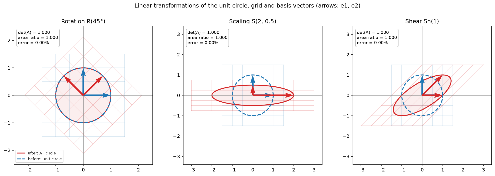

파랑 점선이 변환 전, 빨강이 변환 후의 단위 원이고, 화살표는 기저 벡터 e₁, e₂가 옮겨 가는 모습입니다. 회전은 원을 원으로 보내 전후가 겹치므로 기저 벡터와 격자로 변환을 보였습니다. `det(A)`는 면적이 몇 배가 되는지(부호는 방향이 뒤집혔는지)이고, 선형 변환은 모든 다각형의 면적을 정확히 `det`배로 바꾸므로 오차가 기계 정밀도 수준입니다. `det = 0`인 특이 행렬은 원을 선분으로 눌러 면적이 0이 됩니다.

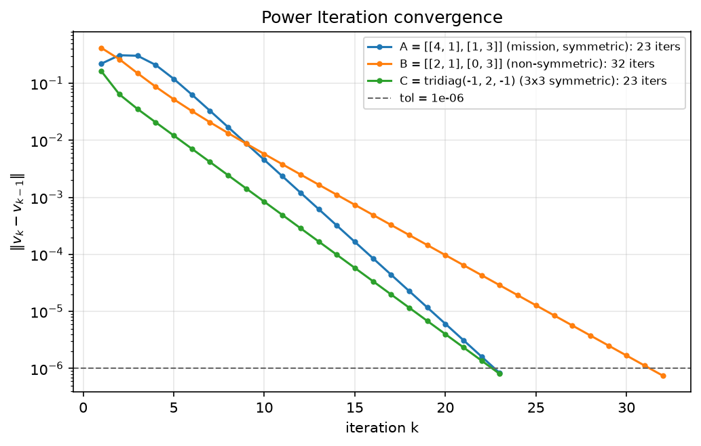

Power Iteration은 `v ← Av/‖Av‖`를 반복해 지배 고유벡터로 수렴하고, 오차는 `|λ₂/λ₁|`의 거듭제곱으로 줄어서 로그 축에서 직선이 됩니다. `np.linalg.eig`는 `verify_power_iteration` 안에서만 호출합니다(테스트가 정적으로 확인합니다).

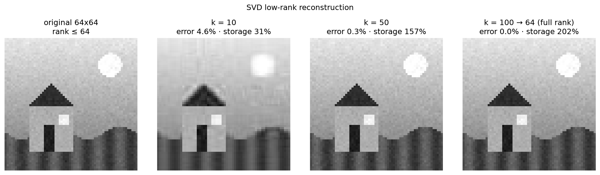

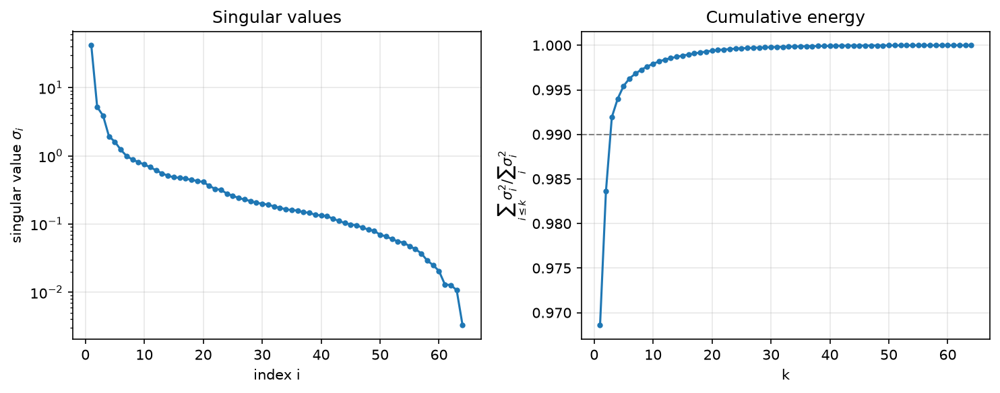

`A = UΣVᵀ`에서 특이값 상위 `k`개만 남긴 `Aₖ`는 rank `k` 이하 행렬 중 원본에 가장 가깝습니다(Eckart–Young). 오차의 제곱은 버린 특이값의 에너지 비율과 같고(테스트가 검증), k=10에서 에너지 99.8%가 남습니다.

### 2. 미적분과 역전파

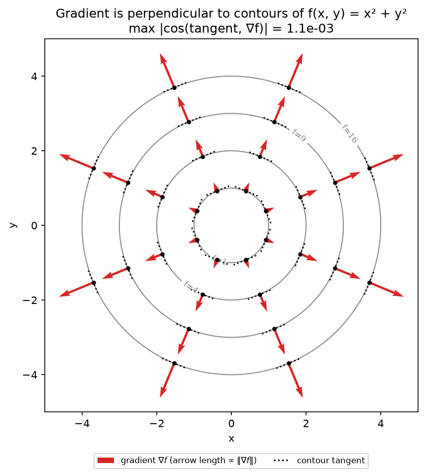

빨강 화살표가 수치 Gradient이고 검정 점선이 그 점의 등고선 접선입니다. 화살표는 모든 점에서 접선과 직각이고, 길이는 `‖∇f‖ = 2r`에 비례해 바깥쪽일수록 깁니다.

`x=[1, 0]`, `y=1`일 때 순전파는 `z1=[0.1, 0.3]`, `a1=[0.5250, 0.5744]`, `z2=0.6072`, `ŷ=0.6473`, `L=0.4350`입니다. 출력층에서 Sigmoid의 도함수와 BCE의 `1/ŷ` 항이 약분되어 `∂L/∂z2 = ŷ−y = −0.3527`이 되고, 여기서 `∂L/∂W2=[−0.1852, −0.2026]`, `∂L/∂z1=[−0.0440, −0.0517]`이 이어집니다. `x₂=0`이라 `∂L/∂W1`의 두 번째 열은 0입니다. 유도의 전 과정은 [노트북](notebooks/backprop_derivation.ipynb)에 있습니다.

### 3. 최적화

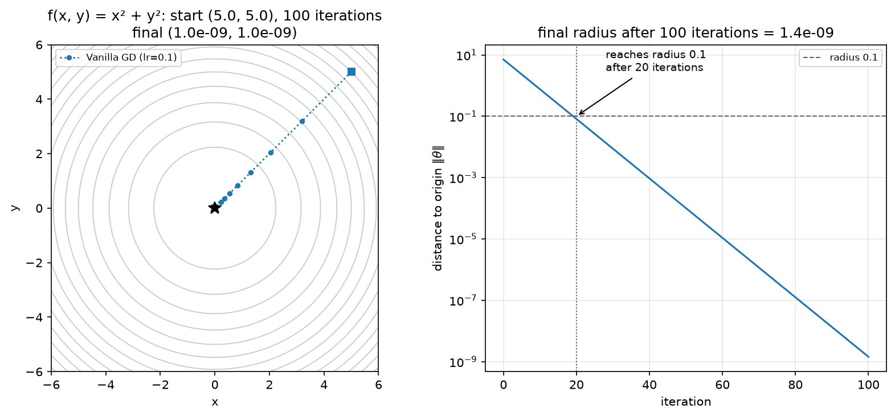

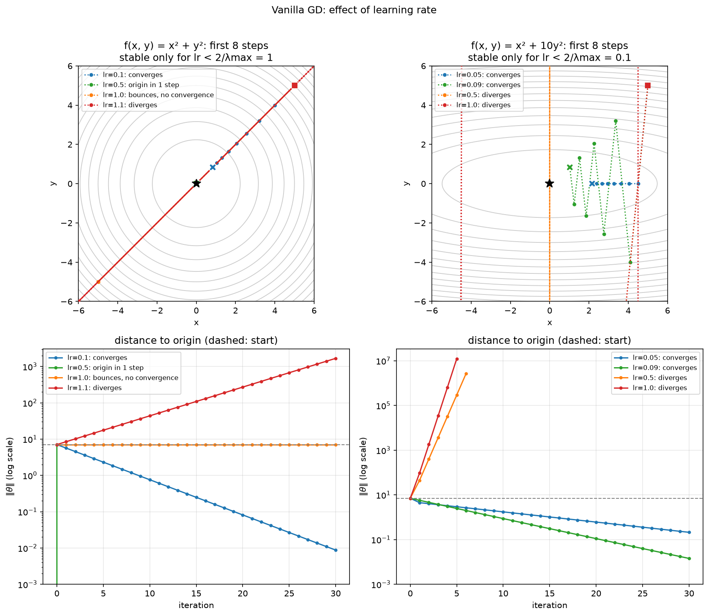

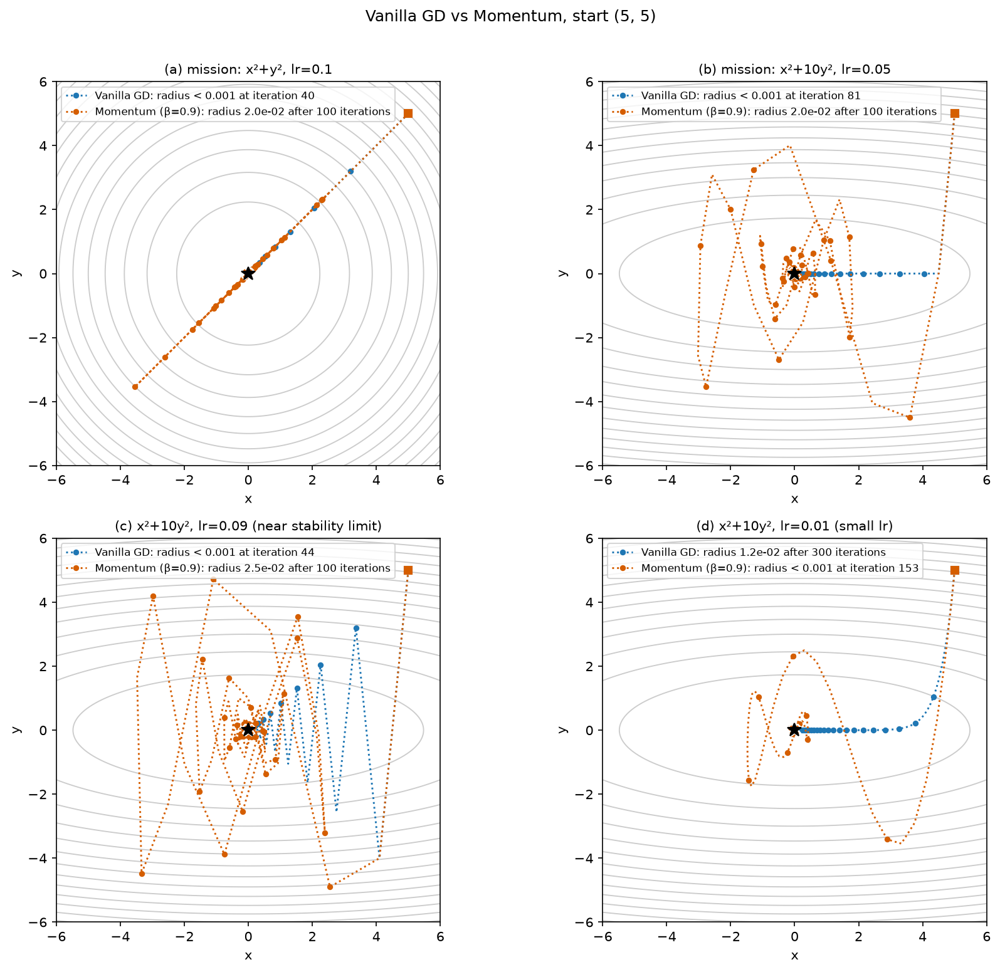

### 4. 확률분포와 손실 함수

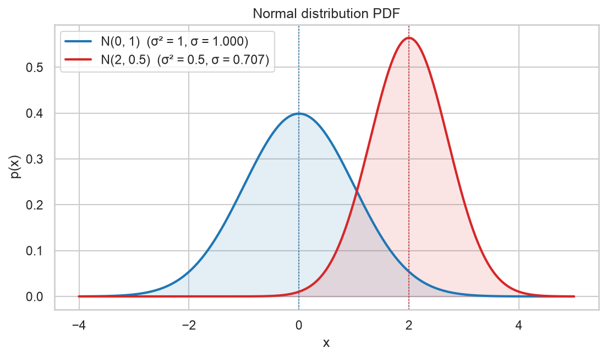

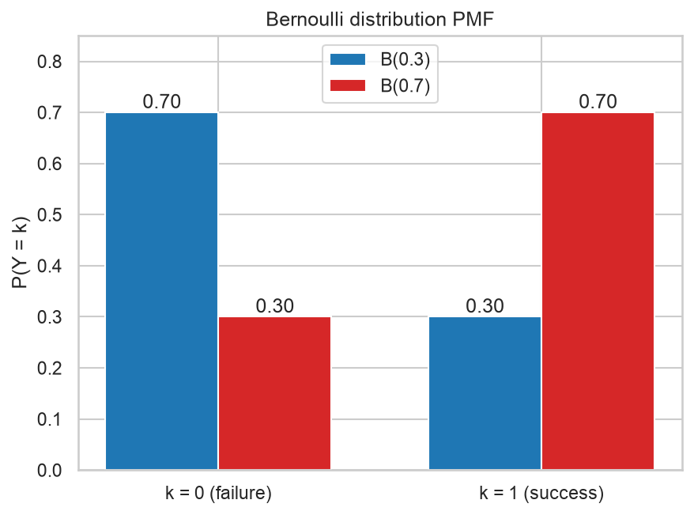

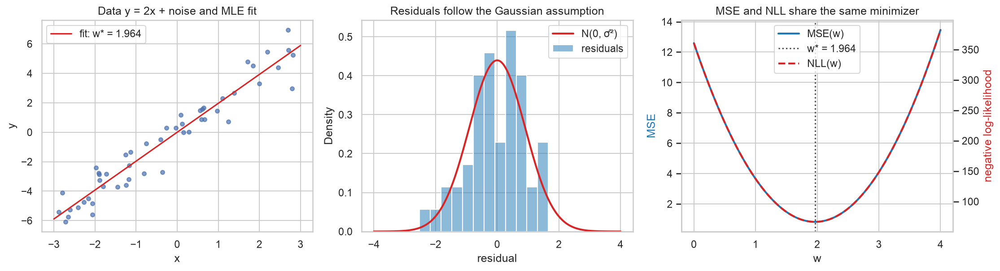

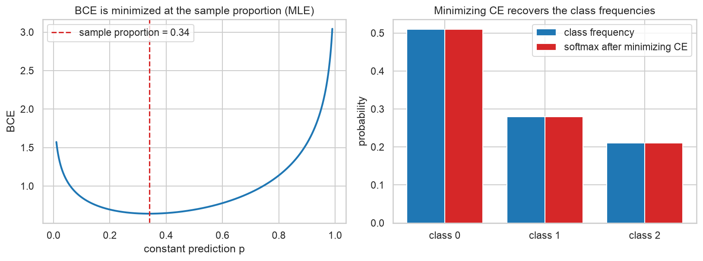

| 데이터 분포 가정 | 음의 로그 가능도 | 대응 손실 | MLE 해 (상수 모델) |
|---|---|---|---|
| 정규분포 | `n/2·ln(2πσ²) + n·MSE/2σ²` | MSE | 표본평균 |
| 베르누이 | `n·BCE` | Binary Cross-Entropy | 표본 비율 |
| 카테고리 | `n·CE` | Cross-Entropy | 클래스 빈도 |

## 원문과 다르게 확인된 점

원문대로 실행해 보니 일부 서술이 수학적으로 맞지 않았습니다. 숨기지 않고 실측값과 근거를 함께 남깁니다. 아래 수치는 모두 `python -m src.optimizer`와 노트북 출력으로 재현됩니다.

1. **`lr≥0.5`에서 발산한다는 서술은 f=x²+y²에서는 거짓입니다.** 이 함수의 GD는 `x ← (1−2·lr)x`이므로 lr=0.5는 한 번에 원점에 도달하고, lr=1.0은 (5,5)↔(−5,−5)를 오가며(거리 불변), lr>1(예: 1.1)부터 발산합니다. 안정 조건은 `lr < 2/λmax`이며 x²+y²는 1, x²+10y²는 0.1입니다. 그래서 발산 확인은 x²+10y²(lr=0.5, 1.0)에서 하고, 두 함수의 학습률별 거동을 모두 그렸습니다.
2. **Momentum(β=0.9)은 미션이 지정한 설정에서 Vanilla GD보다 느립니다.** 원점 반경 1e-3에 처음 들어가는 반복 횟수는 다음과 같습니다.

   | 설정 | Vanilla GD | Momentum (β=0.9) |
   |---|---|---|
   | (a) x²+y², lr=0.1 (미션) | 40회 (100회 후 반경 1.4e-9) | 100회 안에 못 들어감 (반경 2.0e-2) |
   | (b) x²+10y², lr=0.05 (미션) | 81회 | 100회 안에 못 들어감 (반경 2.0e-2) |
   | (c) x²+10y², lr=0.09 (안정 한계 근처) | 44회 | 100회 안에 못 들어감 (반경 2.5e-2) |
   | (d) x²+10y², lr=0.01 (작은 lr) | 300회 안에 못 들어감 (반경 1.2e-2) | 153회 |

   Momentum의 이점은 **학습률이 작아 GD가 느릴 때(d)** 나타납니다. 이차함수에서 β=0.9 Momentum은 위 네 설정 모두 과소감쇠(특성방정식의 근이 복소수)라 감쇠율이 √β≈0.949로 같은 반면, GD는 학습률에 따라 0.8(a), 0.9(b), 0.82(c), 0.98(d)로 달라지기 때문입니다. 또 원문의 "lr=0.05에서 GD가 지그재그"도 맞지 않습니다. y 방향 계수가 `1−0.05·20=0`이라 GD는 한 번에 y=0이 되어 x축을 따라 곧게 갑니다. 지그재그는 안정 한계에 가까운 lr=0.09(c)에서 나타나고, Momentum은 β=0.9에서 오히려 크게 진동합니다. 원문 예시의 수치(GD (0.08, 0.08), Momentum (0.02, 0.02))도 실측과 다릅니다. GD는 (1.0e-9, 1.0e-9)입니다.
3. **`y_true`가 원문에 비어 있어 `y=1`로 풀었습니다**(결과 예시와 같습니다). `y=0`도 노트북 7장에서 확인했습니다. 가중치 관례는 `z1 = W1 @ x`입니다. 결과 예시와 다른 곳이 두 군데 있습니다. `z2`는 0.607155이므로 넷째 자리 반올림은 0.6072입니다(예시의 0.6071은 버림). `∂L/∂z1`의 둘째 값은 예시의 −0.0513이 아니라 −0.0517입니다. 예시의 다른 값으로 곱해도 `−0.2116×0.2445=−0.0517`이고 중심차분으로도 확인했습니다.
4. **SVD의 k=100은 64×64 이미지의 rank(64)를 넘습니다.** 이미지는 "64×64 이하" 조건을 지켜 NumPy로 그린 64×64 풍경을 쓰므로 k=100은 64로 줄여 복원합니다(손실 없음, 그래프 제목에 표시). 저장량 `k(m+n+1)/(mn)`도 k>31이면 원본보다 커서(k=50: 157%) 이 크기에서 실제로 압축이 되는 것은 k=10(31.5%)뿐입니다. k=100이 의미 있게 보이려면 더 큰 이미지가 필요합니다(`plot_svd_comparison(make_sample_image(256))`).
5. **원문의 세 변환(R, S(2, 0.5), Sh)은 모두 det=1**이라 면적비 검증이 변별력이 약합니다. det=3, det=0 변환을 추가로 검증했습니다.
6. **N(2, 0.5)의 0.5는 분산으로 읽었습니다.** 원문의 노이즈 표기 `ε ~ N(0, σ²)`와 같은 관례입니다(σ≈0.707).
7. **Power Iteration 반복 횟수**는 수렴 기준에 따라 달라집니다. 원문 예시는 51회이고, 여기서는 방향 변화량 `‖vₖ−vₖ₋₁‖ < 1e-6`을 기준으로 23회입니다. λ와 v는 예시와 같습니다.

## 제약 사항 준수

- 구현은 NumPy로 하고, Matplotlib/Seaborn은 시각화에만 썼습니다. (Seaborn은 확률 노트북의 잔차 히스토그램에 사용)
- `np.linalg.eig`는 `verify_power_iteration` 안에서만 호출합니다. Power Iteration 본체에는 없습니다.
- PyTorch, TensorFlow, JAX, scikit-learn은 쓰지 않았고, `tests/test_constraints.py`가 `src/`와 노트북의 import를 정적으로 검사합니다.
- 모든 함수와 클래스에 Docstring이 있고(같은 테스트가 AST로 검사), 수식은 Docstring·주석과 노트북 Markdown에 적었습니다.

## 공부 기록

개인 공부 노트와 시도한 방법, 실패 원인, 배운 점은 [`studys/`](studys/)에 기록합니다. `notebooks/`는 미션에서 요구하는 실험·분석 노트북에 사용합니다.
