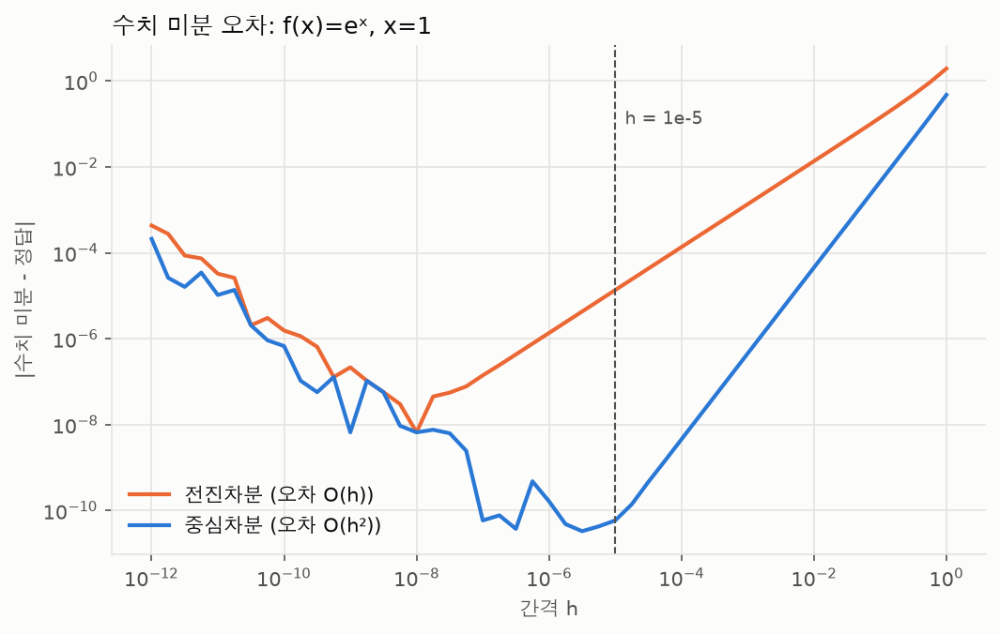
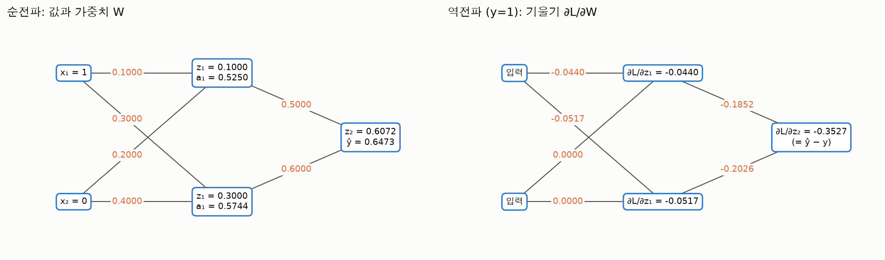
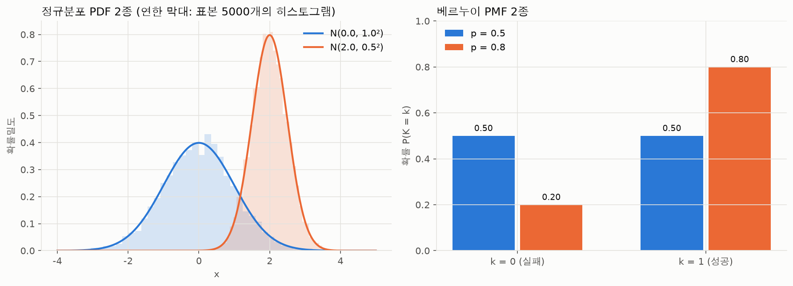
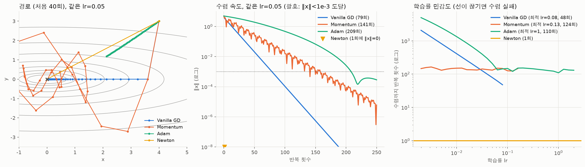
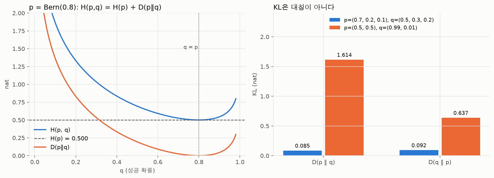

# A2-1. AI 학습 원리와 수학 구현

- 과제 원문: [subjects/subject_a2-1.md](../../subjects/subject_a2-1.md)
- 진행 상태: 필수 요구사항과 보너스 3종 구현 완료 (테스트 84개 통과)

선형대수, 미적분, 확률통계를 NumPy로 직접 구현하고 Matplotlib/Seaborn으로 시각화했습니다. 행렬 변환과 SVD 압축, 중심차분 수치 미분, 연쇄 법칙 기반 역전파, 경사하강법 계열 옵티마이저, 확률분포와 손실 함수(MSE, Cross-Entropy)의 MLE 연결을 다룹니다. 자동 미분 라이브러리와 scikit-learn은 쓰지 않았습니다.

## 폴더 구성

| 경로 | 내용 |
|---|---|
| [`src/linear_algebra.py`](src/linear_algebra.py) | 회전·스케일링·전단 시각화, det와 면적비, Power Iteration, SVD 이미지 압축 |
| [`src/calculus.py`](src/calculus.py) | 중심차분 수치 미분, Gradient, Hessian, 등고선과 Gradient 시각화 |
| [`src/backprop.py`](src/backprop.py) | 2층 신경망 순전파/역전파와 수치 기울기 검증 |
| [`src/optimizer.py`](src/optimizer.py) | VanillaGD, Momentum, Adam(보너스), Newton(보너스), 수렴 경로 시각화 |
| [`src/probability.py`](src/probability.py) | 정규분포 PDF, 베르누이 PMF, Softmax, 손실 함수, 엔트로피/KL(보너스) |
| [`src/plotting.py`](src/plotting.py) | 그래프 공통 설정(한글 글꼴, 색상, 저장 경로) |
| [`notebooks/backprop_derivation.ipynb`](notebooks/backprop_derivation.ipynb) | 역전파 연쇄 법칙 유도, 손계산 vs NumPy, 수치 미분 검증 |
| [`notebooks/probability_loss.ipynb`](notebooks/probability_loss.ipynb) | 확률분포, Softmax, MSE/CE와 MLE 유도, 엔트로피·KL |
| [`tests/`](tests/) | 미션 수치 기준과 제약 사항을 검증하는 pytest 84개 |
| [`outputs/`](outputs/) | 결과 그래프 PNG 17개 |
| [`requirements.txt`](requirements.txt) | 의존 패키지 |

## 실행 방법

이 저장소는 루트에서 uv 환경 하나를 씁니다. 프로젝트 폴더에서 `python -m`으로 실행하면 `outputs/`에 그래프가 저장됩니다.

```bash
uv sync                              # 저장소 루트에서 한 번
cd projects/a2-1-ai-math

uv run python -m src.linear_algebra  # 변환·Power Iteration·SVD 그래프 4개
uv run python -m src.calculus        # 수치 미분·Gradient 그래프 2개
uv run python -m src.optimizer       # 최적화 그래프 4개와 비교표 출력
uv run python -m src.backprop        # 고정값 순전파/역전파 값과 shape 출력
uv run python -m src.probability     # 분포 정규화, Softmax 합, KL 항등식 출력

uv run pytest tests -q               # 84개 테스트
uv run jupyter lab notebooks/        # 노트북 열기
```

노트북을 터미널에서 다시 실행해 결과를 갱신하려면 다음과 같이 합니다. 그래프는 `outputs/`에도 저장됩니다.

```bash
uv run jupyter nbconvert --to notebook --execute --inplace notebooks/backprop_derivation.ipynb
uv run jupyter nbconvert --to notebook --execute --inplace notebooks/probability_loss.ipynb
```

uv 없이 쓰려면 `pip install -r requirements.txt` 후 같은 명령에서 `uv run`만 빼면 됩니다. 난수는 모두 `np.random.seed(42)`(또는 시드 42의 생성기)로 고정해 결과가 재현됩니다.

## 요구사항 충족 현황

| 요구사항 | 결과 | 확인 위치 |
|---|---|---|
| `det(A)`와 면적비 오차 1% 이내 | 최대 오차 7e-15 (회전·스케일링·전단·합성·det=3·det=0 7종) | `linear_algebra.check_area_ratio`, `linear_transformations.png` |
| Power Iteration vs `np.linalg.eig` 5% 이내 | 3개 행렬 모두 오차 6e-13 이하, 18~31회 반복 | `linear_algebra.verify_power_iteration`, `power_iteration_convergence.png` |
| SVD 복원 `k=10, 50, 100` 비교 | 오차 26.2% → 10.8% → 6.2%, 저장량 3.6% → 18.1% → 36.2% | `linear_algebra.plot_svd_comparison`, `svd_compression.png` |
| `f(x)=x²`, `x=3` 수치 미분 오차 `1e-4` 이내 | 오차 3.9e-11 | `calculus.verify_derivative` |
| Gradient가 등고선에 수직 | 접선과 Gradient 사이 \|cos\| 최대 9.6e-12 | `calculus.plot_gradient_field`, `gradient_contour.png` |
| 2층 신경망 손계산 = NumPy (소수점 4자리) | 12개 항목 모두 일치, 수치 기울기와 최대 오차 1.3e-10 | `backprop_derivation.ipynb` 2~5장 |
| Vanilla GD `lr=0.1`, 100회 후 반경 0.1 이내 | 최종 반경 1.0e-9 | `optimizer.plot_gd_convergence`, `gd_convergence.png` |
| `lr≥0.5` 발산과 Momentum(`β=0.9`) 비교 | 아래 "원문과 다르게 확인된 점" 참고 | `optimizer.plot_lr_sweep`, `lr_divergence.png` |
| `x²+10y²`에서 Momentum 이점 확인 | `lr=0.02`에서 204회 → 135회. 단 조건부(아래 참고) | `optimizer.plot_momentum_vs_gd`, `momentum_vs_gd.png` |
| 정규분포 2종 PDF, 베르누이 2종 PMF | N(0,1), N(2,0.5²) / Bernoulli(0.5), (0.8) | `probability_loss.ipynb` 1장 |
| Softmax 합 1.0 오차 `1e-6` 이내 | 1000×10 무작위 logits에서 최대 오차 4.4e-16 | `probability_loss.ipynb` 2장 |
| MSE=정규분포 MLE, CE=베르누이/카테고리 MLE 유도 | 수식 유도와 수치 확인(NLL 최소점 = 표본평균/비율/빈도) | `probability_loss.ipynb` 3~4장 |
| 보너스: Adam과 3종 수렴 속도 비교 | 같은 `lr`과 튜닝 후 모두 비교 | `optimizer.Adam`, `optimizer_comparison.png` |
| 보너스: Hessian 기반 Newton Method | 2차 함수 1회, Rosenbrock 6회에 최솟값 도달 | `optimizer.Newton` |
| 보너스: 엔트로피, KL, Cross-Entropy 직접 구현 | `H(p,q) = H(p) + KL(p‖q)` 확인 | `probability.entropy` 외, `probability_loss.ipynb` 5장 |

## 주요 결과

### 1. 선형대수


행렬 곱 `A·p`는 점을 옮기는 변환이고, 행렬 곱 `R·S`는 "S를 먼저 적용하고 R을 나중에" 적용하는 합성입니다(오른쪽부터). `R·S`와 `S·R`의 그림이 다른 것이 곱셈의 비가환성입니다. `det(A)`는 면적이 몇 배가 되는지(부호는 방향 뒤집힘 여부)이고, `det = 0`인 특이 행렬은 원을 선분으로 납작하게 만들어 면적이 0이 됩니다. 이때 역변환은 존재하지 않습니다.


Power Iteration은 `v ← Av/‖Av‖`를 반복해 지배 고유벡터로 수렴합니다. 고유벡터 오차는 `|λ₂/λ₁|ᵗ`로 줄고(대칭 행렬에서는 Rayleigh 몫으로 구한 고유값 오차가 그 제곱으로 더 빨리 줄어듭니다), 그래서 그래프에서 오차가 직선(= 일정 비율 감소)으로 내려갑니다. 고유값 간격이 가장 큰 공분산 5x5가 18회로 가장 빨리 수렴했습니다.


SVD `A = UΣVᵀ`에서 특이값 상위 `k`개만 남긴 `Aₖ`는 rank `k` 이하 행렬 중 원본에 가장 가깝습니다(Eckart-Young). 잘라낸 특이값의 에너지가 곧 오차라서 `k=10`은 에너지 93.0%(오차 26.2%), `k=100`은 99.6%(오차 6.2%)입니다. 저장량은 `k(m+n+1)`이라 `k=100`이면 원본의 36.2%입니다. 테스트가 이 오차 공식을 직접 검증합니다.

### 2. 미적분과 역전파




중심차분은 오차가 `O(h²)`이고 전진차분은 `O(h)`입니다. `h`를 너무 줄이면 반올림 오차가 커지므로 `h=1e-5` 근처가 가장 좋습니다.



`x=[1,0]`, `y=1`일 때 `z1=[0.1, 0.3]`, `a1=[0.5250, 0.5744]`, `z2=0.6072`, `ŷ=0.6473`, `L=0.4350`입니다. 출력층에서 Sigmoid와 BCE가 약분되어 `∂L/∂z2 = ŷ−y = −0.3527`이 되고, 여기서 `dW2=[−0.1852, −0.2026]`, `dz1=[−0.0440, −0.0517]`이 이어집니다. `x₂=0`이라 `dW1`의 두 번째 열은 0입니다. 유도 과정 전체는 [노트북](notebooks/backprop_derivation.ipynb)에 있습니다.

### 3. 최적화


### 4. 확률분포와 손실 함수




| 데이터 분포 가정 | 음의 로그 가능도 | 대응 손실 | MLE 해 |
|---|---|---|---|
| 정규분포 | `n/2·ln(2πσ²) + n·MSE/2σ²` | MSE | 표본평균 |
| 베르누이 | `n·BCE` | Binary Cross-Entropy | 1의 비율 |
| 카테고리 | `n·CE` | Categorical Cross-Entropy | 클래스 빈도 |

"손실 함수를 고른다"는 것은 데이터가 어떤 분포에서 나왔다고 가정할지 고르는 일입니다. 수치로도 확인했습니다. 정규분포 데이터 200개에서 NLL과 MSE의 최소점이 모두 표본평균 3.077과 같고, 무작위 분포 20000개 중 클래스 빈도보다 Cross-Entropy가 작은 것은 없었습니다.

### 5. 보너스





- **Adam / 3종 비교**: `x²+10y²`에서 같은 `lr=0.05`일 때 수렴(`‖x‖<1e-3`)까지 GD 79회, Momentum 141회, Adam 209회입니다. 학습률을 격자에서 각각 튜닝하면 GD 48회(`lr=0.08`), Momentum 124회(`lr=0.13`), Adam 110회(`lr=1`)입니다.
- **Newton**: Hessian `H`로 `x ← x − H⁻¹∇f`를 계산합니다. 2차 함수는 Taylor 근사가 정확해서 1회에 정확히 도달하고, 비2차인 Rosenbrock에서도 `(-1.2, 1)`에서 6회 만에 `(1, 1)`에 도달합니다. 대신 Hessian 계산과 선형 시스템 풀이가 필요하고, Hessian이 양의 정부호가 아니면 올라가는 방향으로 갈 수 있습니다.
- **엔트로피·KL**: `H(p,q) = H(p) + KL(p‖q)`를 수치로 확인했고, 정규분포 둘 사이의 KL은 해석해 0.443147이 수치 적분과 일치합니다. 분류의 정답은 원-핫이라 `H(p)=0`이므로 Cross-Entropy 최소화가 곧 KL 최소화입니다.

## 미션 원문과 다르게 확인된 점, 그리고 가정한 점

구현하면서 원문의 문장을 그대로 따를 수 없거나 정해져 있지 않은 부분이 있었습니다. 숨기지 않고 정리합니다.

1. **"`lr≥0.5`에서 발산"은 `f=x²+y²`에는 맞지 않습니다.** Vanilla GD는 `x ← (1−2·lr)x`라서 `lr=0.5`는 **1회에 정확히 최솟값**에 도달하고, `lr=1.0`은 같은 크기로 진동만 하며, 발산은 `lr>1`(예: 1.1)부터입니다. 반면 `f=x²+10y²`는 y축 곡률이 20이라 `lr>0.1`이면 발산하므로 `lr=0.5`에서 GD와 Momentum 모두 발산합니다. 발산 한계는 일반적으로 `lr < 2/L`(L은 Hessian의 최대 고유값)입니다. `lr_divergence.png`가 두 함수를 모두 보여 줍니다. 추측이지만 원문은 `x²+10y²`를 염두에 둔 문장으로 보입니다.
2. **Momentum의 이점은 조건부입니다.** `x²+10y²`에서 같은 `lr`을 줬을 때 `lr=0.01`이면 411회 → 152회, `lr=0.02`이면 204회 → 135회로 Momentum이 빠르지만, `lr=0.05`(79회 vs 141회)나 이론 최적 근처인 `lr=0.09`(42회 vs 133회)에서는 GD가 더 빠릅니다. Momentum의 수렴 속도는 학습률과 거의 무관하게 120~150회로 일정한 대신(`momentum_vs_gd.png` 오른쪽), 안정 한계가 `lr<0.19`로 GD(`<0.1`)보다 넓습니다. `β=0.9`가 조건수 10인 이 문제에는 너무 커서(이론 최적 `β≈0.27`) 진동하며 수렴한다는 점도 한 이유입니다. 즉 "학습률을 잘 튜닝하기 어려울 때 Momentum이 견고하다"는 결론이지 "항상 더 빠르다"가 아닙니다.
3. **역전파의 목표값 `y`가 미션에 없습니다.** `y=1`로 가정했고(`ŷ≈0.65`를 1쪽으로 올리는 방향), `y=0` 결과는 노트북 6장에 함께 적었습니다. 가중치 관례는 `W @ x`(`W1[i,j]` = 입력 j → 은닉 i)이며 `x·W1`로 읽으면 `z1=[0.1, 0.2]`가 되어 달라집니다.
4. **원문의 세 변환은 모두 `det=1`입니다.** `R(θ)`, `S(2, 0.5)`, `Sh(k)`만으로는 면적비 검증이 항상 1이라 약합니다. `det≠1`인 `S(1.5, 2)`(면적비 3)와 `det=0`인 특이 행렬을 추가해 "면적비 = |det|"를 의미 있게 확인했습니다.
5. **SVD 이미지는 matplotlib에 포함된 `grace_hopper.jpg`(600×512)를 그레이스케일로 변환**해 썼습니다. 다운로드가 필요 없고 추가 의존성이 없습니다.
6. **Adam의 "최적" 학습률이 1입니다.** 격자 탐색 범위(0.002~2)에서 가장 빨랐던 값이고, Adam은 좌표별 스텝이 대략 `lr` 이하로 제한되어 시작점 `(4, 3)`에서 멀리 있는 이 문제에서는 큰 값이 유리했습니다. 일반적인 권장값은 아닙니다.
7. **분산 MLE는 `n`으로 나눕니다**(표본분산 `n−1`과 다름). 노트북 3장에 4.4721과 4.4946을 나란히 적었습니다.

## 제약 사항 준수

- 구현 계산은 NumPy, 시각화는 Matplotlib/Seaborn입니다. PyTorch, TensorFlow, JAX, scikit-learn, SciPy는 `src/`에서 import하지 않습니다.
- `np.linalg.eig`는 `linear_algebra.reference_dominant_eigenpair()` 한 곳에서 Power Iteration 검증에만 호출합니다. SVD는 `np.linalg.svd`입니다.
- 모든 함수, 클래스, 모듈에 Docstring과 수식 설명이 있습니다. 노트북은 Markdown과 LaTeX로 유도 과정을 적었습니다.
- 위 세 가지(금지 import, `eig` 호출 위치, Docstring)는 [`tests/test_constraints.py`](tests/test_constraints.py)가 소스를 분석해 자동으로 확인합니다.

## 한계

- 역전파는 샘플 1개, 층 2개만 다룹니다. 배치에서는 평균과 배치 축이 추가되고, 층이 깊어지면 Sigmoid 미분 `σ'≤0.25`가 반복 곱해져 기울기가 작아지는 문제가 생깁니다.
- 옵티마이저 비교는 2차원 2차 함수(조건수 10) 위주입니다. 비볼록 함수나 고차원, 확률적 기울기(미니배치) 환경의 결론은 다를 수 있습니다.
- Power Iteration은 지배 고유값이 하나이고 실수일 때만 동작합니다. 회전 행렬처럼 절댓값이 같은 복소 고유값 쌍은 수렴하지 않습니다.
- SVD 압축은 이미지 1장(그레이스케일)만 다뤘고 컬러나 다른 이미지에서의 `k`별 품질은 확인하지 않았습니다.
- MLE는 점추정이라 데이터가 적을 때의 불확실성을 담지 못합니다.

## 개발 환경

- Python 3.13, 루트 uv 환경. 검증한 버전은 NumPy 2.5.3, Matplotlib 3.11.2, Seaborn 0.13.2, pytest 9입니다.
- `requirements.txt`의 하한(NumPy 1.21, Matplotlib 3.4)은 미션 권장 사양이며, 이 하한 버전에서의 실행은 확인하지 못했습니다.
- 그래프의 한글 글꼴은 macOS는 AppleGothic, Windows는 Malgun Gothic, 그 외는 NanumGothic을 씁니다. 글꼴이 없으면 한글이 깨져 보일 수 있습니다(수치와 결과에는 영향 없음).

## 공부 기록

개인 공부 노트와 시도한 방법, 실패 원인, 배운 점은 [`studys/`](studys/)에 기록합니다. `notebooks/`는 미션에서 요구하는 실험·분석 노트북에 사용합니다.
