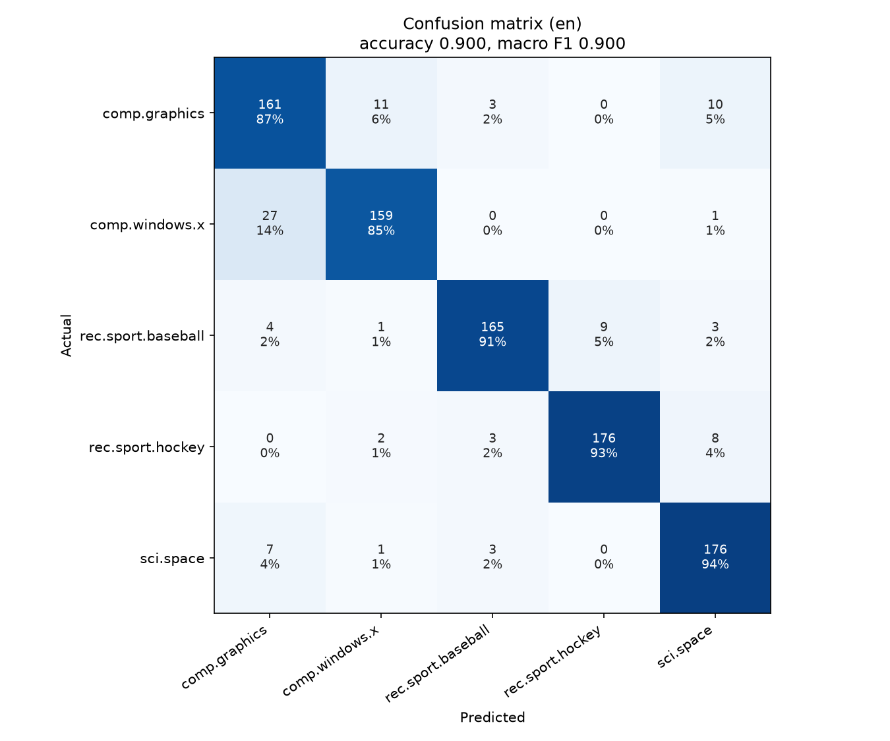
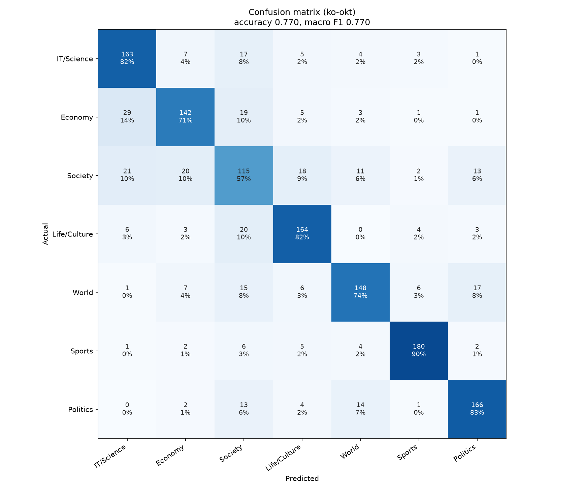

# A4-1. 원하는 내용이 들어있는 문서를 똑똑하게 찾아주는 검색기 만들기

- 과제 원문: [subjects/subject_a4-1.md](../../subjects/subject_a4-1.md)
- 진행 상태: 필수 요구사항 구현 완료 (보너스 제외, 테스트 31개 통과)
- 제출 링크: (제출 시 기록)

영어 뉴스그룹 글(20 Newsgroups)과 한국어 뉴스 제목(KLUE-YNAT) **두 데이터**로 TF-IDF 검색·분류 시스템을 만들었습니다. 전처리, TF-IDF, 코사인 유사도는 NumPy로 직접 구현했고, scikit-learn은 검증과 분류 모델에만 썼습니다. 한국어는 **Okt 형태소 분석과 공백 토큰화를 같은 조건에서 비교**해 토큰화 방식이 결과를 얼마나 바꾸는지 확인했습니다.

## 한눈에 보기

| 질문 | 결과 |
|---|---|
| 직접 구현한 TF-IDF가 sklearn과 같은가? | 세 데이터 × 설정 4개 모두 **PASS**. 기본 설정(raw TF, smooth IDF, L2)의 최대 오차는 영어 1.17e-15, 한국어 2.22e-16으로 허용 오차 1e-6보다 훨씬 작다. |
| 검색이 되는가? | "space shuttle launch", "삼성전자 반도체 실적"처럼 주제가 분명한 검색어는 상위 5개가 모두 맞는 카테고리다. 반대로 "북한"은 "北"이 들어간 제목을 찾지 못하고, "코로나 백신"은 어휘 사전에 없어 결과가 0건이다. |
| 분류 성능은? | 영어(5개 카테고리) **정확도 0.900 / macro F1 0.900**, 한국어(7개 주제) Okt **0.770 / 0.770**, 공백 토큰화 **0.706 / 0.710**. 영어는 분할 시드에 따라 ±0.01 정도 흔들린다(시드 8개 평균 0.902). |
| 한국어 토큰화 방식의 차이는? | 공백 토큰화를 쓰면 어휘가 2배(11,383 → 22,552)가 되고, Test 토큰 중 Train에서 본 적 없는 비율이 10.9% → **35.4%**로 늘어나며, F1이 0.06 떨어진다. |
| 왜 틀리는가? | 영어는 짧은 글일수록 많이 틀린다(토큰 5~9개 정확도 0.754, 100개 이상 0.976). 한국어는 오분류의 42%가 주석자 중 누군가는 모델과 같은 답을 고른 제목이다. 주석자 3명의 의견이 갈린 제목은 정확도가 0.603으로 떨어진다(의견이 일치한 제목은 0.873). |

## 폴더 구성

| 경로 | 내용 |
|---|---|
| [`main.py`](main.py) | CLI: 검색, 검증, 분류, BoW 한계 시연, 토큰화 비교, 오분류 분석 |
| [`src/data.py`](src/data.py) | 데이터 로드, 개인정보(이메일·URL·전화번호) 가리기, 중복 문서 제거 |
| [`src/preprocess.py`](src/preprocess.py) | 정제 → 토큰화 → 불용어 제거 (영어 / 한국어 Okt·공백) |
| [`src/stopword_analysis.py`](src/stopword_analysis.py) | 불용어 후보 근거: 문서 빈도 × 카테고리 균등도 |
| [`src/corpus.py`](src/corpus.py) | 로드 + 전처리, Okt 결과 캐시, `min_df` 설정 |
| [`src/tfidf.py`](src/tfidf.py) | **NumPy TF-IDF** (`NumpyTfidf`: raw/log/double/binary TF, smooth IDF, L2) |
| [`src/verify.py`](src/verify.py) | sklearn `TfidfVectorizer`와의 오차 검증 → `outputs/*/verify_log.txt` |
| [`src/search.py`](src/search.py) | **코사인 유사도**, `search(query) -> List[(score, doc_id, snippet)]`, 계산 과정 출력 |
| [`src/classify.py`](src/classify.py) | Logistic Regression, 지표, 혼동 행렬, 오분류 기여 단어 |
| [`src/compare_tokenizers.py`](src/compare_tokenizers.py) | 한국어 Okt vs 공백 토큰화 비교 |
| [`src/bow_limits.py`](src/bow_limits.py) | BoW 한계 시연 (어순, 동음이의어, 동의어, 부정, OOV) |
| [`src/error_analysis.py`](src/error_analysis.py) | 문서 길이별 정확도, 한국어 레이블 모호성 |
| [`tests/`](tests/) | pytest 31개 (손으로 계산한 TF-IDF 값, sklearn 일치, 검색, 분할 누수 방지, 중복 제거) |
| [`outputs/`](outputs/) | 데이터별 검증 로그, 분류 리포트, 혼동 행렬, 오분류 전체 목록 |

## 실행 방법

이 저장소는 루트에서 uv 환경 하나를 씁니다. 아래 명령은 **이 프로젝트 폴더에서** 실행합니다. 한국어 형태소 분석(KoNLPy Okt)에는 Java 8 이상이 필요합니다.

```bash
uv sync                                   # 저장소 루트에서 한 번
cd projects/a4-1-document-search

# (안 A) CLI 검색
uv run python main.py --query "space shuttle launch" --topk 5
uv run python main.py --lang ko --query "삼성전자 반도체 실적" --topk 5 --explain

# 검증·분류·분석
uv run python main.py --mode verify --lang en        # TF-IDF vs sklearn (--lang ko --tokenizer okt|whitespace)
uv run python main.py --mode classify --lang ko      # 분류 + 혼동 행렬 + 오분류
uv run python main.py --mode bow                     # BoW 한계 시연
uv run python main.py --mode compare                 # 한국어 Okt vs 공백 토큰화
uv run python main.py --mode errors                  # 오분류 원인 (길이, 레이블 모호성)
uv run python main.py --mode all                     # 위 전부 (약 30초)

uv run python -m src.stopword_analysis               # 불용어 후보 근거 표
uv run pytest tests -q                               # 테스트
```

- 처음 실행하면 20 Newsgroups(sklearn이 `~/scikit_learn_data`에 저장), KLUE-YNAT 학습 파일(44MB, `data/raw/`), NLTK 불용어를 자동으로 내려받습니다. Okt 분석 결과는 `data/cache/`에 저장해 두고 다시 씁니다. 캐시 파일 이름에 품사 목록·정제 규칙·Okt 옵션의 지문이 들어 있어서, 규칙을 바꾸면 자동으로 새로 분석합니다. 두 폴더 모두 git에서 제외했습니다.
- uv 없이 실행하려면 `pip install -r requirements.txt` 후 `python main.py ...`로 실행합니다.
- 난수는 모두 `random_state=42`로 고정했습니다. 다시 실행해도 같은 결과가 나옵니다.
- `--topk`는 1 이상만 받습니다. 함수 `search()`도 1 미만이면 `ValueError`를 냅니다.

예시 출력:

```text
$ uv run python main.py --query "space shuttle launch" --topk 5
=== 검색 결과 ===
Query: "space shuttle launch"

Top 5 결과:
1. [0.423] en-03186 [sci.space] "Well, you better not get the shuttle as your launch vehicle. and most ELV's have too far o…"
2. [0.418] en-01889 [sci.space] "COMMERCIAL SPACE NEWS/SPACE TECHNOLOGY INVESTOR NUMBER 22 This is number twenty-two in an …"
3. [0.406] en-04447 [sci.space] "…st exercise is analogous to a shuttle landing/launch in terms of stresses/misalignments/et…"
4. [0.406] en-01329 [sci.space] "…d on the technical aspects of space, but I couldn't find the answer on the FAQs ! I'm curr…"
5. [0.399] en-00039 [sci.space] "…essay, I am writing about the space shuttle and a need for a better propulsion system. Thr…"
```

**(안 B) 함수**: [`src/search.py`](src/search.py)

```python
from src.search import search

search(query: str, topk: int = 5, lang: str = "en", tokenizer: str = "okt") -> list[tuple[float, str, str]]
# 반환: [(score, doc_id, text_snippet), ...], 점수 내림차순, 점수 0인 문서는 제외
search("삼성전자 반도체 실적", lang="ko")
# [(0.437, 'ko-06717', '키움증권 삼성전자 3분기 사상최대 실적…영업익 17조8천억'), ...]
```

---

## 1. 구현 요약

### 1.1 데이터

| | 영어: 20 Newsgroups | 한국어: KLUE-YNAT |
|---|---|---|
| 내용 | 1990년대 초 유즈넷 게시판 글 | 연합뉴스 기사 제목 |
| 카테고리 | comp.graphics, comp.windows.x, rec.sport.baseball, rec.sport.hockey, sci.space (5개) | IT과학, 경제, 사회, 생활문화, 세계, 스포츠, 정치 (7개) |
| 사용 문서 | 4,941건 → 빈 문서 116건, 중복 28건 제거 → 전처리 후 토큰 5개 미만 151건 제거 → **4,646건** | 학습 파일 45,678건에서 주제별 1,000건 무작위 추출 → **7,000건** |
| 평균 길이 | 1,184자 | 27자 |
| 라이선스 | sklearn 내장 공개 데이터 | CC BY-SA 4.0 |

- **카테고리를 고른 이유**: 영어는 일부러 비슷한 쌍(그래픽 ↔ X 윈도, 야구 ↔ 하키)을 넣었습니다. 그래야 혼동 행렬에서 BoW가 무엇을 헷갈리는지 볼 수 있습니다.
- **개인정보와 누수**: 20 Newsgroups는 `remove=('headers', 'footers', 'quotes')`로 불러옵니다. 헤더에는 작성자 이메일과 실명이 있고, 뉴스그룹 이름(정답)도 들어 있어 남겨 두면 레이블이 새어 나갑니다. 본문에 남은 이메일(724건의 글에 있음)·URL·전화번호는 로드할 때 가립니다. 가린 텍스트가 검색 결과 스니펫으로 그대로 화면에 나오기 때문입니다.
- **중복 제거**: 20 Newsgroups에는 한 글을 여러 게시판에 동시에 올린 크로스포스팅이 있습니다. 본문이 같은 글(공백 차이 무시)은 하나만 남기고(24건 제거), 같은 본문인데 레이블이 다른 4건은 정답이 모호해 모두 뺐습니다. 지우지 않으면 같은 글이 Train과 Test에 함께 들어갑니다(지우기 전에는 Test 7건이 Train에 똑같이 있었습니다). 한국어 표본에는 중복이 없었습니다.
- **레이블**: YNAT의 정답은 주석자 3명이 붙인 `label`을 씁니다. 언론사가 붙인 `predefined_news_category`와는 17%가 다릅니다. 이 차이는 [3.2](#32-오분류-사례-분석-한국어-okt)에서 오분류 원인으로 다시 다룹니다.

### 1.2 전처리 파이프라인과 설계 근거

```text
원문 → 개인정보 가리기 → 정제 → 토큰화 → 불용어 제거 → 길이·숫자 필터 → 토큰 리스트
```

| 단계 | 영어 | 한국어 |
|---|---|---|
| 정제 | 소문자 변환. 알파벳과 단어 안 아포스트로피만 남기고 **숫자·특수문자 제거** | 한글·**한자**·영문·숫자·공백만 남김 |
| 토큰화 | 공백 기반 정규식 `[a-z]+(?:'[a-z]+)*` | **Okt** (`norm=True, stem=True`) 또는 **공백** |
| 품사 | (없음) | 명사·동사·형용사·영문·한자만 남김. 조사·어미·구두점·숫자·접미사 제거 |
| 불용어 | NLTK english 198개 + 도메인 31개 | 직접 정의 20개 |
| 기타 | 소유격 's 제거. 2글자 미만·20글자 초과 토큰 제거 | 숫자만 있는 토큰 제거 |

**설계 근거**

- **숫자를 지운 이유(영어)**: 연도, 버전(1.1.3), 스코어, 좌표처럼 문서마다 값이 달라서 주제 신호가 약하고 어휘만 늘립니다.
- **20글자 초과 토큰을 지운 이유**: comp.graphics에는 uuencode로 인코딩된 그림 파일이 본문에 그대로 붙은 글이 있습니다. 이 조각들이 수천 개의 쓰레기 단어가 됩니다.
- **한자를 남긴 이유(한국어)**: 뉴스 제목의 15%에 美·中·北·與·野·朴 같은 한 글자 한자 약어가 있습니다. 北 하나가 정치 기사의 강한 신호이므로 지우면 정보를 잃습니다.
- **어간 추출을 하지 않은 이유(영어)**: 검색 결과와 분류 근거 단어를 사람이 읽을 수 있게 남기려고 했습니다. 대가로 `works`와 `work`가 다른 단어가 됩니다([3.4](#34-bow-한계-분석)).
- **동의어 처리**: 하지 않았습니다. "북한/北", "car/automobile"을 묶으려면 사전이 필요합니다. 묶지 않았을 때 생기는 문제를 한계 분석에 그대로 남겼습니다.
- **불용어 근거**: `src/stopword_analysis.py`로 단어마다 두 값을 계산했습니다. **문서 빈도 비율**과 **카테고리 균등도**(카테고리별 출현 비율의 정규화 엔트로피, 1이면 모든 카테고리에 똑같이 나옴)입니다.
  - 영어: 문서 빈도 5% 이상이면서 균등도 0.95 이상인 단어 중에서 조동사·일반 동사·부사(`would, like, get, know, also, one, ...`)를 뺐습니다. 같은 기준을 넘었어도 `time, new, people, first, good` 같은 내용어는 검색어로 쓰일 수 있어서 남겼습니다.
  - 반대로 `game`(균등도 0.54), `space`(0.42)는 문서 빈도가 높아도 특정 카테고리에 몰려 있으므로 불용어가 아닙니다.
  - 한국어: 기능 용언(하다·되다·있다·없다·이다·않다), 의존명사(것·수·등·중·때·후 ...), Okt가 조사를 명사로 잘못 자른 조각(의·로), 기사 형식어(종합)를 뺐습니다. `한국`은 균등도 0.97로 기준을 넘지만 내용어라 남겼습니다.
  - 주의할 점: NLTK 불용어에는 `not`, `no`가 들어 있습니다. 주제 분류에는 문제가 없지만 부정의 의미가 사라집니다([3.4](#34-bow-한계-분석)).
- **min_df**: 영어 3, 한국어 2입니다. 한 문서에만 나온 단어는 오타나 고유 잡음이 대부분입니다. 영어는 min_df=2로도 어휘가 18,628개(밀집 행렬 약 700MB)라 3으로 올렸습니다(13,387개). 한국어는 제목이 짧아 단어가 드물게 나오므로 2로 두었습니다.

### 1.3 TF-IDF 수식과 구현 ([`src/tfidf.py`](src/tfidf.py))

문서 수를 $n$, 단어 $t$가 나온 문서 수를 $\mathrm{df}(t)$, 문서 $d$ 안에서 $t$가 나온 횟수를 $f_{t,d}$라 하면:

$$
\mathrm{TF}(t,d) = f_{t,d}
\qquad
\mathrm{IDF}(t) = \ln\frac{1+n}{1+\mathrm{df}(t)} + 1
\qquad
\mathbf{x}_d = \frac{\mathrm{TF}(\cdot,d)\odot\mathrm{IDF}}{\lVert \mathrm{TF}(\cdot,d)\odot\mathrm{IDF}\rVert_2}
$$

- **TF**: 문서 안에서 자주 나온 단어일수록 그 문서를 잘 설명한다고 봅니다.
- **IDF**: 여러 문서에 흔하게 나오는 단어일수록 문서를 구별하지 못하므로 가중치를 낮춥니다. 분모와 분자의 `+1`(smooth)은 가상의 문서 하나가 모든 단어를 포함한다고 보고 0으로 나누는 것을 막습니다. 끝의 `+1`은 모든 문서에 나온 단어도 가중치가 0이 되지 않게 하는 scikit-learn의 정의입니다.
- **L2 정규화**: 긴 문서는 단어 횟수가 많아 벡터가 길어집니다. 길이를 1로 맞추면 문서 길이와 상관없이 방향(단어 구성)만 비교합니다.

구현 과정 (`NumpyTfidf`):

1. `fit`: 문서마다 `set(doc)`으로 df를 세고, `min_df` 조건을 거친 단어를 **정렬**해 열 번호를 붙입니다. 정렬하면 sklearn과 열 순서가 같아집니다. 그다음 IDF 벡터를 `np.log`로 계산합니다.
2. `count_matrix`: (문서 번호, 단어 번호) 쌍을 모아 `np.add.at`으로 (n, V) 횟수 행렬을 만듭니다. 어휘 사전에 없는 단어는 버립니다.
3. `term_frequency`: TF 변형을 고릅니다. raw(기본), log = 1+ln f(sklearn `sublinear_tf`), double = 0.5+0.5·f/max f, binary.
4. `transform`: `x *= idf` (브로드캐스팅), 행마다 `sqrt(Σx²)`로 나눕니다. 0 벡터 문서는 0으로 둡니다. 메모리를 아끼려고 제자리 연산을 씁니다.

### 1.4 검색 시스템 ([`src/search.py`](src/search.py))

1. 말뭉치 전체로 TF-IDF를 학습합니다(어휘 사전, IDF).
2. 검색어를 **문서와 똑같은 전처리**로 토큰화하고, 말뭉치의 IDF로 벡터화합니다.
3. 코사인 유사도를 문서 행렬 전체에 한 번에 계산합니다.

$$\cos(\mathbf{q},\mathbf{d}) = \frac{\mathbf{q}\cdot\mathbf{d}}{\lVert\mathbf{q}\rVert\,\lVert\mathbf{d}\rVert} = \frac{\sum_t q_t d_t}{\sqrt{\sum_t q_t^2}\sqrt{\sum_t d_t^2}}$$

   - 코드로는 `D @ q / (sqrt(einsum('ij,ij->i', D, D)) * sqrt(q @ q))`입니다.
   - 남은 단어가 없는 검색어(0 벡터)는 모든 점수를 0으로 두고 빈 결과를 돌려줍니다.

4. `np.argpartition`으로 상위 k개를 O(n)에 고른 뒤 그 k개만 정렬합니다.
5. 결과는 (점수, 문서 ID, 스니펫)입니다. 스니펫은 검색어 단어가 처음 나오는 위치를 중심으로 자릅니다.

`--explain`을 붙이면 1위 문서와의 유사도를 단어별로 풀어서 보여 줍니다. 정규화 전 벡터로 계산해도 같은 값이 나오는 것으로 "정규화는 길이만 바꾸고 방향은 그대로 둔다"를 확인할 수 있습니다.

```text
=== 코사인 유사도 계산 예시 ===
Query: "삼성전자 반도체 실적"
전처리 후 토큰: ['삼성', '전자', '반도체', '실적']
대상 문서: 1위 ko-06717 [경제]
벡터 차원: 6,332 (검색어에서 0이 아닌 차원 4개, 문서에서 9개)

단어                 IDF     q 가중치     d 가중치       q×d
반도체              6.909    0.5879    0.0000    0.0000
삼성               4.678    0.3980    0.2656    0.1057
실적               6.243    0.5312    0.3545    0.1883
전자               5.435    0.4624    0.3086    0.1427

코사인 유사도 = (Query · 문서) / (||Query|| × ||문서||)
  L2 정규화된 벡터: = 0.4367 / (1.0000 × 1.0000) = 0.4367
  정규화 전 TF×IDF : = 90.3930 / (11.7530 × 17.6105) = 0.4367
정규화는 벡터 길이(문서 길이)를 1로 맞출 뿐 방향을 바꾸지 않으므로 두 값이 같다.
```

`반도체`는 1위 문서에 없어서 내적에 기여하지 않습니다. 1위 문서는 검색어 4개 중 3개(삼성·전자·실적)만 맞았습니다.

### 1.5 분류 시스템 ([`src/classify.py`](src/classify.py))

- **분할**: Train/Test 8:2, 카테고리 비율을 유지하는 층화 분할(`stratify`), `random_state=42`.
- **누수 방지**: TF-IDF(직접 구현)는 **Train 문서로만** fit 합니다. Test 문서가 IDF나 어휘 사전 계산에 들어가면 Test 정보가 학습에 섞입니다. Test는 Train에서 만든 어휘와 IDF로 transform만 합니다. 테스트 `test_vectorizer_fit_on_train_only`가 이것을 확인합니다.
- **모델**: `LogisticRegression(C=1.0, max_iter=2000, random_state=42)` (다중 클래스 softmax).
- **오분류 근거**: 로지스틱 회귀의 클래스 점수는 $\sum_t w_{c,t}\,x_t + b_c$입니다. 그래서 틀린 문서마다 $w_{c,t}\,x_t$가 큰 단어를 뽑으면, 어떤 단어 때문에 그 클래스로 갔는지 바로 보입니다.

---

## 2. 검증·실험 결과

### 2.1 TF-IDF 구현 검증 ([`outputs/*/verify_log.txt`](outputs/))

**sklearn 설정**: `TfidfVectorizer(analyzer=<전처리된 토큰 리스트를 그대로 사용>, lowercase=False, min_df=<영어 3 / 한국어 2>, dtype=float64)`에 아래 4가지 조합을 바꿔 가며 비교했습니다. `analyzer`에 함수를 주면 sklearn 자체의 소문자 변환, 토큰 패턴, 불용어가 전혀 적용되지 않습니다. 그래서 두 구현이 정확히 같은 토큰을 봅니다.

| 검증 | 직접 구현 | sklearn | 영어 (4646×13387) 최대 / 평균 오차 | 한국어 Okt (7000×6332) 최대 / 평균 오차 | 결과 |
|---|---|---|---|---|---|
| 1 (**기본**) | `tf='raw', smooth_idf=True, norm='l2'` | `sublinear_tf=False, smooth_idf=True, norm='l2'` | 1.17e-15 / 4.96e-20 | 2.22e-16 / 1.36e-20 | PASS |
| 2 | `tf='log'` | `sublinear_tf=True` | 3.19e-16 / 6.08e-20 | 2.22e-16 / 1.35e-20 | PASS |
| 3 | `smooth_idf=False` | `smooth_idf=False` | 1.05e-15 / 5.42e-20 | 2.22e-16 / 1.23e-20 | PASS |
| 4 | `norm=None` | `norm=None` | 0 / 0 | 0 / 0 | PASS |

모든 검증에서 어휘 집합, 0이 아닌 위치, IDF 벡터(최대 오차 0)가 일치했습니다. 어휘가 다르면 행렬을 비교하지 않고 바로 FAIL로 기록합니다. 오차는 부동소수점 반올림 수준(1e-15)입니다. 한국어 공백 토큰화도 4개 모두 PASS입니다.

```text
=== TF-IDF 구현 검증 결과 ===
데이터: en, 문서 4,646건
환경: Python 3.13.5, NumPy 2.5.3, scikit-learn 1.9.1
[검증 1: 기본 설정] 직접 구현 vs Scikit-learn
  - 직접 구현 설정: NumpyTfidf(tf='raw', smooth_idf=True, norm='l2', min_df=3)
  - sklearn 설정 : sublinear_tf=False, smooth_idf=True, norm='l2'
  - TF-IDF 행렬 shape: (4646, 13387), 어휘 일치: True, 0이 아닌 위치 일치: True
  - IDF 최대 오차: 0.00e+00
  - 최대 오차: 1.17e-15
  - 평균 오차: 4.96e-20
  - 결과: PASS (허용 오차 1e-06 이내)
```

### 2.2 검색 결과

| 검색어 | 상위 5개 카테고리 | 1위 (점수) |
|---|---|---|
| space shuttle launch | sci.space × 5 | 0.423 "Well, you better not get the shuttle as your launch vehicle…" |
| x window server motif widget | comp.windows.x × 5 | 0.429 "I've run Motif 1.1.3 … on an X11R5 server…" |
| goalie playoff stanley cup | rec.sport.hockey × 5 | 0.402 "…the Stanley cup would be devaluated" |
| 삼성전자 반도체 실적 | 경제 × 5 | 0.437 "키움증권 삼성전자 3분기 사상최대 실적…" |
| 북한 미사일 발사 | 정치 × 5 | 0.433 "정부 北 미사일발사 강행시 혹독한 대가 치를 것종합" |
| 딥러닝 이미지 분류 | IT과학 × 5 | 0.334 "카이스트 휴대전화로 딥러닝 AI 반도체 칩 개발" |
| **apple released a new golf app** | graphics 2, windows.x 2, hockey 1 | 0.317 "Apple just released the Quicktime volume…" (골프 글은 5위 하키 글 하나) |
| **손흥민 골** | 스포츠 × 5 | 0.589 **"500골 메시 역시 해결사…4골 중 1골…"** (손흥민 기사가 아님) |
| **코로나 백신** | (0건) | 두 단어 모두 어휘 사전에 없음 |

굵게 표시한 세 검색어가 TF-IDF 검색의 약점을 보여 줍니다.

- **"손흥민 골"**: 손흥민이 없는 메시 기사가 1위입니다(0.589). 제목 "500골 메시 역시 해결사…4골 중 1골"에 `골`이 3번 나와 TF가 3이고, 토큰이 7개뿐이라 L2 정규화 후 `골`의 가중치가 0.78이나 됩니다. 게다가 이 말뭉치에서는 `골`(IDF 6.91)이 `손흥민`(6.00)보다 드문 단어라 가중치가 더 큽니다. 같은 단어가 반복될수록 점수가 계속 오르는 것은 BM25가 TF 포화로 막으려는 문제입니다.
- **"북한 미사일 발사"**: 1위 문서의 `북한` 가중치가 0입니다(`--explain` 출력). 제목에는 "北"으로 적혀 있어서, 점수는 `미사일`과 `발사`만으로 나왔습니다.

### 2.3 분류 성능

| 데이터 | Train / Test | 어휘(Train) | 정확도 | F1 (macro) |
|---|---|---|---|---|
| 영어 20 Newsgroups (5개) | 3,716 / 930 | 11,488 | **0.900** | **0.900** |
| 한국어 YNAT, Okt (7개) | 5,600 / 1,400 | 5,482 | **0.770** | **0.770** |
| 한국어 YNAT, 공백 (7개) | 5,598 / 1,400 | 5,184 | 0.706 | 0.710 |

영어는 분할에 따른 변동이 있습니다. 같은 설정으로 분할 시드만 0~7로 바꾸면 정확도가 0.886~0.913(평균 0.902, 표준편차 0.009)입니다. 중복 제거 전 같은 실험의 평균은 0.905였습니다. 중복 제거가 정확도를 낮춘 효과는 0.003 정도이고, 나머지는 분할 운에 따른 차이입니다.

카테고리별 F1:

- **영어**: graphics 0.839, windows.x 0.881, baseball 0.927, hockey 0.941, space 0.914
- **한국어 Okt**: 스포츠 0.907, 정치 0.824, 생활문화 0.806, IT과학 0.774, 세계 0.771, 경제 0.742, **사회 0.568**

혼동 행렬 (행: 실제, 열: 예측, 숫자와 행 기준 비율):

| 영어 | 한국어 (Okt) |
|---|---|
|  |  |

공백 토큰화 결과는 [`outputs/ko-whitespace/confusion_matrix.png`](outputs/ko-whitespace/confusion_matrix.png)에 있습니다.

- **영어**: 오분류 93건 중 38건(41%)이 **graphics ↔ windows.x** 사이에서 나왔습니다(11 + 27). 두 게시판 모두 "file, format, program, display" 같은 컴퓨터 어휘를 공유합니다. 특히 windows.x 글의 14%가 graphics로 갔습니다. 야구 ↔ 하키는 12건(9 + 3)으로 그보다 적습니다. 선수와 팀 이름이 겹치지 않기 때문입니다.
- **한국어**: **사회**가 가장 어렵습니다(recall 57%). 사회 기사는 경제(10%), IT과학(10%), 생활문화(9%) 쪽으로 흩어지고, 다른 주제도 사회로 많이 끌려옵니다(열 합계 205건 중 정답 115건). "사회"가 사건·사고·교육·노동처럼 고유 어휘가 없는 넓은 범주이기 때문입니다. 경제 → IT과학(14%)과 정치 ↔ 세계(7~8%)도 눈에 띕니다.

### 2.4 한국어: Okt vs 공백 토큰화 ([`src/compare_tokenizers.py`](src/compare_tokenizers.py))

| 지표 | Okt | 공백 |
|---|---|---|
| 문서당 토큰 수 | 8.00 | 6.98 |
| 어휘 크기 (min_df=1) | 11,383 | **22,552** |
| 한 문서에만 나온 단어 비율 | 44.4% | **71.9%** |
| Test 토큰 중 Train에 없는 비율 (OOV) | 10.9% | **35.4%** |
| 정확도 / F1 (macro) | **0.770 / 0.770** | 0.706 / 0.710 |
| "삼성전자 실적" 점수 > 0 문서 수 | 240 | 66 |
| "대통령 정상회담" 점수 > 0 문서 수 | 296 | 127 |

**성능이 왜 달라지는가**

- 한국어는 조사·어미가 단어에 붙는 **교착어**입니다. 공백으로 자르면 "삼성전자가/삼성전자는/삼성전자"가 서로 다른 열이 됩니다.
  - 같은 개념의 문서 빈도가 여러 열로 쪼개집니다. 각 열은 드물게 나오므로 IDF는 높지만 학습 근거는 적습니다.
  - Test 문서 단어의 3분의 1이 처음 보는 어절이라 분류에 아무 정보도 주지 못합니다.
- 검색에서도 "삼성전자" 검색어가 "삼성전자가"가 들어간 제목을 찾지 못해, 점수 > 0인 문서가 240 → 66건으로 줄었습니다.
- 영어는 굴절이 적고(works/work 정도) 단어가 공백으로 분리되어 있어 공백 토큰화가 잘 통합니다. 영어 분류가 공백 기반 토큰화로 0.900이 나온 것과 대비됩니다.
- **형태소 분석기도 완벽하지 않습니다.** Okt는 "삼성전자 실적"은 `삼성/전자/실적`으로 자르지만, "삼성전자가"는 `삼(관형사)/성(관형사)/전자/가`로 잘못 자릅니다. 품사 필터가 `삼`·`성`을 버리므로 `전자`만 남습니다. "SKT버라이즌 5G"의 `5G`는 `5(숫자)/G(영문)`로 갈라져 `g`가 됩니다. 사용자 사전(고유명사 등록)으로 고칠 수 있는 오류입니다.

---

## 3. 한계와 개선 방향

### 3.1 오분류 사례 분석 (영어)

전체 93건은 [`outputs/en/misclassified.txt`](outputs/en/misclassified.txt)에 있습니다. 괄호 안 숫자는 클래스 점수에 대한 기여도($w_{c,t}x_t$)입니다.

| # | 실제 → 예측 (확률) | 문서 (요약) | 예측 쪽 기여 단어 | 원인과 BoW 한계 |
|---|---|---|---|---|
| 1 | baseball → **hockey** (0.86) | "그 사람은 뉴스그룹 2곳(여기와 rec.sport.hockey)에서 악명 높다. **하키 시즌이 거의 끝나서** r.s.bb로 돌아왔다" | hockey +1.93, season +0.43, sport +0.28 | **언급과 주제를 구분하지 못한다.** 하키는 "다른 게시판"으로 언급됐을 뿐인데, `hockey`는 하키 클래스에서 계수가 가장 큰 단어(4.35)라 판정을 결정했다. 야구 쪽 기여 단어는 back, season, rec, bb(r.s.bb의 조각)처럼 모두 0.16 이하로 약하다. |
| 2 | graphics → **space** (0.85) | "ames.arc.nasa.gov의 /pub/SPACE에 지구 **이미지**가 많다…" | space +0.83, nasa +0.48, earth +0.45 | **의도와 어휘가 다르다.** 글의 목적은 "이미지 파일 위치 안내"(그래픽)지만, 단어 대부분이 우주 어휘다. BoW는 단어가 "무엇에 대한 것인지"가 아니라 "몇 번 나왔는지"만 본다. |
| 3 | graphics → **windows.x** (0.55) | "Windows Meta File 변환기를 찾는다. Windows 환경 밖에서 쓰려고 한다" | windows +0.78, use +0.29, file +0.25 | **다의어.** 여기서 Windows는 마이크로소프트 Windows인데, 모델은 X Window 시스템의 `windows`(windows.x 계수 2.34)로 받아들였다. 두 뜻이 같은 차원이다. |
| 4 | windows.x → **graphics** (0.53) | "Linux에서 startx를 하면 모니터가 **graphics mode**로 바뀌고 하얀 화면만…" | graphics +0.44, screen +0.16, help +0.16 | **다의어와 드문 단어.** 여기서 graphics는 "그래픽 모드(화면 상태)"라는 뜻이다. 정답의 핵심 단서 `startx`(X 실행 명령)는 전체 6개 문서에만 나와 windows.x 계수가 0.14로 작다. 드문 단어는 학습 근거가 적어 강한 신호가 되지 못한다. |
| 5 | baseball → **space** (0.49) | "…지구의 삶은 **팀 플레이**다… 테레사 수녀와 스탈린…" (스레드에서 벗어난 철학 논쟁) | planet +0.24, life +0.18, world +0.16 | **비유와 문맥.** "life on earth is a team effort"의 earth·planet은 우주 이야기가 아니라 비유다. 야구 스레드라는 문맥은 인용문을 지우면서 함께 사라졌다. |
| 6 | baseball → **graphics** (0.56) | "그런 사이트를 아는 분은 저에게도 보내 주세요. 감사합니다" | please +0.45, site +0.43, knows +0.36 | **짧은 문서와 문맥 손실.** 전처리 후 토큰이 5개뿐이고 주제어가 하나도 없다. "사이트를 알려 달라"는 표현은 FTP 사이트를 묻는 comp 게시판에 많아서 graphics로 갔다. 무엇을 찾는지는 지워진 원글에 있었다. |

**길이의 영향** ([`src/error_analysis.py`](src/error_analysis.py)): 토큰 수가 적을수록 정확도가 떨어집니다. 짧은 글은 벡터의 0이 아닌 차원이 몇 개 없어서 단어 하나에 판정이 좌우됩니다.

| 토큰 수 | 5~9 | 10~19 | 20~49 | 50~99 | 100+ |
|---|---|---|---|---|---|
| Test 문서 | 65 | 164 | 334 | 202 | 165 |
| 정확도 | 0.754 | 0.799 | 0.898 | 0.970 | 0.976 |

### 3.2 오분류 사례 분석 (한국어, Okt)

전체 322건은 [`outputs/ko-okt/misclassified.txt`](outputs/ko-okt/misclassified.txt)에 있습니다. "주석자"는 YNAT 주석자 3명이 고른 1순위 주제입니다.

| # | 실제 → 예측 (확률) | 제목 | 예측 쪽 기여 단어 | 주석자 | 원인과 BoW 한계 |
|---|---|---|---|---|---|
| 1 | 세계 → **정치** (0.89) | 두테르테 필리핀 대통령 방한…내일 문대통령과 정상회담 | 대통령 +3.05, 정상회담 +0.71 | 세계·정치·세계 | **같은 단어, 다른 주어.** `대통령`은 한국 대통령이면 정치, 외국 대통령이면 세계인데 BoW는 누구의 대통령인지 구분하지 못한다. 주석자도 의견이 갈렸다. |
| 2 | 경제 → **IT과학** (0.82) | 고동진 사장 갤럭시S8 판매 갤럭시S7보다 15% 많아 | s +1.39, 갤럭시 +1.16 | IT·경제·경제 | **관점을 반영하지 못함.** 같은 "갤럭시"라도 판매량은 경제, 신기능은 IT다. 모델은 제품명(갤럭시, S8 → `s`)에 끌렸다. 핵심 단어 `판매`의 경제 쪽 기여는 +0.36뿐이다. |
| 3 | 스포츠 → **정치** (0.82) | 올림픽 문 대통령 뒤에 북한 옆에 미국은 빈자리 | 대통령 +1.73, 북한 +1.02, **문 +0.79** | 스포츠·스포츠·정치 | **주제 혼합과 다의어.** 올림픽 개막식 좌석 이야기지만 정치 단어가 3개, 스포츠 단어는 `올림픽` 하나다. `문`(문재인)은 "문(door)"과 같은 토큰이다. |
| 4 | 정치 → **세계** (0.82) | 문제는 백악관의 트럼프가 아니라 우리 내면의 트럼프 | 트럼프 +2.66, 백악관 +0.34 | 정치·정치·세계 | **비유와 부정.** "트럼프가 **아니라** 우리 내면의 트럼프"는 국내 정치를 비유로 비판하는 칼럼이다. 부정(`아니다`)과 비유를 BoW는 볼 수 없다. |
| 5 | 세계 → **정치** (0.78) | 에티오피아 총리 北 무책임한 행동…우리는 한국편 | **北 +1.93**, 총리 +0.64 | 세계·정치·세계 | **데이터의 강한 단서가 과적합됨.** 北이 들어간 제목은 대부분 정치(남북 관계)라서 北 하나가 판정을 결정했다. 말한 사람이 외국 총리라는 점은 반영되지 않는다. |
| 6 | 경제 → **IT과학** (0.75) | SKT버라이즌 5G 공동연구 손 잡는다 | g +0.96, skt +0.79, 연구 +0.67 | IT·경제·경제 | **관용 표현과 전처리 부산물.** "손 잡는다"(제휴)는 경제 기사의 핵심이지만 `손`, `잡다`로 쪼개져 의미를 잃었다. `5G`는 숫자 제거 규칙 때문에 `g`가 되었다. |

**레이블 모호성** ([`src/error_analysis.py`](src/error_analysis.py)): 한국어 오분류의 상당수는 "모델이 틀렸다"고 단정하기 어렵습니다.

- Test 제목 1,400건 중 주석자 3명의 1순위 주제가 **일치한 것은 61.9%**뿐입니다.
- 일치한 제목의 정확도는 **0.873**, 의견이 갈린 제목은 **0.603**입니다.
- 오분류 322건 중 **42.2%**는 모델의 예측을 주석자 중 한 명 이상이 골랐습니다.
- 정리하면, 짧은 뉴스 제목의 주제는 사람도 하나로 정하기 어렵습니다. 정확도 0.770은 이 레이블 잡음이 깔린 상태에서 나온 값입니다.

### 3.3 오분류 원인

| 원인 | 영어 사례 | 한국어 사례 | BoW와의 관계 |
|---|---|---|---|
| 다의어·동음이의어 | graphics(모드 ↔ 주제), windows(MS ↔ X) | 문(대통령 ↔ door), 대통령(국내 ↔ 외국) | 단어 하나 = 차원 하나라 뜻을 나눌 수 없다 |
| 주제 혼합·의도 | NASA 서버의 이미지, 하키를 언급한 야구 글 | 올림픽 + 대통령 | 단어 개수의 합으로만 판정한다 |
| 비유·부정 | life on earth is a team effort | 트럼프가 아니라 | 단어 사이의 관계(어순, 수식)를 버린다 |
| 문맥 손실 | 인용문을 지운 답글("사이트 보내 주세요") | (제목만 사용) | 문서 하나를 독립된 단어 주머니로 본다 |
| 가짜 상관 | 사람 이름 `craig`(graphics 계수 0.52), 서버 주소 `mit`(windows.x 계수 1.99) | 北 → 정치 | 단어와 레이블의 동시 출현만 학습한다 |
| 짧은 문서 | 토큰 5~9개 정확도 0.754 | 평균 8토큰 | 0이 아닌 차원이 적어 단어 하나에 좌우된다 |
| 레이블 모호성 | 크로스포스팅 글(같은 본문, 다른 게시판) | 주석자 불일치 38% | 모델 밖의 문제지만 BoW 지표에 섞여 나온다 |

### 3.4 BoW 한계 분석 ([`src/bow_limits.py`](src/bow_limits.py))

말뭉치로 학습한 어휘와 IDF를 그대로 써서 문장 쌍의 코사인 유사도를 계산했습니다.

| 한계 | 문장 A | 문장 B | 코사인 | 설명 |
|---|---|---|---|---|
| 어순 무시 | the dog bit the man | the man bit the dog | **1.000** | 벡터가 완전히 같다. 누가 누구를 물었는지 정보가 없다 |
| 어순 무시 | 한국이 일본을 이겼다 | 일본이 한국을 이겼다 | **1.000** | 형태소 분석이 조사(이/을)를 지워 승자 정보가 사라진다 |
| 부정 | 실적이 좋다 | 실적이 좋지 않다 | **1.000** | `않다`는 불용어, `좋지`는 원형 `좋다`가 되어 정반대 문장이 같아진다 |
| 부정 | the new card works well | the new card does not work | 0.693 | `not`이 NLTK 불용어라 지워진다. 남은 차이는 works/work(어간 추출 안 함)뿐이다 |
| 동음이의어 | 배가 고프다 | 배를 타고 바다로 | 0.317 | 신체의 배와 탈것의 배가 같은 차원이다 |
| 동음이의어 | apple released a new mac | apple pie recipe | 0.385 | 회사와 과일이 같은 차원이다 |
| 동의어·표기 | 북한 | 北 | **0.000** | 뜻이 같아도 다른 차원이라 겹치는 부분이 0이다 |
| 동의어·표기 | nasa shuttle launch | space agency orbiter liftoff | **0.000** | 같은 사건을 다른 단어로 쓰면 찾지 못한다 |
| 어휘 밖 단어 | 코로나 백신 | 백신 접종 | **0.000** | 말뭉치에 없던(또는 min_df 미만인) 단어는 버려져 0 벡터가 된다 |

**어순 사례에 대한 참고**: 공백 토큰화에서는 "고양이가/고양이를"이 다른 토큰이라 두 문장의 벡터가 달라집니다. 하지만 이것은 조사(격)가 남은 것이지 어순을 본 것이 아닙니다. "고양이가 쥐를"과 "쥐를 고양이가"는 여전히 같은 벡터입니다.

### 3.5 개선 방향과 후속 학습

| 문제 | 개선 방법 | 이 과제에서 확인할 근거 |
|---|---|---|
| 어순·부정 | n-gram 특성(`not work`, `좋지 않다`), 부정어를 불용어에서 빼고 다음 단어와 결합 | 3.4의 코사인 1.000 사례 |
| 동의어·표기 차이 | 동의어 사전(북한=北, 美=미국), 쿼리 확장 | "북한" 검색에서 1위 문서의 북한 가중치 0 |
| 다의어·문맥 | 문맥 임베딩(BERT 계열), 문장 임베딩 검색 | 대통령·문·graphics 사례 |
| 형태소 오류 | 사용자 사전(삼성전자, 갤럭시S8, 5G), Mecab 등 다른 분석기 비교 | "삼성전자가" → 전자 |
| 가짜 상관 | 주소·서명·이름 같은 메타 텍스트 제거 규칙 | craig, mit 계수 |
| 짧은 문서 | 제목 + 본문 사용, 문자 n-gram, 사전 학습 임베딩 평균 | 길이별 정확도 표 |
| OOV | 서브워드 토큰화(BPE, WordPiece), 주기적 색인 갱신 | 코로나 0건 |
| 레이블 모호성 | 다중 레이블 분류, 주석 일치 문서만으로 평가 | 일치 0.873 vs 불일치 0.603 |

후속 학습 순서는 Word2Vec·FastText(분산 표현, 동의어 문제) → BM25(TF 포화와 문서 길이 보정, 보너스) → 문맥 임베딩(BERT)과 벡터 검색으로 이어집니다. 다음 과제(A4-2)의 규칙 기반 정보 추출·감성 분석은 이 과제에서 본 부정 처리 문제를 규칙으로 다룹니다.

## 4. 테스트

`uv run pytest tests -q` → 31개 통과. 데이터 파일 없이 작은 가짜 말뭉치로 돕니다(Okt 테스트는 Java가 없으면 건너뜀).

- `test_tfidf.py`: 손으로 계산한 횟수·IDF·TF-IDF 값, L2 노름 1, TF 변형 4종, min_df, 사전에 없는 단어 처리, 무작위 말뭉치에서 sklearn과 1e-6 이내로 일치하는지, 어휘가 다르면 검증이 FAIL로 끝나는지.
- `test_search.py`: 코사인 유사도 정의와 일치하는지, 0 벡터 처리, top-k 정렬, `search()` 반환 형식, 불용어만 있는 검색어, topk 1 미만 거부, 스니펫이 단어 시작에서만 일치하는지.
- `test_classify.py`: 8:2 층화 분할, **TF-IDF를 Train으로만 fit 하는지**(Test에만 있는 단어가 어휘 사전에 없어야 함).
- `test_preprocess.py`: 개인정보 가리기, 영어·한국어 정제·토큰화·불용어 규칙, 중복 제거, Okt 캐시 지문이 설정 변경에 따라 바뀌는지.

## 공부 기록

개인 공부 노트와 시도한 방법, 실패 원인, 배운 점은 [`studys/`](studys/)에 기록합니다.
