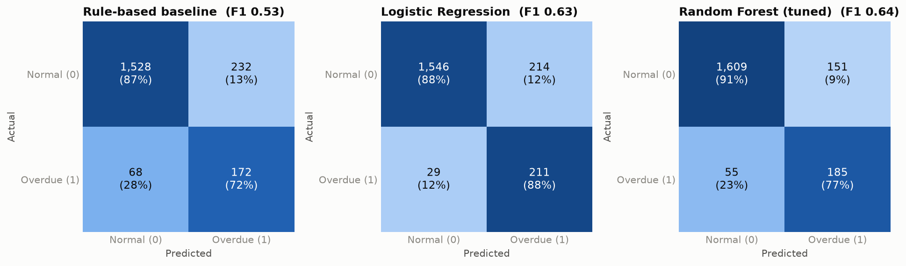
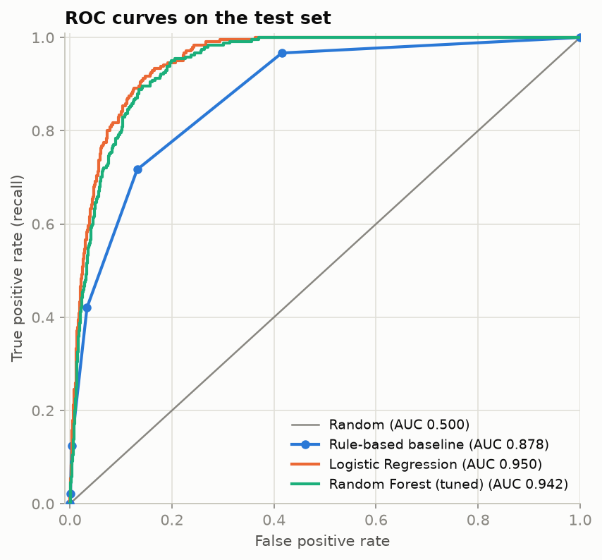
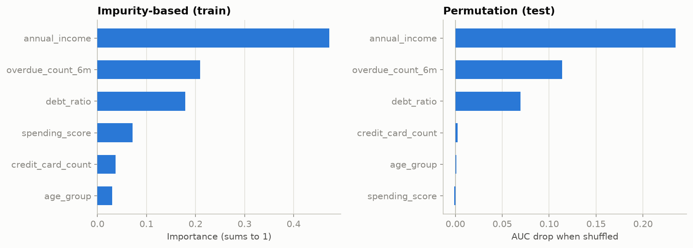
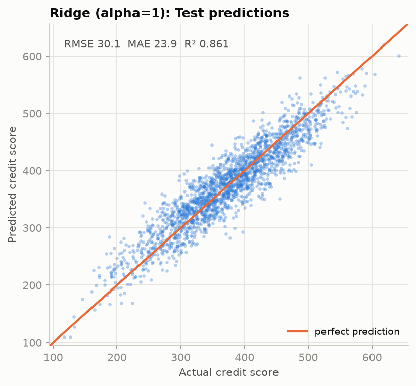
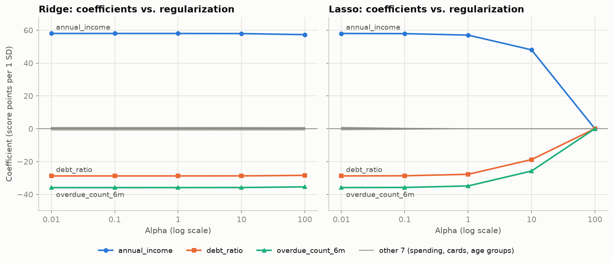

# A5-1. 대출을 해줘도 될지 AI가 대신 판단해주는 시스템 만들기

- 과제 원문: [subjects/subject_a5-1.md](../../subjects/subject_a5-1.md)
- 진행 상태: 필수 요구사항 구현 완료 (보너스 제외, 테스트 30개 통과)
- 제출 링크: (제출 시 기록)

가상 금융 데이터 10,000건으로 **신용 점수(회귀)** 와 **연체 위험(분류)** 을 예측하고, 사람이 만든 **규칙 기반 베이스라인** 과 머신러닝 모델의 성능을 같은 Test 세트에서 비교했습니다. 전처리는 scikit-learn `Pipeline`/`ColumnTransformer` 로 묶어 Train 에서만 fit 하고, 불균형은 `class_weight='balanced'` 와 SMOTE 로 다뤘으며, 랜덤 포레스트는 `GridSearchCV` 로 튜닝했습니다.

## 한눈에 보기

| 질문 | 결과 |
|---|---|
| ML 이 규칙 기반보다 나은가? | 나아졌다. 랜덤 포레스트(튜닝)는 베이스라인 대비 **F1 0.534 → 0.642 (+20.3%)**, **AUC 0.878 → 0.942 (+7.3%)**. 다만 단순한 로지스틱 회귀(AUC 0.950)도 비슷하거나 더 좋았다. |
| 신용 점수는 얼마나 맞히는가? | Ridge(α=1) **RMSE 30.1, MAE 23.9, R² 0.861**. RMSE 30 은 데이터에 넣은 노이즈 크기(σ=30)와 같아 사실상 한계에 도달했다. |
| 규제를 세게 하면? | Lasso 는 α=1 에서 영향 없는 변수 7개를 0 으로 만들고, α=100 에서는 모든 계수가 0 이 되어 R² 가 0 으로 떨어진다. Ridge 는 계수를 거의 줄이지 못했다. |
| 데이터 누수가 얼마나 위험한가? | `credit_score` 를 feature 에 넣으면 AUC 0.940 → 0.984, F1 0.649 → 0.889, Recall 0.721 → 1.000 으로 **성능이 부풀려진다.** |

## 폴더 구성

| 경로 | 내용 |
|---|---|
| [`src/data_gen.py`](src/data_gen.py) | 과제가 제공한 데이터 생성 코드 → `data/finance_data.csv` (git 제외) |
| [`src/preprocess.py`](src/preprocess.py) | 데이터 로딩, 8:2 분할, 연령대 변환, `ColumnTransformer` 전처리 |
| [`src/baseline.py`](src/baseline.py) | if-else 규칙 5개의 투표로 연체를 예측하는 베이스라인 |
| [`src/regression.py`](src/regression.py) | Ridge/Lasso, Alpha 5개, 계수 변화 그래프, RMSE·MAE·R² |
| [`src/classification.py`](src/classification.py) | 불균형 처리 비교, 랜덤 포레스트 GridSearchCV, Confusion Matrix, ROC, 특징 중요도, 누수 실험 |
| [`src/metrics.py`](src/metrics.py), [`src/plotting.py`](src/plotting.py) | 지표 계산과 그래프 공통 스타일 |
| [`tests/`](tests/) | 분할·누수 방지·요구사항을 확인하는 pytest 30개 |
| [`outputs/`](outputs/) | 결과 그래프 PNG 5개 |
| [`requirements.txt`](requirements.txt) | 사용 라이브러리와 버전 |

## 실행 방법

이 저장소는 루트에서 uv 환경 하나를 씁니다. 모든 모듈은 실행하면 결과표를 출력하고 그래프를 `outputs/` 에 저장합니다. 난수는 모두 `random_state=42` 로 고정되어 있어 같은 결과가 나옵니다.

```bash
uv sync                                    # 저장소 루트에서 한 번
cd projects/a5-1-credit-risk

uv run python -m src.data_gen              # data/finance_data.csv 생성 (연체 12.01%)
uv run python -m src.preprocess            # 분할 현황과 전처리 검증
uv run python -m src.baseline              # 규칙 기반 베이스라인
uv run python -m src.regression            # 회귀: 표 + 그래프 2개
uv run python -m src.classification        # 분류: 표 + 그래프 3개 (약 30초)

uv run pytest tests -q                     # 테스트
```

uv 없이 실행하려면 `pip install -r requirements.txt` 후 같은 명령에서 `uv run` 을 빼고 `python -m src.…` 로 실행합니다. 데이터 파일(`*.csv`)은 `.gitignore` 로 저장소에 올라가지 않으므로, 처음에는 `src.data_gen` 부터 실행해야 합니다.

## 데이터와 파이프라인

- **데이터**: 고객 6개 변수(나이, 연 소득, 소비 점수, 부채 비율, 카드 수, 최근 6개월 연체 횟수)와 타깃 둘(`credit_score` 회귀, `is_overdue` 분류). 연체는 10,000건 중 1,201건(12.01%)이다. 데이터 값은 고치지 않았다.
- **분할**: Train 8,000건 (연체 961), Test 2,000건 (연체 240). `random_state=42`, 연체 여부 기준 stratified. 회귀와 분류가 같은 행을 쓴다.
- **전처리** (`ColumnTransformer`): 수치형 5개는 중앙값 대치 → 표준화, 범주형 1개(`age_group`)는 최빈값 대치 → 원-핫 인코딩. 변환 후 열은 10개.
- **누수 방지**: 전처리기는 항상 `Pipeline` 안에서 Train 으로만 fit 되고, 5-fold 교차 검증에서는 fold 마다 그 fold 의 Train 부분으로 다시 fit 된다. SMOTE 도 imblearn `Pipeline` 안에 있어서 fit 때만 Train fold 에서 샘플을 만들고, 예측 때는 건너뛴다. 입력 변수 목록에는 두 타깃이 없다는 것을 테스트가 확인한다.
- **연령대 변환**: 데이터에 범주형 변수가 없어서, `age` 를 `age_group`(20s~60s)으로 바꿔 범주형 1개를 만들었다 (입력 변수는 6개 그대로). 구간 경계가 고정이라 데이터에서 배우는 값이 없고, 그래서 분할 전에 해도 누수가 아니다. 원본 CSV 는 건드리지 않는다.
- **결측치**: 이 데이터에는 결측치가 없어서 대치기는 실제로 값을 바꾸지 않는다. 결측이 있는 새 데이터가 들어와도 Train 의 중앙값·최빈값으로 채워지는지는 테스트로 확인했다.

## 성능 비교 리포트

### 1. 분류: 규칙 기반 베이스라인 vs 머신러닝

Test 2,000건(연체 240건), 연체를 양성으로 보고, 연체 확률 0.5 이상이면 연체로 판정했다.

| 모델 | Accuracy | Precision | Recall | F1-Score | AUC |
| --- | ---: | ---: | ---: | ---: | ---: |
| 규칙 기반 베이스라인 | 0.850 | 0.426 | 0.717 | 0.534 | 0.878 |
| Logistic Regression (balanced) | 0.878 | 0.496 | 0.879 | 0.635 | 0.950 |
| Random Forest (기본) | 0.905 | 0.584 | 0.725 | 0.647 | 0.939 |
| Random Forest (튜닝) | 0.897 | 0.551 | 0.771 | 0.642 | 0.942 |

- 튜닝한 랜덤 포레스트는 베이스라인보다 **F1 +20.3%, AUC +7.3%** 높다. 규칙 기반이 놓친 연체 고객이 68명(Recall 0.717)이고, 랜덤 포레스트는 55명이다.
- **랜덤 포레스트가 로지스틱 회귀를 압도하지는 못했다.** Test AUC 는 로지스틱 회귀가 더 높고(0.950 대 0.942), F1 은 0.007~0.012 차이다. Test 의 연체가 240건뿐이라 이 정도 차이는 우연일 수 있어서, 같은 fold 로 Train 5-fold 교차 검증도 해 보았다. 결과는 같은 방향이다.

  | 모델 | CV F1 | CV F1 표준편차 | CV AUC |
  | --- | ---: | ---: | ---: |
  | Logistic Regression (balanced) | 0.647 | 0.022 | 0.954 |
  | Random Forest (기본) | 0.661 | 0.019 | 0.943 |
  | Random Forest (튜닝) | 0.668 | 0.018 | 0.945 |

  F1 은 랜덤 포레스트가 조금 앞서지만 차이가 표준편차(약 0.02) 안쪽이고, AUC 는 로지스틱 회귀가 앞선다. 튜닝 RF 의 CV F1 은 60개 조합 중 최고값을 고른 것이라 약간 낙관적이다.
- 이유는 데이터 생성 방식에 있다. 신용 점수가 변수들의 **선형 결합 + 노이즈** 이고 연체는 그 점수의 하위 15% 라서, 정답 경계가 거의 선형이다. 이런 경계는 선형 모델이 직접 표현하고, 트리는 계단으로 근사한다. 비선형 관계가 있는 실제 데이터에서는 결과가 달라질 수 있다.
- 베이스라인의 AUC 는 확률이 없어서 "걸린 규칙의 수(0~5)"를 점수로 계산했다. 점수가 최대 6단계뿐이라 ROC 곡선이 몇 개 점만 잇는 꺾은선이다.

**Confusion Matrix** (색은 실제 클래스 안에서의 비율이고, 칸에는 건수와 비율을 적었다. 연체가 12% 뿐이라 건수로 칠하면 연체 칸이 전부 연해 보이기 때문이다.)



**ROC 곡선** (범례에 AUC 를 적었다.)



### 2. 규칙 기반 베이스라인

규칙 5개 중 **2개 이상 걸리면 연체**로 본다. 임계값은 Train 의 구간별 연체율을 보고 정했고 Test 는 평가에서 한 번만 썼다.

| 규칙 | Train 발동 수 | Train 연체율 | Train 연체 포착률 |
| --- | ---: | ---: | ---: |
| 1. 최근 6개월 연체 2회 이상 | 775 | 0.387 | 0.312 |
| 2. 부채 비율 > 0.8 | 1,532 | 0.238 | 0.379 |
| 3. 연 소득 < 3,000만원 | 1,246 | 0.408 | 0.529 |
| 4. 연 소득 < 4,000만원 이면서 부채 비율 > 0.6 | 1,010 | 0.459 | 0.483 |
| 5. 연체 1회 이상 이면서 부채 비율 > 0.5 | 1,576 | 0.328 | 0.538 |

걸린 규칙이 몇 개 이상일 때 연체로 볼지는 Train F1 로 골랐다 (1개: 0.389, **2개: 0.552**, 3개: 0.503, 4개: 0.218, 5개: 0.044). Test F1 이 0.534 로 Train 과 비슷해서, 임계값이 Train 에 과하게 맞춰지지는 않았다.

### 3. 불균형 처리 효과

같은 로지스틱 회귀에 처리 방식만 바꿔서 Test 에서 비교했다 (연체 12%).

| 모델 | Accuracy | Precision | Recall | F1-Score | AUC |
| --- | ---: | ---: | ---: | ---: | ---: |
| LogReg (처리 없음) | 0.920 | 0.710 | 0.571 | 0.633 | 0.950 |
| LogReg (class_weight=balanced) | 0.878 | 0.496 | 0.879 | 0.635 | 0.950 |
| LogReg (SMOTE) | 0.885 | 0.514 | 0.867 | 0.645 | 0.950 |

- 처리하지 않으면 모델이 연체를 보수적으로 판정해서 **Recall 이 0.571** 로 낮다. `balanced` 와 SMOTE 는 연체 쪽으로 판정 기준을 옮겨 **Recall 을 0.88 안팎**으로 올리지만, 그 대가로 Precision 이 0.71 → 0.50 으로 떨어진다.
- F1 과 AUC 는 거의 같다. 불균형 처리가 모델의 구분 능력(AUC)을 높이는 것이 아니라, **Recall 과 Precision 의 균형점을 옮기는** 효과라는 뜻이다. 어느 쪽이 좋은지는 비즈니스 판단이다. 연체 고객을 놓치는 손실이 크면 Recall 을, 우량 고객을 거절하는 손실이 크면 Precision 을 본다.
- Accuracy 는 모델을 고르는 기준으로 쓸 수 없다. 전부 "정상"이라고 해도 Test Accuracy 가 0.880 이다.
- SMOTE 는 전처리 후(원-핫 열 포함)에 적용해서 원-핫 열이 보간된 소수 값이 될 수 있다. 이 데이터에서는 범주형이 `age_group` 하나이고 연체와 무관해서 영향이 없다.

### 4. 랜덤 포레스트 GridSearchCV

| 파라미터 | 후보 |
| --- | --- |
| `n_estimators` | 100, 200, 300 |
| `max_depth` | 4, 6, 8, 12, None |
| `min_samples_leaf` | 1, 5, 10, 20 |

3 × 5 × 4 = **60 조합 × 5-fold** (과제 가이드: 파라미터당 5개 이하, 총 100개 이하), 기준은 F1, `class_weight='balanced'`. 최적은 `n_estimators=300, max_depth=12, min_samples_leaf=1` 이다.

| 순위 | n_estimators | max_depth | min_samples_leaf | CV F1 | CV AUC |
| ---: | ---: | ---: | ---: | ---: | ---: |
| 1 | 300 | 12 | 1 | 0.668 | 0.945 |
| 2 | 200 | 12 | 1 | 0.666 | 0.945 |
| 3 | 100 | 12 | 1 | 0.662 | 0.944 |
| 4 | 100 | None | 1 | 0.661 | 0.943 |
| 5 | 300 | None | 1 | 0.660 | 0.944 |

튜닝의 효과는 작다. 기본 설정(CV F1 0.661)에서 0.668 로 올랐지만 표준편차 안쪽이고, Test F1 은 기본 0.647, 튜닝 0.642 로 오히려 조금 낮다. 최적 조합이 탐색 범위의 가장자리(`min_samples_leaf=1`, `n_estimators=300`)에 있지만, 상위 조합끼리 차이가 0.01 이하라서 범위를 넓혀도 크게 달라지지 않을 것으로 본다.

### 5. 특징 중요도 (튜닝한 랜덤 포레스트)



| 변수 | 불순도 기반 (Train) | 순열 중요도 (Test, AUC 감소) |
| --- | ---: | ---: |
| annual_income | 0.4727 | 0.2347 |
| overdue_count_6m | 0.2094 | 0.1139 |
| debt_ratio | 0.1792 | 0.0694 |
| spending_score | 0.0714 | -0.0012 |
| credit_card_count | 0.0369 | 0.0024 |
| age_group | 0.0305 | 0.0008 |

**해석 3줄 요약**

1. 연체 예측은 **연 소득, 최근 6개월 연체 횟수, 부채 비율** 세 변수가 거의 전부다 (순열 중요도 0.235, 0.114, 0.069). 이 세 변수는 신용 점수 생성식에 실제로 들어간 변수와 같다.
2. 불순도 기반 중요도는 신용 점수와 무관한 `spending_score` 에도 0.071 을 주지만(4위), 변수를 섞어 보는 순열 중요도로는 사실상 0(-0.001)이다. 불순도 기반은 값의 종류가 많은 변수를 부풀려 보므로, **해석은 순열 중요도를 기준으로** 해야 한다.
3. 카드 수와 연령대는 두 방법 모두에서 영향이 거의 없고, 회귀에서 Lasso 가 0 으로 만든 변수와 일치한다. 서로 다른 모델이 같은 결론을 내므로, 이 변수들은 **대출 심사에서 빼도 되는 변수**로 볼 수 있다.

### 6. 회귀: 신용 점수 예측 (Ridge vs Lasso)

입력은 변수 6개(전처리 후 10열), 예측값은 0~1000 으로 잘랐다. Alpha 는 Train 5-fold CV RMSE 가 가장 낮은 값으로 골랐고(Ridge α=1, Lasso α=0.1), Test 는 보고용으로만 썼다.

| 모델 | RMSE | MAE | R² |
| --- | ---: | ---: | ---: |
| Ridge (α=1) | 30.134 | 23.933 | 0.861 |
| Lasso (α=0.1) | 30.131 | 23.928 | 0.861 |

Alpha 별 전체 결과 (CV 는 Train 5-fold, 나머지는 Test):

| 모델 | CV RMSE | CV R² | RMSE | MAE | R² | 0인 계수 |
| --- | ---: | ---: | ---: | ---: | ---: | ---: |
| Ridge (α=0.01) | 29.570 | 0.862 | 30.133 | 23.933 | 0.861 | 0 |
| Ridge (α=0.1) | 29.570 | 0.862 | 30.133 | 23.933 | 0.861 | 0 |
| Ridge (α=1) | 29.570 | 0.862 | 30.134 | 23.933 | 0.861 | 0 |
| Ridge (α=10) | 29.570 | 0.862 | 30.136 | 23.934 | 0.861 | 0 |
| Ridge (α=100) | 29.590 | 0.862 | 30.174 | 23.954 | 0.861 | 0 |
| Lasso (α=0.01) | 29.569 | 0.862 | 30.133 | 23.933 | 0.861 | 1 |
| Lasso (α=0.1) | 29.565 | 0.862 | 30.131 | 23.928 | 0.861 | 3 |
| Lasso (α=1) | 29.605 | 0.862 | 30.220 | 23.977 | 0.860 | 7 |
| Lasso (α=10) | 34.259 | 0.815 | 35.237 | 28.214 | 0.810 | 7 |
| Lasso (α=100) | 79.688 | -0.000 | 80.874 | 64.730 | -0.000 | 10 |

- **R² 0.861 은 사실상 상한이다.** 신용 점수에 표준편차 30 의 노이즈를 직접 더했으므로 RMSE 는 30 아래로 내려갈 수 없고, 점수의 분산(표준편차 79.9)으로 계산한 R² 상한은 1 − 30²/79.9² ≈ 0.859 이다. 예측한 점수와 실제 점수는 아래 그래프에서 대각선 주위에 모여 있다.
- Alpha 0.01~1 에서는 두 모델의 RMSE 차이가 0.1 이내(30.131~30.220)라서, 최적 Alpha 를 CV 로 골랐다고 해서 성능이 의미 있게 달라지는 것은 아니다.



### 7. 규제 강도(Alpha)별 계수 변화



색이 있는 선 3개는 신용 점수 생성식에 실제로 들어간 변수이고, 회색 선 7개(소비 점수, 카드 수, 연령대 더미 5개)는 영향이 없는 변수다. 계수는 표준화된 변수 기준이라 "변수가 1 표준편차 오를 때 점수가 몇 점 바뀌는가"이다.

**Lasso (L1)**

| 변수 | α=0.01 | α=0.1 | α=1 | α=10 | α=100 |
| --- | ---: | ---: | ---: | ---: | ---: |
| annual_income | 58.01 | 57.92 | 57.02 | 48.04 | 0.00 |
| debt_ratio | -28.77 | -28.68 | -27.78 | -18.81 | 0.00 |
| overdue_count_6m | -35.87 | -35.78 | -34.87 | -25.79 | 0.00 |
| spending_score | -0.16 | -0.07 | -0.00 | 0.00 | 0.00 |
| credit_card_count | 0.17 | 0.08 | 0.00 | 0.00 | 0.00 |
| age_group (5개 더미) | -0.72 ~ 0.88 | -0.40 ~ 0.31 | 모두 0 | 모두 0 | 모두 0 |

**Ridge (L2)**

| 변수 | α=0.01 | α=0.1 | α=1 | α=10 | α=100 |
| --- | ---: | ---: | ---: | ---: | ---: |
| annual_income | 58.02 | 58.02 | 58.01 | 57.95 | 57.30 |
| debt_ratio | -28.78 | -28.78 | -28.77 | -28.74 | -28.43 |
| overdue_count_6m | -35.88 | -35.88 | -35.87 | -35.83 | -35.43 |
| spending_score | -0.17 | -0.17 | -0.17 | -0.16 | -0.16 |
| credit_card_count | 0.18 | 0.18 | 0.18 | 0.18 | 0.18 |
| age_group (5개 더미) | -0.88 ~ 0.81 | -0.88 ~ 0.81 | -0.88 ~ 0.81 | -0.88 ~ 0.81 | -0.83 ~ 0.75 |

- **Lasso 는 계수를 정확히 0 으로 만든다.** α=1 부터 영향 없는 변수 7개(소비 점수, 카드 수, 연령대 5개)가 0 이 되고 성능은 그대로(R² 0.860)다. 변수 선택이 규제에서 저절로 일어난 것이다. α=10 에서는 진짜 변수의 계수까지 줄어(소득 58 → 48) R² 가 0.810 으로 떨어지고, α=100 에서는 모든 계수가 0 이 되어 항상 평균 점수만 내놓는다 (R² 0.000, 규제가 너무 세면 과소적합).
- **Ridge 는 0 으로 만들지 않고, 여기서는 거의 줄이지도 못했다.** α 를 만 배(0.01 → 100) 키워도 소득 계수가 58.02 → 57.30 으로 1% 남짓 줄었다. 변수를 표준화했고 표본이 8,000건이라 오차 제곱합이 규제항(α × 계수²)을 압도하기 때문이다. 이 데이터는 과대적합이 거의 없어서(Ridge α=1 의 Train RMSE 29.5 대 Test RMSE 30.1) 규제가 필요 없다. 규제의 효과가 크게 보이는 쪽은 변수가 많고 표본이 적은 경우다.

### 8. 데이터 누수 실험

연체 여부는 `credit_score` 의 하위 15% 에서 만들어진 값이라, `credit_score` 를 feature 로 넣으면 정답을 미리 알려 주는 셈이다. 같은 랜덤 포레스트(기본 설정)로 확인했다.

| feature | Accuracy | Recall | F1-Score | AUC |
| --- | ---: | ---: | ---: | ---: |
| `credit_score` 제외 (정상) | 0.906 | 0.721 | 0.649 | 0.940 |
| `credit_score` 포함 (누수) | 0.970 | 1.000 | 0.889 | 0.984 |

Recall 이 1.000 이 되고 F1 이 0.649 → 0.889 로 뛴다. 실제 대출 심사에서는 "신용 점수"를 연체 이후에야 알 수 있는 값으로 만들었다면 같은 일이 일어날 수 있다. 이 프로젝트의 모든 분류 모델은 `credit_score` 를 입력에서 제외했다.

## 과제 목표별 정리

- **규칙 기반 대비 ML**: F1 0.534 → 0.642, AUC 0.878 → 0.942. 규칙은 해석과 감사가 쉽고 Recall 도 0.717 로 나쁘지 않지만 Precision 이 0.426 으로 낮아서 우량 고객을 많이 거절한다. 한계: 이 데이터는 선형 구조라 복잡한 모델(RF)이 단순한 로지스틱 회귀보다 낫지 않았다.
- **파이프라인과 데이터 누수**: 전처리·SMOTE·교차 검증이 모두 Train 안에서만 fit 된다. 전처리기를 전체 데이터로 fit 하면 테스트가 실패한다는 것을 확인했다. 누수 실험으로 위험을 수치로 보였다.
- **회귀 vs 분류 지표**: 회귀는 오차 크기(RMSE, MAE)와 설명력(R²), 분류는 불균형 때문에 Accuracy 대신 Precision, Recall, F1, AUC 를 본다. 같은 데이터에서도 "얼마나 틀렸나"와 "어느 쪽을 얼마나 놓쳤나"는 다른 질문이다.
- **규제(L1/L2)**: L1(Lasso)은 영향 없는 계수를 정확히 0 으로, L2(Ridge)는 모든 계수를 비례해서 줄인다. 규제가 너무 세면 모델이 상수에 가까워진다.
- **불균형**: 가중치 조정과 SMOTE 는 Recall 을 0.571 → 0.87~0.88 로 올리고 Precision 을 낮춘다. AUC 는 그대로이므로 모델 능력이 아니라 판정 기준을 옮기는 효과다.

## 원문·예시와 달랐던 점

1. **범주형 변수와 결측치가 없다.** 과제는 "범주형은 인코딩, 수치형은 대치"를 요구하지만 데이터는 전부 숫자이고 결측치도 없다. 그래서 `age` 를 연령대로 바꿔 범주형 1개를 만들었고, 대치기는 결측이 생기는 새 데이터를 위해 파이프라인에 넣었다 (이 데이터에서는 값을 바꾸지 않음).
2. **예시표의 수치와 다르다.** 과제의 예시표(RF Accuracy 0.87, AUC 0.89, Ridge R² 0.91 등)는 "정답이 아니라 참고"라고 되어 있고, 실제로 이 데이터에서는 R² 가 0.861 이 한계다. 랜덤 포레스트의 AUC 는 0.942 로 예시(0.89)보다 높지만, 로지스틱 회귀보다는 낮았다.
3. **예시 규칙 중 "카드 8장 이상"은 뺐다.** Train 에서 이 규칙의 연체율이 12.3% 로 전체 평균(12.0%)과 같다. 카드 수는 데이터 생성식에 없는 변수라 가짜 양성만 늘린다.
4. **원문 코드의 주석과 동작이 다르다.** 소득 처리 주석은 "0 으로 처리"인데 코드는 `max(x, 1500)` 이다. 데이터를 수정하지 않는다는 규칙에 따라 코드대로 두었다 (소득이 정확히 1,500 인 행이 408건).
5. **`data_gen.py` 는 두 가지만 바꿨다.** 쓰지 않는 `import random` 을 뺐고 함수로 감쌌다. 과제 문서의 코드를 그대로 실행한 결과와 생성된 CSV 가 바이트 단위로 같음을 확인했다.
6. **판정 기준은 확률 0.5 로 고정했다.** 실제 심사에서는 Recall 과 Precision 의 비용에 따라 기준을 조정하겠지만, 이 과제 범위에서는 모든 모델을 같은 기준으로 비교했다.
7. **신용 점수의 실제 범위는 78~676 이다.** "0~1000" 은 가능한 범위이고, 예측값을 이 범위로 자르도록 구현했다 (테스트로 확인).

## 사용 라이브러리

Python 3.13, NumPy 2.5.3, pandas 3.0.6, scikit-learn 1.9.1, Matplotlib 3.11.2, imbalanced-learn 0.14.2 (SMOTE), pytest 9.1.1. 딥러닝 프레임워크와 외부 데이터는 쓰지 않았다. 버전은 [`requirements.txt`](requirements.txt) 에 있고, 이 파일만으로 만든 빈 환경에서 테스트 30개가 통과함을 확인했다.
