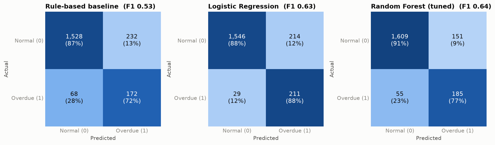
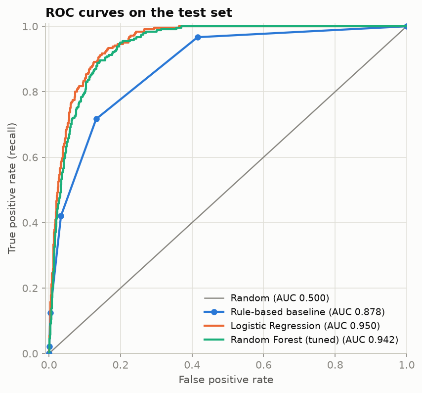
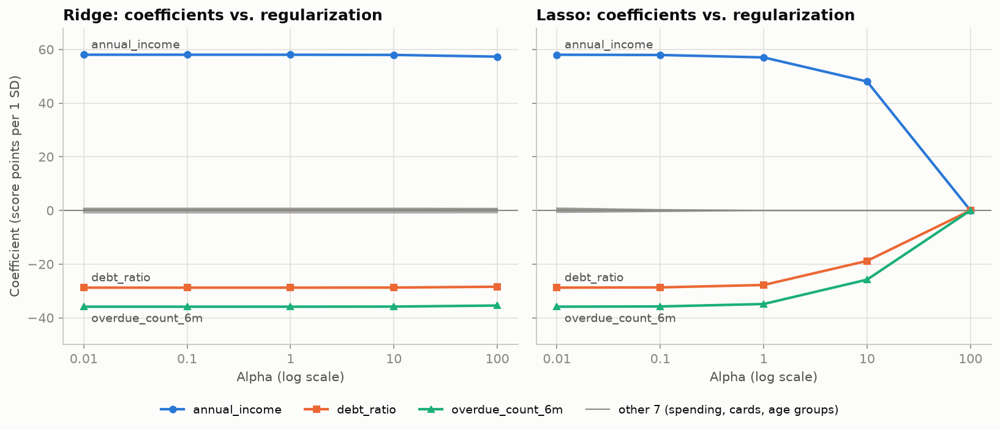

# A5-1 항목 1: 평가 문장별 개념과 설명 방법

이 문서는 머신러닝을 처음 접하는 사람에게 **항목 1의 평가 내용과 구현 의도**를 설명하기 위한 학습 자료입니다. [평가 원문](../../../evaluations/evaluations_a5-1.md)의 일곱 문장을 각각 제시하고, 그 아래에 필요한 개념과 프로젝트 연결 내용을 정리했습니다.

읽을 때는 **무엇을 확인하는 평가인가 → 어떤 개념이 필요한가 → 코드와 결과를 어떻게 설명할까** 순서로 따라가세요.

프로젝트 수치는 기존 [README](../README.md)에 기록된 결과를 인용했습니다. 이 문서 작성 과정에서 모델을 다시 실행해 측정한 값은 아닙니다. 별도로 표시한 가상 예시는 개념 설명용입니다.

## 먼저 알아둘 전체 그림

은행이 고객 정보를 보고 두 가지 질문에 답한다고 생각하면 쉽습니다.

| 질문 | 문제 종류 | 이 프로젝트의 정답 열 |
|---|---|---|
| 이 고객의 신용 점수는 몇 점일까? | 회귀: 연속적인 수치 예측 | `credit_score` |
| 이 고객은 연체할까? | 분류: 정해진 범주 예측 | `is_overdue`, 정상 0·연체 1 |

나이·소득·부채 비율처럼 예측에 참고하는 정보를 **특성(feature)**, 모델이 맞혀야 하는 정답을 **타깃(target)**이라고 합니다. 고객 한 명의 데이터 한 행은 **샘플(sample)**입니다.

```text
가상 고객 10,000명 생성
        ↓
학습용 Train 8,000명 / 최종 평가용 Test 2,000명 분리
        ↓
Train 내부에서 전처리 학습·모델 학습·설정 선택
        ↓
Test에 학습한 전처리를 적용하고 예측
        ↓
성능 비교표·그래프·실행 문서로 결과 설명
```

Train은 공부할 문제집, Test는 실력을 확인하는 시험지와 같습니다. **시험지 결과를 보고 계속 공부 방법을 고르면 공정한 최종 시험이 되기 어렵습니다.**

## 1. 데이터 생성: 10,000건이 어떤 데이터인지 설명하기

> **평가 문장:** `data_gen.py`를 실행하여 `finance_data.csv`(10,000건)가 정상 생성되는가?

### 평가에서 확인하는 것

제공된 생성 코드를 실행해 학습에 필요한 데이터를 만들 수 있는지 확인합니다. 파일 존재뿐 아니라 **행 수, 컬럼의 의미, 정답의 형태와 분포**를 알아야 합니다.

### 알아야 할 개념

| 개념 | 쉬운 설명 | 이 프로젝트에서의 의미 |
|---|---|---|
| CSV | 표를 텍스트로 저장하는 파일 형식 | 한 행에 고객 한 명의 정보를 저장 |
| 합성 데이터 | 실제 기록 대신 규칙과 난수로 만든 데이터 | 가상 금융 고객 10,000명 |
| 난수 시드 | 무작위 값을 다시 만들기 위한 출발점 | 시드 42와 같은 코드·환경으로 결과 재현 |
| 노이즈 | 입력만으로 완전히 설명하기 어려운 무작위 변동 | 신용 점수 생성 시 무작위 오차 추가 |
| 클래스 분포 | 분류 정답별 데이터 수와 비율 | 정상과 연체 고객의 비율 |

원본 CSV는 입력 변수 6개와 타깃 2개, 총 8개 컬럼으로 구성됩니다.

- 입력: 나이, 연 소득, 소비 점수, 부채 비율, 신용카드 수, 최근 6개월 연체 횟수
- 회귀 정답: 신용 점수
- 분류 정답: 연체 여부

신용 점수는 소득이 높으면 올라가고, 부채 비율과 연체 횟수가 높으면 내려가도록 생성됩니다. 여기에 노이즈를 더합니다. 연체 여부는 신용 점수 하위 15% 고객 중 약 80%를 연체로 정하는 방식입니다. **모든 고객에게 독립적으로 12% 확률을 적용한 데이터와는 다릅니다.**

### 프로젝트에서 확인할 근거

[데이터 생성 코드](../src/data_gen.py)의 `generate_data()`와 `main()`을 확인합니다. README에 기록된 결과는 전체 10,000건, 연체 1,201건(12.01%)입니다. CSV의 헤더는 고객 수에 포함하지 않습니다.

다음 명령은 저장소 루트에서 시작합니다.

```bash
cd projects/a5-1-credit-risk
uv run python -m src.data_gen
```

실제 저장 위치는 `data/finance_data.csv`입니다. 생성 후에는 10,000행인지, 필수 컬럼이 있는지, 결측치나 예상 밖의 값이 있는지 확인합니다.

### 이렇게 설명해 보세요

> 고객 10,000명의 가상 데이터를 생성했습니다. 같은 고객 정보로 신용 점수와 연체 여부를 각각 예측합니다. 연체 고객이 약 12%라서 이후 평가에서는 데이터 불균형도 고려해야 합니다. 실제 은행 데이터가 아니므로 이 성능을 실제 금융 서비스의 성능으로 일반화할 수는 없습니다.

## 2. 베이스라인: 사람이 만든 규칙과 ML을 공정하게 비교하기

> **평가 문장:** 규칙 기반 베이스라인이 5개 이상의 `if-else` 규칙으로 구현되어 있고, ML 모델과 성능 비교표(Accuracy, F1-Score, AUC)가 정량적으로 제시되어 있는가?

### 평가에서 확인하는 것

사람이 직접 만든 판단 기준을 구현하고, 머신러닝이 그 기준보다 얼마나 나은지 **같은 데이터와 지표로 수치화**했는지 확인합니다.

### 베이스라인과 규칙 기반 모델

**베이스라인(baseline)**은 새 모델의 효과를 판단하는 비교 기준입니다. 복잡한 모델의 점수만 보여주면, 간단한 방법보다 나아졌는지 알 수 없습니다.

규칙 기반 모델에서는 사람이 조건을 정하고, ML 모델에서는 데이터로부터 관계를 학습합니다. 이 프로젝트의 [베이스라인 코드](../src/baseline.py)는 다음 다섯 조건을 독립적으로 검사합니다.

| 번호 | 위험 조건 |
|---|---|
| 1 | 최근 6개월 연체 횟수 2회 이상 |
| 2 | 부채 비율 0.8 초과 |
| 3 | 연 소득 3,000만 원 미만 |
| 4 | 연 소득 4,000만 원 미만이면서 부채 비율 0.6 초과 |
| 5 | 최근 6개월 연체 1회 이상이면서 부채 비율 0.5 초과 |

`rule_flags()`의 다섯 `if`는 동시에 여러 개가 참일 수 있습니다. `if/elif`로 첫 조건에서 검사를 끝내는 구조와 다릅니다. 조건이 맞으면 1, 아니면 초기값 0을 유지하고, 해당 개수를 합칩니다.

```text
고객 A가 조건 1·2·5에 해당 → 위험 점수 3
고객 B가 조건 3에만 해당  → 위험 점수 1

선택한 기준이 2개라면 A는 연체, B는 정상으로 예측
```

기준 개수 `min_hits`는 Train의 F1을 보고 고릅니다. Test 정답을 보고 규칙이나 기준을 정하면 비교 결과가 유리하게 부풀려질 수 있습니다.

### 성능 지표를 이해하는 출발점: 네 가지 예측 결과

이 문서에서 **양성(Positive)은 연체 1**, 음성(Negative)은 정상 0입니다. 양성은 좋다는 뜻이 아니라 탐지하려는 대상이라는 뜻입니다.

| 실제 상태 | 연체로 예측 | 정상으로 예측 |
|---|---|---|
| 실제 연체 | TP: 연체를 찾아냄 | FN: 연체를 놓침, 미탐 |
| 실제 정상 | FP: 정상 고객을 위험하다고 판단, 오탐 | TN: 정상을 맞힘 |

| 지표 | 계산 | 답하는 질문 |
|---|---|---|
| Accuracy, 정확도 | `(TP + TN) / 전체` | 전체 중 몇 명을 맞혔는가? |
| Precision, 정밀도 | `TP / (TP + FP)` | 연체라고 예측한 사람 중 실제 연체는 몇 명인가? |
| Recall, 재현율 | `TP / (TP + FN)` | 실제 연체 고객 중 몇 명을 찾아냈는가? |
| F1-Score | `2 × Precision × Recall / (Precision + Recall)` | 정밀도와 재현율을 함께 보면 어떤가? |
| ROC-AUC | ROC 곡선 아래 면적 | 연체 고객에게 정상 고객보다 높은 위험 점수를 주는가? |

F1은 정밀도와 재현율의 **조화평균**입니다. 둘 중 하나만 높아서는 높은 점수를 받기 어렵습니다. 두 지표가 모두 0이면 보통 F1도 0으로 처리합니다.

**가상 예시:** 정상 900명, 연체 100명 중 TP=80, FN=20, FP=40, TN=860이라고 해봅시다.

```text
Accuracy = (80 + 860) / 1000 = 94%
Precision = 80 / 120 ≈ 66.7%
Recall = 80 / 100 = 80%
F1 ≈ 0.727
```

반면 모두 정상으로 예측해도 Accuracy는 90%입니다. 이때 연체는 한 명도 찾지 못하므로 Recall과 F1은 0입니다. 이것이 불균형 데이터에서 Accuracy만 보면 안 되는 이유입니다.

### AUC는 0/1 예측과 구분하기

Accuracy와 F1은 최종 0/1 예측으로 계산합니다. ROC-AUC는 보통 **예측 확률이나 연속·순서형 위험 점수**로 계산합니다. 이 프로젝트의 규칙 모델은 발동한 규칙 수 0~5를 사용합니다. AUC 계산에 반드시 확률이 필요한 것은 아닙니다.

AUC 0.95는 정확도 95%라는 뜻이 아닙니다. 무작위로 고른 연체 고객과 정상 고객 쌍에서 연체 고객에게 더 높은 점수를 주는 비율로 이해할 수 있습니다. 같은 점수인 쌍은 절반으로 계산합니다.

### 프로젝트 결과와 설명 예시

다음은 README에 기록된 동일 Test Set 비교입니다.

| 모델 | Accuracy | F1-Score | ROC-AUC |
|---|---:|---:|---:|
| 규칙 기반 | 0.850 | 0.534 | 0.878 |
| 로지스틱 회귀, balanced | 0.878 | 0.635 | 0.950 |
| 랜덤 포레스트, 튜닝 | 0.897 | 0.642 | 0.942 |

로지스틱 회귀는 이름에 ‘회귀’가 있지만 여기서는 연체 여부를 예측하는 **분류 모델**입니다.

> 다섯 규칙을 비교 기준으로 만들고 같은 테스트 고객에게 ML 모델도 적용했습니다. 튜닝한 랜덤 포레스트는 규칙 모델보다 F1이 0.108, AUC가 0.064 높았습니다. 다만 AUC는 로지스틱 회귀가 가장 높아서 지표에 따라 순위가 달라집니다.

## 3. 전처리 모듈화: 학습과 예측에 같은 처리 순서 적용하기

> **평가 문장:** Scikit-learn의 `Pipeline` 또는 `ColumnTransformer`로 전처리가 모듈화되어 있고, `fit/predict` 실행 시 에러 없이 동작하는가?

### 평가에서 확인하는 것

전처리를 여러 곳에 복사해 쓰지 않고, 학습과 예측에서 일관되게 실행할 수 있는 구조로 만들었는지 확인합니다.

### 전처리의 세 가지 기본 작업

| 작업 | 쉬운 설명 | 프로젝트 적용 |
|---|---|---|
| 결측치 대체 | 비어 있는 값을 정해진 기준으로 채움 | 수치형은 중앙값, 범주형은 최빈값 |
| 표준화 | 변수마다 다른 숫자 크기를 조정 | 수치형에 `StandardScaler` |
| 원-핫 인코딩 | 범주마다 별도의 0/1 열을 만듦 | 연령대 `age_group`에 적용 |

표준화는 대략 `(원래 값 − Train 평균) / Train 표준편차`입니다. 연 소득 5,000과 부채 비율 0.5처럼 단위가 다른 변수에 동일한 규제를 적용할 때 특히 중요합니다. 트리 모델은 일반적으로 표준화가 필수는 아니지만, 이 프로젝트는 공통 처리 구조를 사용합니다.

원-핫 인코딩은 다음처럼 동작합니다.

```text
age_group = 30s
        ↓
20s 여부 0 / 30s 여부 1 / 40s 여부 0 / 50s 여부 0 / 60s 여부 0
```

원본 데이터에는 결측치와 범주형 변수가 없습니다. 프로젝트에서는 나이를 고정된 연령대로 바꾸어 범주형 처리를 구현했고, 결측치 대체기는 새 데이터에 결측이 들어올 경우에 대비해 넣었습니다.

### 두 도구의 역할

- **`ColumnTransformer`**: 열의 종류에 따라 서로 다른 전처리를 적용합니다. 수치형 경로와 범주형 경로를 나누는 역할입니다.
- **`Pipeline`**: 전처리와 모델을 순서대로 연결합니다. 전체 작업 순서를 관리하는 역할입니다.

```text
입력 데이터
  ├─ 수치형 5개 → 중앙값 대체 → 표준화 ─┐
  └─ 연령대 1개 → 최빈값 대체 → 인코딩 ─┤ ColumnTransformer
                                       ↓
                                 변환 결과 10열
                                       ↓
                                  예측 모델
        [위의 전처리와 모델을 Pipeline으로 연결]
```

### `fit`, `transform`, `predict`와 데이터 누수

| 메서드 | 하는 일 |
|---|---|
| `fit` | 평균·대체값·모델 계수 등 데이터에서 기준을 학습 |
| `transform` | 이미 학습한 기준으로 입력을 변환 |
| `predict` | 학습된 전처리와 모델로 최종 예측 |

전체 데이터로 평균을 구한 뒤 Train/Test를 나누면 Test 정보가 학습 과정에 들어갑니다. 이렇게 예측 시 알 수 없어야 하는 정보가 학습·선택에 들어오는 문제를 **데이터 누수(data leakage)**라고 합니다.

```text
올바른 순서
데이터 분할 → Train으로 전처리와 모델 fit → Test에 predict
```

Pipeline이 있어도 전체 데이터로 `fit`하면 누수가 생깁니다. **도구 사용과 올바른 학습 범위가 함께 필요합니다.** 교차검증에서도 전처리는 각 학습 폴드에서 다시 학습해야 합니다.

### 프로젝트 근거와 설명 예시

[전처리 코드](../src/preprocess.py)의 `build_preprocessor()`가 학습 전 전처리기를 만들고, [분류 코드](../src/classification.py)의 `make_logreg()`·`make_forest()`와 [회귀 코드](../src/regression.py)의 `make_model()`이 이를 모델과 연결합니다.

> 수치형과 범주형 전처리는 ColumnTransformer로 나누고, 그 결과를 모델에 연결하는 Pipeline을 만들었습니다. Train에서만 기준을 학습하고 Test에는 그대로 적용합니다. 회귀와 분류는 같은 전처리 구성을 사용하되 각각 별도의 파이프라인을 학습합니다.

## 4. 불균형 처리: 연체를 더 잘 찾으면서 어떤 오류가 늘었는지 보기

> **평가 문장:** 불균형 처리(`class_weight='balanced'` 또는 SMOTE) 적용 후, 분류 모델의 Confusion Matrix와 ROC-AUC 곡선이 시각화되어 있는가?

### 평가에서 확인하는 것

연체 고객이 적다는 문제를 학습에 반영하고, 결과를 숫자 하나가 아니라 **오류 유형과 위험 구분 능력**으로 보여주는지 확인합니다.

### 불균형 처리의 두 방법

**클래스 가중치**는 소수 클래스의 오류에 더 큰 벌점을 주는 방법입니다. 연체 고객을 틀렸을 때 더 큰 배점을 잃게 만드는 것과 비슷합니다.

`balanced`는 클래스 수와 샘플 수에 따라 가중치를 자동 계산합니다. 정상 90%, 연체 10%라면 연체 샘플 하나의 가중치는 정상 샘플 하나의 약 9배입니다. **데이터 수를 바꾸는 것이 아니라 학습 시 오류의 비중을 바꿉니다.**

**SMOTE**는 소수 클래스 샘플과 그 이웃 사이를 보간해 가상 샘플을 만드는 방법입니다. 단순히 기존 행을 복사하는 방법과는 다릅니다.

| 방법 | 바꾸는 것 | 주의점 |
|---|---|---|
| 클래스 가중치 | 학습 손실에서 각 클래스의 비중 | Recall 증가와 함께 오탐이 늘 수 있음 |
| SMOTE | 학습 데이터의 샘플 수와 분포 | 스케일·이웃 선택·범주형 변수 처리에 주의 |

프로젝트는 두 방법을 각각 적용한 로지스틱 회귀를 비교합니다. SMOTE는 전처리 다음에 `imblearn` Pipeline 안에서 수행됩니다. 일반 SMOTE가 원-핫 열 사이를 보간하면 0.3 같은 값이 생길 수 있습니다. 범주 의미를 엄격히 유지해야 한다면 SMOTENC 같은 대안을 검토할 수 있습니다.

SMOTE는 **Train에만**, 교차검증에서는 **각 학습 폴드에만** 적용합니다. Test까지 증강하면 원래 고객 분포를 평가할 수 없고, 분할 전에 적용하면 합성 샘플을 통해 검증 정보가 새어 들어갈 수 있습니다. 클래스 가중치도 학습 시 사용하는 설정이며 Test 정답이나 분포를 바꾸는 처리가 아닙니다.

### Confusion Matrix 읽기

혼동 행렬은 앞서 설명한 TP·FN·FP·TN을 표로 보여줍니다. 프로젝트 그래프는 **행이 실제 상태, 열이 예측 상태**입니다.

- 실제 연체 행에서 정상으로 예측한 칸: 놓친 연체 고객 FN
- 실제 정상 행에서 연체로 예측한 칸: 잘못 경고한 정상 고객 FP
- 대각선: 맞힌 고객 TN·TP

칸의 숫자는 건수이고, 색은 실제 클래스 안에서의 비율입니다. 정상 고객이 많아 색이 정상 건수에만 지배되는 것을 피하려는 표현입니다.



### ROC 곡선과 임계값 읽기

모델이 위험 점수 0.7을 출력하면, 기준 0.5 이상이므로 연체로 분류할 수 있습니다. 이 기준이 **임계값(threshold)**입니다. 이 프로젝트의 ML 비교는 0.5를 사용합니다.

임계값을 낮추면 같은 모델에서도 일반적으로 연체를 더 많이 찾고, 정상 고객에 대한 경고도 늘어납니다. 이 변화를 여러 임계값에서 그린 것이 ROC 곡선입니다.

- 가로축 FPR: `FP / (FP + TN)`, 정상 중 잘못 경고한 비율
- 세로축 TPR: `TP / (TP + FN)`, 실제 연체 중 찾아낸 비율, 즉 Recall
- 왼쪽 위에 가까울수록 적은 오탐으로 많은 연체를 탐지
- AUC 약 0.5는 무작위 순위 수준, 1은 완벽한 순위 구분



ROC-AUC가 높아도 특정 임계값에서 오탐이 적다는 보장은 없습니다. 매우 불균형한 문제에서는 Precision–Recall 곡선도 함께 보면 경고의 실효성을 이해하는 데 도움이 됩니다. 이는 추가 설명이며 해당 평가 문장의 필수 그래프는 혼동 행렬과 ROC 곡선입니다.

### 프로젝트 결과와 설명 예시

| 로지스틱 회귀의 처리 방식 | Precision | Recall |
|---|---:|---:|
| 불균형 처리 없음 | 0.710 | 0.571 |
| 클래스 가중치 | 0.496 | 0.879 |
| SMOTE | 0.514 | 0.867 |

> 클래스 가중치 적용 후 실제 연체를 찾는 비율은 57.1%에서 87.9%로 올랐습니다. 대신 정밀도가 낮아져 경고 중 정상 고객의 비중이 커졌습니다. 따라서 불균형 처리의 효과를 Recall 증가와 오탐 증가 양쪽에서 설명해야 합니다.

불균형 처리는 학습 자체를 바꾸므로 단순히 예측 임계값을 옮기는 것과 동일한 작업은 아닙니다. 결과적으로 비슷한 Precision·Recall 변화가 나타날 수 있지만, 항상 AUC가 유지되거나 성능이 향상되는 것은 아닙니다.

## 5. Ridge/Lasso: 모델을 지나치게 복잡하게 만들지 않기

> **평가 문장:** Ridge/Lasso 모델에 Alpha 값 변화(0.01~100)에 따른 계수 변화 그래프가 있고, RMSE/MAE/R² 중 2개 이상이 측정되어 있는가?

### 평가에서 확인하는 것

회귀 모델의 규제 강도를 바꾸어 계수에 어떤 변화가 생기는지 관찰하고, 실제 예측 오차도 함께 측정했는지 확인합니다.

### 계수, 과적합, 규제

선형 회귀는 다음과 같이 특성에 계수를 곱해서 점수를 예측합니다.

```text
예상 신용 점수 = 절편 + a × 소득 + b × 부채 비율 + c × 연체 횟수 + …
```

`a`, `b`, `c`가 **계수(coefficient)**입니다. 다른 입력이 같을 때 특정 입력 변화에 따라 예측이 얼마나 변하는지 나타냅니다. 계수의 부호는 증가·감소 방향을 나타내며, 인과관계를 증명하는 것은 아닙니다.

**과적합**은 학습 데이터의 우연한 패턴까지 외워 새 데이터에서 성능이 떨어지는 현상입니다. **규제(regularization)**는 큰 계수에 벌점을 주어 모델의 복잡도를 제어하는 방법입니다.

```text
학습 목표 = 예측 오차 + Alpha × 계수에 대한 벌점
```

| 모델 | 규제 | 특징 |
|---|---|---|
| Ridge | L2: 계수 제곱합에 벌점 | 계수를 전반적으로 줄이며 보통 정확히 0으로 만들지는 않음 |
| Lasso | L1: 계수 절댓값 합에 벌점 | 일부 계수를 정확히 0으로 만들어 변수 선택 효과를 낼 수 있음 |

Ridge가 모든 계수를 같은 비율로 줄이는 것은 아닙니다. 데이터의 상관구조와 규제 강도에 따라 변화가 달라집니다. Lasso가 남긴 변수가 항상 진짜 원인인 것도 아닙니다.

### Alpha와 계수 변화 그래프

- Alpha가 작음: 규제 벌점이 상대적으로 약함
- Alpha가 큼: 계수를 줄이려는 영향이 강함
- 지나치게 큰 Alpha: 필요한 관계까지 줄여 **과소적합**이 생길 수 있음

프로젝트는 `0.01, 0.1, 1, 10, 100`을 비교합니다. 그래프의 가로축은 Alpha의 로그 축이고, 세로축은 계수입니다. 선 하나가 전처리 후 특성 하나를 나타냅니다.



수치형 변수는 표준화되어 있으므로 계수는 입력이 1 표준편차 증가할 때의 예측 점수 변화로 읽습니다. 원-핫 열은 표준화하지 않은 0/1 값이므로 같은 해석을 그대로 적용하면 안 됩니다.

README 결과에서 Lasso는 Alpha 1에서 영향 없는 특성 7개의 계수를 0으로 만들고, Alpha 100에서는 모든 계수가 0이 됩니다. 반면 Ridge는 이 범위에서 변화가 작습니다. **실제 그래프에서 변화가 작다면 그 사실도 결과**입니다. 또한 두 모델은 목적함수의 오차항 정규화 방식이 달라 같은 Alpha 숫자를 같은 규제 효과로 해석하면 안 됩니다.

### 회귀 성적표 읽기

| 지표 | 쉬운 설명 | 좋은 방향 |
|---|---|---|
| MAE | 실제값과 예측값 차이의 절댓값을 평균 | 작을수록 좋음 |
| RMSE | 오차를 제곱해 평균한 뒤 제곱근. 큰 실수에 더 민감 | 작을수록 좋음 |
| R² | 항상 평가 데이터 평균을 예측하는 기준 대비 오차가 얼마나 줄었는지 | 1에 가까울수록 좋음 |

**가상 예시:** 두 고객의 점수 예측 오차가 10점과 30점이면 MAE는 20점이고, RMSE는 `√((10² + 30²) / 2) ≈ 22.36점`입니다.

MAE와 RMSE의 단위는 타깃과 같은 ‘신용 점수의 점’입니다. R²는 단위가 없고, 일반적인 비상수 타깃에서 1은 완벽한 예측, 0은 평가 데이터 평균 예측 수준, 음수는 그보다 큰 제곱오차를 뜻합니다. **R² 0.861은 고객의 86.1%를 맞혔다는 뜻이 아닙니다.**

### 프로젝트 근거와 설명 예시

[회귀 코드](../src/regression.py)의 `run_regression()`이 Alpha별 계수와 지표를 계산하고, `plot_coefficient_path()`가 그래프를 만듭니다. Alpha는 Train 내부 교차검증 RMSE로 선택합니다. Alpha별 Test 결과를 함께 제시하더라도 Test 점수로 최적 Alpha를 고르면 안 됩니다.

| 모델 | RMSE | MAE | R² |
|---|---:|---:|---:|
| Ridge, Alpha 1 | 30.134 | 23.933 | 0.861 |
| Lasso, Alpha 0.1 | 30.131 | 23.928 | 0.861 |

> Ridge와 Lasso에 규제 강도 다섯 개를 적용했습니다. Lasso는 강도를 높일수록 일부 계수를 0으로 만들었고, 지나치게 높이면 예측 성능도 떨어졌습니다. 선택한 모델은 평균 절대 오차 약 24점이며, 두 모델의 성능 차이는 매우 작았습니다.

## 6. 앙상블과 튜닝: 여러 모델을 결합하고 설정을 검증하기

> **평가 문장:** 앙상블 모델(Random Forest 또는 HistGradientBoosting)이 `GridSearchCV`로 튜닝되어 있고, 단일 모델 대비 성능 향상이 수치로 입증되어 있는가?

### 평가에서 확인하는 것

여러 모델을 결합하는 앙상블을 사용하고, 설정을 체계적으로 탐색했는지 확인합니다. 또한 **어떤 단일 모델의 어떤 지표보다 향상되었는지** 비교 근거가 필요합니다.

### 결정 트리와 앙상블

**결정 트리**는 “소득이 얼마 미만인가?”, “연체 횟수가 몇 회 이상인가?”처럼 질문을 순서대로 이어 예측하는 모델입니다. 사람이 조건을 고정한 규칙 모델과 달리 분기 기준을 데이터로부터 학습합니다.

**앙상블**은 여러 모델의 예측을 결합하는 방법입니다. 여러 판단을 모으되, 각 판단이 충분히 다양해야 효과가 있습니다.

| 방법 | 동작 방식 | 기대하는 효과 |
|---|---|---|
| Random Forest | 복원추출한 데이터와 무작위 특성 선택으로 여러 트리를 만들고 예측 결합 | 개별 트리의 높은 분산을 줄임 |
| HistGradientBoosting | 앞선 모델의 오차를 줄이는 방향으로 트리를 순차 추가. 수치값을 구간화해 계산 | 단순 모델이 놓친 관계를 보완 |

**복원추출**은 뽑은 샘플을 다시 넣고 뽑는 방식입니다. 같은 고객이 여러 번 포함되거나 빠질 수 있어 트리마다 다른 학습 데이터가 만들어집니다.

- **편향**: 모델이 너무 단순한 가정 때문에 관계를 놓치는 경향
- **분산**: 학습 데이터가 조금 바뀌었을 때 예측이 크게 달라지는 경향

깊은 트리는 복잡한 관계를 배우지만 데이터 변화에 민감할 수 있습니다. 랜덤 포레스트는 서로 다른 트리의 예측을 평균 내어 그 흔들림을 줄입니다. 모든 데이터에서 단순 모델을 이긴다는 뜻은 아닙니다.

### 파라미터와 하이퍼파라미터

| 용어 | 누가 결정하는가? | 예 |
|---|---|---|
| 파라미터 | 학습 과정에서 데이터로 결정 | 회귀 계수, 트리의 분기 기준 |
| 하이퍼파라미터 | 학습 전에 지정하거나 탐색으로 선택 | 트리 수, 최대 깊이, 리프 최소 샘플 수 |

**튜닝**은 하이퍼파라미터를 고르는 작업입니다. `GridSearchCV`는 지정한 후보 조합을 **교차검증**으로 비교합니다.

5-fold 교차검증은 Train을 다섯 부분으로 나누고, 네 부분으로 학습·한 부분으로 검증하는 과정을 돌아가며 수행합니다. 검증 점수의 평균으로 설정을 고릅니다. 여기서 검증 폴드는 최종 Test Set과 다릅니다.

```text
Train 8,000명 안에서 후보별 5-fold 검증
                    ↓
평균 검증 F1이 가장 좋은 설정 선택
                    ↓
선택한 설정으로 Train 전체 재학습
                    ↓
Test 2,000명에서 최종 평가
```

프로젝트의 [분류 코드](../src/classification.py)는 다음을 탐색합니다.

| 설정 | 후보 | 의미 |
|---|---|---|
| `n_estimators` | 100, 200, 300 | 트리 개수 |
| `max_depth` | 4, 6, 8, 12, 제한 없음 | 트리 최대 깊이 |
| `min_samples_leaf` | 1, 5, 10, 20 | 마지막 잎 노드에 필요한 최소 샘플 수 |

총 `3 × 5 × 4 = 60`개 조합을 5-fold로 검증하므로 후보 검증 학습은 300회입니다. 최종 재학습은 별도입니다. AUC도 기록하지만 `refit="f1"`이므로 최종 선택 기준은 F1입니다.

### 성능 향상을 설명할 때 구분할 세 가지 비교

| 비교 | 답하는 질문 |
|---|---|
| 규칙 기반 vs ML | 학습하는 모델을 도입할 효과가 있는가? |
| 결정 트리 한 개 vs 랜덤 포레스트 | 여러 트리를 결합한 효과가 있는가? |
| 기본 랜덤 포레스트 vs 튜닝한 랜덤 포레스트 | 설정 탐색의 효과가 있는가? |

이 비교들을 섞으면 “튜닝했으니 모든 지표가 개선됐다” 같은 부정확한 설명을 하기 쉽습니다.

README의 [편향·분산 실험](../src/tradeoff.py)에서 깊이 12인 단일 트리와 튜닝한 랜덤 포레스트의 **Train 내부 CV F1은 0.586 → 0.668**, CV AUC는 **0.798 → 0.945**였습니다. 이는 앙상블 효과의 비교 근거입니다.

한편 README의 최종 Test 결과에서 기본 랜덤 포레스트와 튜닝 모델은 다음과 같습니다.

| 모델 | Test F1 | Test AUC |
|---|---:|---:|
| 기본 랜덤 포레스트 | 0.647 | 0.939 |
| 튜닝한 랜덤 포레스트 | 0.642 | 0.942 |

튜닝 후 Test AUC는 조금 올랐지만 F1은 조금 낮아졌습니다. 교차검증에서 가장 좋았던 설정이 최종 Test의 모든 지표에서도 최고라는 보장은 없습니다. 작은 차이만으로 확실한 우열을 단정하기도 어렵습니다.

### 이렇게 설명해 보세요

> 랜덤 포레스트의 설정 60개를 5-fold 교차검증으로 비교했고 F1을 기준으로 선택했습니다. 단일 트리와 비교하면 교차검증 성능이 좋아져 여러 트리를 결합하는 효과를 확인했습니다. 다만 기본 랜덤 포레스트 대비 최종 테스트 F1은 개선되지 않았으므로, 튜닝이 모든 지표를 높였다고 말하지는 않습니다.

평가자가 최종 Test에서의 단일 모델 대비 개선을 요구한다면, 같은 Test·같은 지표의 비교표를 함께 제시해야 합니다. 위의 CV 수치를 Test 수치로 바꿔 설명하면 안 됩니다.

## 7. README와 의존성: 다른 사람도 실행하고 검토할 수 있게 만들기

> **평가 문장:** `README.md`에 프로젝트 개요, 실행 방법, 성능 비교 리포트가 포함되어 있고, `requirements.txt`가 존재하는가?

### 평가에서 확인하는 것

작성자만 실행할 수 있는 코드가 아니라, 다른 사람이 목적을 이해하고 실행 결과를 확인할 수 있는 프로젝트인지 평가합니다.

### 알아야 할 개념

| 개념·파일 | 역할 |
|---|---|
| README | 프로젝트의 안내서. 무엇을 만들었고 어떻게 실행하는지 설명 |
| 의존성 | 코드 실행에 필요한 외부 패키지 |
| `requirements.txt` | 필요한 패키지와 버전을 기록하는 파일 |
| `pyproject.toml` | Python 버전과 프로젝트 의존성 등을 정의 |
| `uv.lock` | 해결된 의존성 버전을 고정해 일관된 환경 구성에 도움 |
| 재현성 | 같은 코드·데이터·환경·실행 조건으로 결과를 다시 확인할 수 있는 성질 |

파일이 있다는 것만으로 충분하지 않습니다. README의 명령이 실제 구조와 맞고, 보고서의 수치가 어떤 데이터와 조건에서 나온 것인지 확인할 수 있어야 합니다.

### README에 설명할 내용

| 부분 | 독자가 알 수 있어야 할 내용 |
|---|---|
| 프로젝트 개요 | 가상 금융 데이터로 신용 점수와 연체 여부를 예측한다는 목적 |
| 실행 방법 | 실행 위치, 환경 준비, 데이터 생성부터 평가까지의 순서 |
| 성능 비교 | 모델 이름, 동일한 평가 조건, 지표, 그래프와 해석 |
| 결과의 한계 | 합성 데이터라는 점, 개선되지 않은 지표, 추가 검증이 필요한 부분 |

이 저장소는 루트의 단일 uv 환경과 Python 3.13을 사용합니다. 평가에서 요구하는 `requirements.txt`도 제공하지만, 프로젝트 작업은 uv 기준으로 진행합니다.

아래는 저장소 루트에서 시작하는 실행 순서입니다.

```bash
uv sync
cd projects/a5-1-credit-risk
uv run python -m src.data_gen
uv run python -m src.preprocess
uv run python -m src.baseline
uv run python -m src.regression
uv run python -m src.classification
uv run python -m src.tradeoff
```

결과표는 터미널에 출력되고 그래프는 `outputs/`에 저장됩니다. 생성 데이터는 Git에서 제외되므로 처음 실행할 때 데이터 생성 단계가 필요합니다.

근거 파일: [프로젝트 README](../README.md), [requirements.txt](../requirements.txt), [루트 pyproject.toml](../../../pyproject.toml), [루트 uv.lock](../../../uv.lock).

### 이렇게 설명해 보세요

> 다른 사람이 같은 과정을 따라 실행할 수 있도록 README에 실행 위치와 순서를 적었습니다. 모델별 비교표와 그래프도 포함했고, 사용한 패키지는 의존성 파일에 기록했습니다. 실행 환경은 저장소 루트의 uv 환경 하나로 관리합니다.

## 발표 전 마지막으로 확인할 질문

1. 고객 한 행의 입력 변수와 두 타깃을 구분할 수 있는가?
2. 다섯 규칙이 어떻게 최종 연체 판단과 AUC용 점수로 바뀌는가?
3. Accuracy가 높아도 연체 탐지에 실패할 수 있는 이유를 숫자로 설명할 수 있는가?
4. 전처리의 `fit`이 Train과 각 교차검증 학습 폴드 안에서만 수행되는가?
5. 불균형 처리 후 더 많이 찾은 연체와 늘어난 오탐을 함께 설명할 수 있는가?
6. 계수 그래프의 축·선·Alpha와 회귀 지표의 의미를 설명할 수 있는가?
7. 앙상블 효과와 튜닝 효과를 구분하고, 개선되지 않은 지표도 설명할 수 있는가?
8. README의 명령으로 데이터 생성부터 최종 결과 확인까지 안내할 수 있는가?

전체 과제의 흐름을 더 공부하려면 [선수 개념부터 발표까지](credit-risk-explanation.md), 평가자에게 보여줄 파일을 확인하려면 [결과물 체크리스트](deliverables-checklist.md)를 함께 읽으세요.
