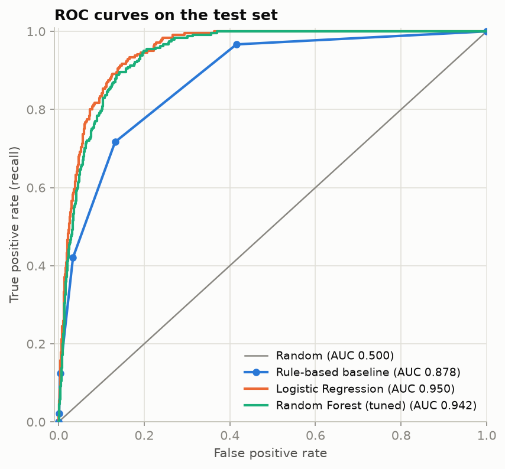
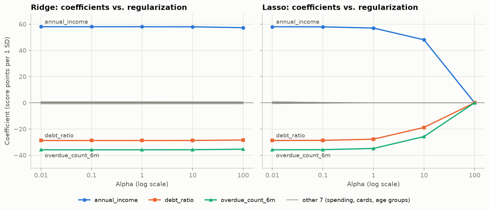

# A5-1 항목 3: 이론을 실제 결과와 연결해 설명하기

이 문서는 [평가 원문](../../../evaluations/evaluations_a5-1.md)의 **항목 3 평가 문장 네 개**를 설명하기 위한 학습 자료입니다. [항목 1 개념 설명](evaluation-item-1-concepts.md)과 같은 방식으로 개념, 평가 의도, 코드·그래프 근거, 발표 예시를 정리했습니다.

항목 3의 핵심은 **“이 방법을 왜 선택했고, 실제 결과에서 무엇을 확인했는가”**입니다. 용어 정의만 설명하기보다 수치나 그래프를 한 가지 이상 근거로 들어야 합니다.

이 문서의 프로젝트 수치는 기존 [README](../README.md)에 기록된 결과입니다. 문서 작성 과정에서 모델을 재학습해 측정한 값은 아닙니다. 가상 예시는 별도로 표시합니다. 합성 데이터에서의 관찰을 실제 은행 데이터에서도 성립하는 사실로 일반화하지 않습니다.

## 1. 왜 Accuracy만 보지 않고 F1과 AUC를 사용하는가?

> **평가 문장:** 이 문제에서 Accuracy 대신 F1-Score와 AUC를 평가 지표로 선택한 이유는 무엇이며, 불균형 데이터에서 Accuracy가 왜 부적절한지 구체적인 수치로 설명할 수 있는가?

### 평가에서 확인하는 것

높은 숫자를 얻는 것과 과제의 목적을 달성하는 것이 다를 수 있음을 이해하는지 확인합니다. 여기서 목적은 정상 고객이 많은 상황에서도 **연체 고객을 유용하게 구분하는 것**입니다.

### Accuracy가 놓치는 것

Test 고객은 2,000명이며 정상 1,760명, 연체 240명입니다. 모델이 모든 고객에게 “정상”이라고 답하면 다음 결과가 나옵니다.

| 실제 상태 | 정상으로 예측 | 연체로 예측 |
|---|---:|---:|
| 정상 1,760명 | TN 1,760 | FP 0 |
| 연체 240명 | FN 240 | TP 0 |

```text
Accuracy = 1,760 / 2,000 = 88%
Recall = 0 / 240 = 0%
F1 = 0
```

Accuracy는 88%지만 연체를 한 명도 찾지 못합니다. 이처럼 **다수 클래스의 정답 수가 전체 지표를 지배**하므로 Accuracy 단독으로 모델을 고르기 어렵습니다. Accuracy가 쓸모없다는 뜻은 아니며, 다른 지표와 함께 해석해야 합니다.

### F1: 경고의 정확성과 연체 탐지를 함께 보기

연체를 양성 1로 두면 TP는 연체 탐지, FP는 정상 고객 오탐, FN은 놓친 연체입니다.

| 지표 | 계산 | 쉬운 질문 |
|---|---|---|
| Precision | `TP / (TP + FP)` | 경고한 고객 중 실제 연체는 얼마나 되는가? |
| Recall | `TP / (TP + FN)` | 실제 연체 중 얼마나 찾았는가? |
| F1 | `2TP / (2TP + FP + FN)` | 경고의 정확성과 탐지를 함께 보면 어떤가? |

모두 연체라고 예측하면 Recall은 1이지만 Precision은 연체 비율인 0.12에 불과합니다. 이때 F1은 약 0.214입니다. F1은 한쪽 지표만 극단적으로 높이는 방법에 높은 점수를 주지 않습니다.

다만 F1은 TN을 직접 반영하지 않고, FP·FN에 실제 금융 손실 금액을 부여하지도 않습니다. 따라서 **F1이 최고인 임계값이 사업 손실을 최소화하는 임계값과 같다는 보장은 없습니다.**

### AUC: 한 임계값을 넘어서 위험 순위를 보기

모델은 먼저 연체 위험 점수를 출력합니다. 그 점수를 0.5 같은 **임계값**과 비교하면 최종 0/1 예측이 됩니다. Accuracy와 F1은 이 최종 판정에 따라 달라집니다.

ROC 곡선은 임계값을 바꿀 때 다음 두 비율을 그립니다.

- 세로축 TPR = Recall: 실제 연체 중 찾아낸 비율
- 가로축 FPR: 실제 정상 중 잘못 경고한 비율

ROC-AUC는 이 곡선 아래 면적입니다. 임의의 연체 고객과 정상 고객을 뽑았을 때 연체 고객에게 더 높은 점수를 주는 능력으로 이해할 수 있습니다. 동점은 절반으로 계산합니다.

```text
AUC 약 0.5 → 무작위 순위 수준
AUC 1.0 → 연체와 정상의 점수 순위를 완벽하게 구분
```

AUC 0.95는 정확도 95%라는 뜻도, 경고 중 95%가 실제 연체라는 뜻도 아닙니다. 실제 양성 비율이 매우 낮으면 ROC-AUC가 높아도 많은 경고가 오탐일 수 있어 Precision·Recall이나 PR 곡선도 확인하는 것이 좋습니다.



### 이 프로젝트 결과로 설명하기

| 로지스틱 회귀 | Accuracy | Precision | Recall | F1 | AUC |
|---|---:|---:|---:|---:|---:|
| 불균형 처리 없음 | 0.920 | 0.710 | 0.571 | 0.633 | 0.950 |
| 클래스 가중치 적용 | 0.878 | 0.496 | 0.879 | 0.635 | 0.950 |

가중치 적용 후 Accuracy는 낮아졌지만 Recall은 0.571에서 0.879로 올랐습니다. F1은 비슷하고, AUC는 소수 셋째 자리까지 같습니다. 이는 위험 순위의 구분 능력과 특정 기준에서의 판정 결과가 다른 측면임을 보여줍니다.

두 모델의 AUC가 반올림 값으로 같다고 예측 순위가 완전히 같거나 가중치가 순위에 영향을 주지 않았다고 단정할 수는 없습니다.

근거 코드: [metrics.py](../src/metrics.py)의 `classification_metrics()`와 [classification.py](../src/classification.py)의 `evaluate()`. Accuracy·F1에는 `y_pred`, AUC에는 위험 점수 `y_score`를 전달합니다.

### 이렇게 설명해 보세요

> 테스트 고객 중 정상 비율이 88%이므로 모두 정상이라고 답해도 정확도 88%가 나옵니다. 하지만 연체를 한 명도 찾지 못합니다. 그래서 정밀도와 재현율을 함께 보는 F1, 그리고 위험 점수의 순위 구분 능력을 보는 AUC를 함께 사용했습니다. 실제로 가중치 적용 후 정확도는 낮아졌지만 연체 탐지율은 크게 높아졌습니다.

## 2. Ridge/Lasso는 복잡도를 어떻게 제어하며 그래프에서 무엇을 확인했는가?

> **평가 문장:** 규제(Ridge/Lasso)가 모델의 복잡도를 어떻게 제어하는지, Alpha 값 변화에 따른 계수 변화 그래프를 근거로 설명할 수 있는가? L1과 L2의 차이를 이 데이터셋 결과에서 어떻게 확인했는가?

### 평가에서 확인하는 것

규제의 정의뿐 아니라 **자신의 그래프에서 계수와 성능이 실제로 어떻게 달라졌는지** 설명할 수 있는지 확인합니다.

### 계수와 모델 복잡도

선형 모델은 입력에 계수를 곱해 신용 점수를 예측합니다.

```text
예측 점수 = 절편 + 소득 계수 × 소득 + 부채 계수 × 부채 비율 + …
```

여러 계수가 지나치게 커지거나 불필요한 특성의 우연한 패턴까지 학습하면 새 데이터에 불안정할 수 있습니다. 규제는 계수에 벌점을 주어 허용되는 모델의 범위를 제한합니다. **특성 개수만이 복잡도를 뜻하는 것은 아니며, 같은 특성을 써도 계수 제약으로 복잡도를 조절할 수 있습니다.**

| 방법 | 벌점 형태 | 일반적인 효과 |
|---|---|---|
| Ridge, L2 | 계수 제곱합 | 계수를 줄여 안정화, 보통 정확히 0으로 만들지는 않음 |
| Lasso, L1 | 계수 절댓값 합 | 일부 계수를 정확히 0으로 만들어 변수 선택 효과 |

L1 벌점은 0에서 꺾이는 형태라 최적화 결과가 정확히 0에 놓일 수 있습니다. L2는 매끄러운 제곱 벌점이라 계수를 연속적으로 줄이는 경향이 있습니다. 이것이 계수 그래프에서 기대하는 차이입니다.

### Alpha를 높이면 항상 좋아지는가?

Alpha는 규제 강도입니다. 작으면 데이터 오차를 줄이는 쪽에, 크면 계수를 줄이는 쪽에 상대적으로 무게를 둡니다.

```text
규제가 너무 약함 → 우연한 패턴까지 학습할 가능성
적절한 규제    → 새 데이터 예측의 안정성에 도움
규제가 너무 강함 → 필요한 관계도 버려 과소적합 가능성
```

이것은 가능한 경향이지, 모든 데이터에서 중간 Alpha가 반드시 최고라는 뜻은 아닙니다. 최적값은 Train 내부 교차검증으로 선택합니다.

스케일링도 필요합니다. 소득을 원으로 표현할지 만 원으로 표현할지에 따라 필요한 계수 크기가 달라집니다. 계수 크기에 벌점을 주므로 단위가 제각각이면 규제 효과도 달라집니다. 프로젝트는 수치형 입력을 표준화합니다.

### 그래프를 설명하는 순서



1. 가로축: Alpha 0.01~100, 로그 축이므로 같은 간격이 10배 증가를 뜻합니다.
2. 세로축: 각 특성의 학습된 계수입니다.
3. 각 선: 전처리 후 특성 하나입니다. 수치형 5개와 연령대 원-핫 5개로 총 10개입니다.
4. 0으로 가는 선: 해당 특성의 직접적인 선형 기여가 줄어드는 모습입니다.
5. 계수와 함께 성능표 확인: 불필요한 기여를 줄였는지, 필요한 관계까지 버렸는지 판단합니다.

### Lasso에서 확인한 결과

| Alpha | 0으로 집계된 계수 | Test RMSE | Test R² |
|---|---:|---:|---:|
| 0.01 | 1 | 30.133 | 0.861 |
| 0.1 | 3 | 30.131 | 0.861 |
| 1 | 7 | 30.220 | 0.860 |
| 10 | 7 | 35.237 | 0.810 |
| 100 | 10 | 80.874 | 약 0 |

코드는 절댓값이 `1e-8`보다 작은 계수를 0으로 집계합니다.

Alpha 1에서는 소비 점수·카드 수·연령대 열의 계수가 0이 되면서 성능은 거의 유지됩니다. 이 특성들은 합성 신용 점수 생성식에 직접 사용되지 않았다는 사실과도 연결됩니다.

Alpha 10에서는 소득 계수도 약 58에서 48로 줄고 RMSE가 커집니다. Alpha 100에서는 모든 계수가 0이 되어 입력과 관계없이 절편에 해당하는 일정한 점수를 냅니다. **규제가 강할수록 항상 좋은 것이 아니라는 근거**입니다.

### Ridge에서 확인한 결과

소득 계수는 Alpha 0.01에서 약 58.02, Alpha 100에서 약 57.30입니다. 이 범위에서는 0으로 만들지 않았고 감소 폭도 작습니다. 다른 계수의 변화도 대체로 작습니다.

이 프로젝트에서는 표본이 충분하고 입력 수가 적으며 타깃이 거의 선형으로 만들어졌기 때문에, 해당 범위의 Ridge 규제가 예측을 크게 바꾸지 않았다고 해석할 수 있습니다. 변화가 작다는 이유만으로 Ridge 구현이 잘못됐다고 판단할 수는 없습니다.

Ridge가 모든 계수를 동일 비율로 줄이는 것은 아닙니다. 또한 scikit-learn의 Ridge와 Lasso는 오차항의 정규화 방식이 달라 **같은 Alpha 숫자가 같은 강도의 축소를 보장하지 않습니다.**

### 설명할 때 피할 오해

- Lasso에서 0인 계수는 이 모델에서 직접 사용하지 않는 특성이라는 뜻입니다. 현실에서 그 특성이 항상 무관하다는 증명은 아닙니다.
- 상관된 특성이 있으면 Lasso는 그중 일부를 선택할 수 있어 선택 결과가 흔들릴 수 있습니다.
- 정규화된 수치형 계수와 표준화하지 않은 원-핫 계수는 단위 해석이 다릅니다.
- 노이즈 표준편차가 30이라고 모든 유한 Test Set에서 RMSE가 반드시 30 이상이라는 뜻은 아닙니다. 노이즈는 기대 오차의 바닥을 이해하는 근거이며, 표본 결과에는 변동이 있습니다.

근거 코드: [regression.py](../src/regression.py)의 `ALPHAS`, `run_regression()`, `plot_coefficient_path()`. 선택한 Alpha는 Ridge 1, Lasso 0.1이며 Train CV RMSE를 기준으로 고릅니다.

### 이렇게 설명해 보세요

> 규제는 큰 계수에 벌점을 주어 모델을 안정화하는 방법입니다. Lasso는 일부 계수를 정확히 0으로 만들었고 Alpha 1에서는 불필요한 특성을 줄이면서 성능을 거의 유지했습니다. 하지만 Alpha 100에서는 모든 관계를 버려 성능이 떨어졌습니다. Ridge는 같은 범위에서 계수가 조금만 줄었으므로 이 데이터에서는 규제 효과가 크지 않았습니다.

## 3. 앙상블은 편향·분산을 어떻게 줄이며 실제로 무엇이 달라졌는가?

> **평가 문장:** 앙상블 기법(Random Forest/Boosting)이 단일 모델의 편향이나 분산을 줄이는 원리는 무엇이며, 실제 성능 결과에서 이 효과를 어떻게 확인했는가?

### 평가에서 확인하는 것

“여러 모델을 합치면 좋아진다”는 말에서 나아가 **어떤 방식으로 결합하고 어떤 종류의 오류가 줄었는지** 실험 결과로 설명할 수 있는지 확인합니다.

### 편향과 분산을 쉬운 예로 이해하기

| 개념 | 쉬운 설명 | 모델에서의 예 |
|---|---|---|
| 편향 | 너무 단순한 가정 때문에 패턴을 놓치는 경향 | 얕은 트리가 복잡한 관계를 표현하지 못함 |
| 분산 | 학습 데이터가 달라지면 예측이 크게 바뀌는 경향 | 깊은 트리의 분기 기준이 일부 고객에 민감 |
| 줄이기 어려운 잡음 | 입력만으로 예측할 수 없는 변동 | 신용 점수 생성 시 더한 무작위 오차 |

학습 점수와 검증 점수가 모두 낮다면 과소적합 가능성이 있습니다. 학습 점수만 매우 높고 검증 점수가 낮으면 과적합 가능성이 있습니다. 다만 **점수 격차는 진단 단서이며 편향·분산을 수학적으로 직접 측정한 값은 아닙니다.** 특히 F1과 AUC를 그대로 편향²·분산·잡음으로 분해할 수는 없습니다.

### Random Forest: 다른 트리의 예측을 평균 내기

깊은 트리 하나는 데이터를 잘 맞히지만 일부 고객이 바뀌면 예측도 바뀔 수 있습니다. 랜덤 포레스트는 여러 트리를 서로 다르게 만들고 예측 확률을 평균 냅니다.

1. 학습 고객을 복원추출해 트리마다 다른 데이터를 제공합니다.
2. 각 분기에서 후보 특성을 무작위로 제한해 트리 간 다양성을 높입니다.
3. 여러 트리의 예측을 결합해 개별 트리의 흔들림을 완화합니다.

모든 트리가 같은 실수를 하면 평균해도 줄어들지 않습니다. 따라서 트리 수뿐 아니라 **트리 사이의 상관**도 중요합니다.

추가로, 분산이 같고 쌍별 상관이 모두 같다는 단순화 아래 평균 예측의 분산은 다음처럼 표현할 수 있습니다.

```text
평균의 분산 = ρσ² + (1 − ρ)σ² / B

B: 트리 수, σ²: 트리 하나의 분산, ρ: 트리 간 상관
```

트리 수 B를 늘리면 둘째 항은 줄지만 첫째 항은 남습니다. 이것이 트리를 무한히 늘려도 모든 오차가 사라지지 않는 이유를 설명하는 직관입니다.

### Boosting: 앞선 모델이 놓친 부분을 순차적으로 보완하기

Gradient Boosting은 앞선 예측의 손실을 줄이는 방향으로 다음 모델을 추가합니다. 제곱오차 회귀에서는 잔차를 학습하는 방식으로 이해할 수 있고, 분류에서는 선택한 손실의 음의 기울기를 이용해 개선합니다.

작은 트리들이 순차적으로 관계를 보완해 편향을 줄이는 데 도움이 됩니다. 다만 트리 수·깊이·학습률에 따라 과적합도 생길 수 있습니다. Random Forest는 주로 병렬적으로 학습한 모델의 평균, Boosting은 순차적인 보완이라는 차이가 있습니다.

**이 프로젝트가 직접 구현·측정한 앙상블은 Random Forest입니다.** Boosting 원리는 비교 개념이며 프로젝트의 실험 결과인 것처럼 설명하면 안 됩니다.

### 실험 1: 같은 교차검증에서 학습·검증 점수 비교

아래 수치는 README의 편향·분산 실험 결과입니다. Train 점수는 각 CV 반복의 학습 부분에서 얻은 점수의 평균이며, CV 점수는 각 검증 부분 점수의 평균입니다.

| 모델 | Train F1 | CV F1 | 차이 | CV AUC |
|---|---:|---:|---:|---:|
| 얕은 트리, 깊이 3 | 0.548 | 0.534 | 0.014 | 0.886 |
| 단일 트리, 깊이 12 | 0.867 | 0.586 | 0.281 | 0.798 |
| 단일 트리, 깊이 제한 없음 | 1.000 | 0.536 | 0.464 | 0.734 |
| 랜덤 포레스트, 300개·깊이 12 | 0.844 | 0.668 | 0.175 | 0.945 |
| 로지스틱 회귀, balanced | 0.649 | 0.647 | 0.002 | 0.954 |

트리가 깊어지면 Train F1은 높아지지만 CV 점수는 나빠지는 모습을 볼 수 있습니다. 같은 깊이 12에서 랜덤 포레스트를 사용하면 단일 트리 대비 CV F1과 AUC가 높아지고 학습·검증 격차도 줄어듭니다. 이는 과적합을 완화했다는 근거입니다.

### 실험 2: 학습 고객을 바꿔 20번 다시 학습하기

동일한 Test 고객을 두고 Train 고객을 복원추출해 20번 재학습합니다. 고객별 예측 확률의 표준편차를 구한 뒤 고객 전체에 평균합니다.

| 모델 | 예측 확률 표준편차의 고객 평균 |
|---|---:|
| 단일 트리, 깊이 12 | 0.118 |
| 랜덤 포레스트, 300개·깊이 12 | 0.031 |

0.031은 0.118의 약 26%입니다. 즉 이 실험에서는 학습 데이터 변화에 따른 예측 확률의 흔들림이 상당히 줄었습니다. **표준편차를 측정한 것이므로 이를 그대로 “분산이 4분의 1”이라고 표현하면 부정확합니다.**

모든 모델에 같은 재표본을 사용하며, Test 입력은 예측 관찰용입니다. 이 과정에서 Test 정답으로 모델을 학습하지는 않습니다. 다만 반복 관찰한 Test 성능을 보고 모델 선택을 계속 바꾸면 최종 평가의 독립성이 약해집니다.

근거 코드: [tradeoff.py](../src/tradeoff.py)의 `cv_gap_table()`, `bootstrap_indices()`, `prediction_wobble()`. `TUNED_FOREST_PARAMS`에는 튜닝 결과가 고정되어 있으므로 탐색 설정을 바꾸었다면 함께 일치하는지 확인해야 합니다.

### 결과 해석의 한계

- 학습·검증 격차와 재학습 흔들림을 함께 보며 분산 감소를 뒷받침합니다. 편향이 정확히 같거나 분산만 변했다고 증명한 실험은 아닙니다.
- 튜닝에 사용한 CV를 다시 비교에 사용하므로 선택에 따른 낙관성이 있을 수 있습니다. 더 엄격한 성능 추정에는 독립 검증이나 중첩 교차검증을 사용할 수 있습니다.
- 이 데이터는 신용 점수가 선형식으로 생성되어 로지스틱 회귀도 잘 작동합니다. 실제 CV AUC는 랜덤 포레스트보다 로지스틱 회귀가 조금 높습니다.
- 앙상블의 효과와 튜닝의 효과는 다릅니다. 기본 랜덤 포레스트 대비 튜닝 후 Test F1은 0.647에서 0.642로 소폭 낮아졌습니다.

### 이렇게 설명해 보세요

> 깊은 트리 하나는 학습 데이터에 민감해 과적합하기 쉽습니다. 랜덤 포레스트는 서로 다른 트리를 평균 내어 그 흔들림을 줄입니다. 같은 깊이의 단일 트리와 비교했을 때 CV F1이 0.586에서 0.668로 올랐고, 재학습에 따른 예측 확률 표준편차도 0.118에서 0.031로 줄었습니다. 다만 모든 단일 모델보다 좋았던 것은 아니며 로지스틱 회귀의 AUC는 더 높았습니다.

## 4. 왜 SMOTE나 클래스 가중치를 선택하고 Test에는 적용하지 않는가?

> **평가 문장:** 불균형 데이터를 처리할 때 SMOTE나 `class_weight`를 선택한 이유는 무엇이며, 해당 방법을 Test Set에는 적용하지 않아야 하는 이유를 설명할 수 있는가?

### 평가에서 확인하는 것

처리 방법을 선택한 이유, 적용 위치, 장단점을 알고 있는지 확인합니다. “연체 고객 수를 늘려 점수를 높였다”보다 **학습을 바꾸면서 평가는 실제 분포로 유지했다**는 설명이 중요합니다.

### 클래스 가중치를 선택하는 이유

`class_weight="balanced"`는 적은 클래스의 오류에 더 큰 가중치를 줍니다. 샘플을 새로 만들지 않고 소수 클래스에 더 주의를 기울이게 할 수 있어 기본 비교 방법으로 사용하기 좋습니다.

클래스별 가중치는 대략 `전체 샘플 수 / (클래스 수 × 해당 클래스 샘플 수)`입니다. 정상 90%, 연체 10%라면 연체 샘플 하나는 정상 샘플 하나보다 약 9배 큰 가중치를 받습니다.

이것이 “은행 손실이 정확히 9배이기 때문”이라는 뜻은 아닙니다. `balanced`는 **빈도에 따른 자동 보정**이지 실제 손실 금액으로 계산한 비용은 아닙니다.

### SMOTE를 선택하는 이유

SMOTE는 소수 클래스 이웃 사이에 가상 샘플을 만들어 학습 데이터를 보강합니다. 단순 복제와 다른 방식으로 소수 클래스의 특성 공간을 채우는 대안입니다.

| 관점 | 클래스 가중치 | SMOTE |
|---|---|---|
| 바꾸는 대상 | 학습 손실의 비중 | 학습 샘플 수와 분포 |
| 샘플 추가 | 없음 | 있음 |
| 주요 장점 | 간단하고 합성 샘플이 필요 없음 | 소수 클래스 주변을 보강할 수 있음 |
| 주요 주의점 | 오탐 증가, 확률 해석 변화 가능 | 이상치·스케일·범주형 보간에 민감 |

프로젝트는 같은 로지스틱 회귀를 처리 없음·가중치·SMOTE로 비교해 처리 효과를 살펴봅니다. 이 비교만으로 모든 데이터에서 어느 방법이 우월하다고 결론 내릴 수는 없습니다.

### 이 프로젝트의 결과

| 처리 | Precision | Recall | F1 | AUC |
|---|---:|---:|---:|---:|
| 없음 | 0.710 | 0.571 | 0.633 | 0.950 |
| 클래스 가중치 | 0.496 | 0.879 | 0.635 | 0.950 |
| SMOTE | 0.514 | 0.867 | 0.645 | 0.950 |

두 방법 모두 Recall을 높였지만 Precision은 낮췄습니다. SMOTE의 F1이 조금 높으나 차이가 작으므로 한 번의 Test 점수만으로 확실한 우월성을 주장하기 어렵습니다. 방법 선택은 Train 내부 검증을 기준으로 해야 하며 Test 비교표는 최종 보고에 사용합니다.

가중치나 SMOTE는 학습 과정 자체를 바꾸므로 단순히 예측 임계값만 바꾸는 것과 동일하지 않습니다. 또한 출력 0.8이 실제 연체 확률 80%와 맞는지는 별도로 확률 보정을 확인해야 합니다.

### Test에 SMOTE를 적용하면 왜 문제가 되는가?

Test는 실제로 만날 고객 분포에서 모델의 실력을 확인하는 자료입니다. 연체 비율을 바꾸거나 가상 고객을 추가하면 평가 대상 자체가 달라집니다.

**가상 예시:** 같은 TPR 80%, FPR 10%라도 연체 비율에 따라 Precision이 달라집니다.

| 평가 집단 | TP | FP | Precision |
|---|---:|---:|---:|
| 연체 100명·정상 900명 | 80 | 90 | 약 47.1% |
| 연체 500명·정상 500명 | 400 | 50 | 약 88.9% |

오류 비율이 같아도 평가 분포를 50:50으로 바꾸면 경고가 훨씬 정확해 보일 수 있습니다. 실제로 SMOTE는 샘플 위치까지 바꾸므로 ROC-AUC도 영향을 받을 수 있습니다.

또한 **분할 전에 SMOTE를 적용하면** 나중에 검증·Test로 갈 고객을 참고해 가상 학습 샘플이 만들어질 수 있습니다. 이웃 정보를 통해 누수가 생기는 이유입니다.

### 클래스 가중치는 “Test에 적용하지 않는다”를 어떻게 설명할까?

클래스 가중치는 원래 모델의 `fit()`에서 쓰는 설정입니다. 예측할 Test 행에 별도 가중치를 붙이는 전처리가 아닙니다. 가중치를 사용해 학습한 모델로 Test를 예측하는 것은 올바른 사용입니다.

평가 지표에 임의의 `sample_weight`를 주어 균형 잡힌 성능처럼 보고하는 것은 별개의 작업입니다. 그런 평가가 필요하면 목적과 가중 방식을 명시하고 원래 Test 분포의 결과도 구분해야 합니다. 이 프로젝트의 공통 지표 함수는 가중치 없는 Test 지표를 계산합니다.

### 코드에서 적용 위치 보여주기

[classification.py](../src/classification.py)의 `make_logreg()`를 보면 다음 순서입니다.

```text
가중치 모델: 전처리 → class_weight를 지정한 로지스틱 회귀
SMOTE 모델: 전처리 → SMOTE → 로지스틱 회귀
```

SMOTE는 일반 scikit-learn Pipeline 대신 `imblearn.pipeline.Pipeline`에 넣습니다. 이 Pipeline은 학습 시 샘플링을 수행하고 예측 시에는 건너뜁니다. 교차검증에 사용할 때도 전체 Pipeline을 전달해야 학습 폴드 안에서만 증강됩니다.

```text
Train/Test 분할
  ├─ Train → 학습 폴드에서 전처리 학습·SMOTE·모델 학습
  └─ Test  → 학습된 전처리 적용·예측·원래 정답과 평가
```

이 프로젝트는 전처리 후 원-핫 열에도 일반 SMOTE를 적용합니다. 0/1 열에 소수 값이 생길 수 있으므로 범주 의미가 중요한 데이터에서는 SMOTENC 등 대안을 검토해야 합니다.

### 이렇게 설명해 보세요

> 연체 고객이 약 12%라서 모델이 정상 고객에 치우치지 않도록 클래스 가중치와 SMOTE를 비교했습니다. 두 방법 모두 연체 탐지율을 높였지만 오탐도 늘었습니다. SMOTE는 학습 자료만 보강하고 Test는 실제 고객 분포를 유지했습니다. 클래스 가중치는 학습 시 오류의 비중을 바꾸는 설정이며 Test 데이터 자체를 바꾸지는 않습니다.

## 발표 전 확인할 질문

1. 모두 정상으로 예측할 때 Test Accuracy 88%, Recall 0이 되는 과정을 계산할 수 있는가?
2. F1과 AUC가 서로 다른 측면을 평가한다는 점과 각각의 한계를 설명하는가?
3. L1·L2의 정의를 실제 계수 그래프와 연결할 수 있는가?
4. 너무 큰 Alpha에서 과소적합이 생긴 수치를 보여줄 수 있는가?
5. 편향·분산을 점수 하나로 단정하지 않고 여러 실험 근거로 설명하는가?
6. 0.118과 0.031이 ‘예측 확률 표준편차의 평균’임을 정확히 말하는가?
7. 앙상블 효과와 하이퍼파라미터 튜닝 효과를 구분하는가?
8. SMOTE의 위치와 클래스 가중치의 적용 시점을 코드로 설명하는가?

관련 문서: [항목 1: 구현과 결과물](evaluation-item-1-concepts.md), [항목 2: 코드 구조와 데이터 흐름](evaluation-item-2-concepts.md), [프로젝트 README](../README.md).
