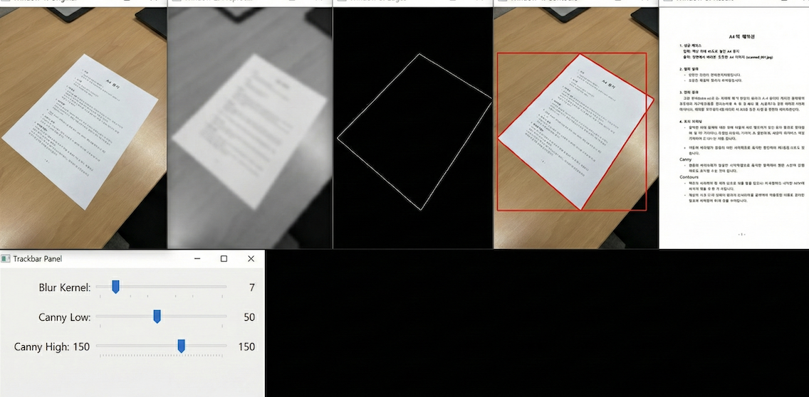
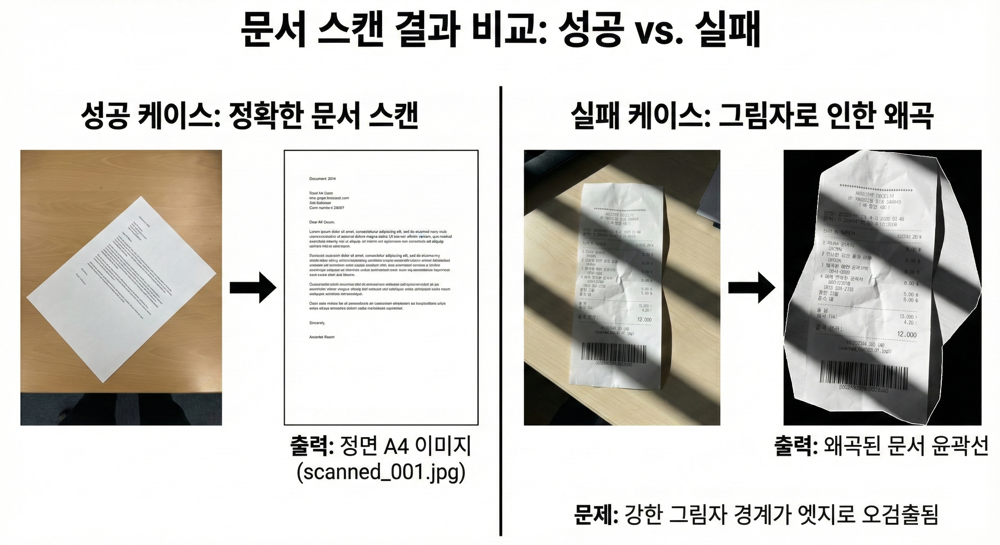

# A3-1. 휴대폰으로 찍은 종이를 똑바르게 펴서 스캔하게 만들기

분야: AI/SW 심화  
구분: 컴퓨터 비전  
학습시간: 60시간  
필수/선택: 필수

## 문제기술

### 기술적 설명

### 1. 미션 소개

컴퓨터 비전은 컴퓨터가 이미지와 영상을 이해하고 처리하도록 만드는 기술 분야입니다. 스마트폰 카메라의 문서 스캔, 자동차 번호판 인식, 공장의 불량 검출 등 우리 주변의 많은 서비스가 이 기술을 기반으로 동작합니다.

이 미션에서는 OpenCV와 NumPy를 활용해 비스듬하게 촬영된 문서를 자동으로 인식하고 반듯하게 펴주는 문서 스캐너를 직접 구현합니다. 노이즈 제거, 엣지 검출, 윤곽선 추출, 투시 변환으로 이어지는 이미지 처리 파이프라인 전체를 설계하고, 각 단계에서 이미지가 어떻게 변환되는지 눈으로 확인합니다.

트랙별 활용 시나리오

- AI Mobility / Smart Factory: 차량 검사 보고서, 제조 라벨, 공정 점검 서류를 현장에서 즉시 디지털화하는 상황
- Healthcare: 의료 처방전, 검사 결과지, 동의서 등을 환자 차트에 자동 정리하는 상황
- E-Commerce: 영수증, 송장, 반품 신청서 등을 빠르게 스캔하여 데이터베이스화하는 상황

이미지 처리 파이프라인을 직접 설계하며 "사람이 규칙을 설계하는 방식"의 근본적인 한계를 체감하고, 이후 머신러닝과 딥러닝에서 "데이터로부터 학습하는 방식"이 왜 필요한지 스스로 답할 수 있게 됩니다.

### 2. 최종 결과물

다음 기능이 정상 동작하는 Python 애플리케이션 1개와 분석 보고서 1개를 완성한다.

1. 문서 스캐너 애플리케이션
   - 사용자가 이미지 경로를 입력하면 즉시 동작한다.
   - 처리 과정(원본 → 전처리 → 엣지 검출 → 윤곽선 → 변환 결과)을 단계별 윈도우로 시각화한다.
   - 트랙바를 통해 블러 강도, 엣지 임계값을 실시간으로 조절할 수 있다.
2. 지능형 문서 영역 감지 및 변환
   - 복잡한 배경 위에 놓인 영수증, A4 용지, 명함 등을 자동으로 찾는다.
   - 비스듬하게 찍힌 문서를 정면에서 본 것처럼 반듯한 직사각형으로 펴준다.
   - 그림자나 조명 얼룩이 있는 경우에도 글씨가 최대한 선명해지도록 적응형 이진화를 적용한다. (강한 그림자는 실패할 수 있으며, 보고서에서 분석한다)
3. 웹캠 보드 (선택)
   - 웹캠을 실행하면 실시간 프레임에서 문서 검출 및 윤곽선을 표시한다.
   - 특정 키(예 : 's') 입력 시 현재 프레임을 캡처하여 변환 결과를 저장한다.
   - 종료 키(예 : 'q') 입력 시 프로그램이 정상적으로 종료된다.
4. 분석 보고서
   - 20장의 테스트 이미지에 대한 성공률 측정 결과가 포함된다.
   - 알고리즘이 실패하는 조건(그림자, 구겨짐, 빛 반사 등)을 분석한다.
   - "규칙 기반 접근의 한계"와 "학습 기반 접근이 필요한 이유"에 대한 결론이 포함된다.
     - *보고서 요구 사항(확인 필요)*

       ### 분석 보고서 요구 사항

       다음 내용이 포함된 분석 보고서를 작성한다.

       **1. 테스트 결과 요약**

       | 조건 | 테스트 수 | 성공 | 실패 | 성공률 |
       | --- | --- | --- | --- | --- |
       | 단순 배경 + 정면 | 5 | ? | ? | ?% |
       | 그림자 있음 | 5 | ? | ? | ?% |
       | 45도 이상 기울어짐 | 5 | ? | ? | ?% |
       | 복잡한 배경 | 5 | ? | ? | ?% |

       **2. 실패 원인 분석**

       - 각 실패 케이스에 대해 "왜 실패했는지"를 기술한다.
       - 해결을 위해 시도한 파라미터 조정과 그 결과를 기록한다.

       **3. 파라미터 딜레마**

       - "모든 이미지에 적용 가능한 최적 파라미터가 존재하는가?"에 대한 답을 데이터로 제시한다.
       - 이미지 A의 최적 파라미터가 이미지 B에서는 왜 실패하는지 설명한다.

       **4. 규칙 기반의 한계**

       - 본인이 설계한 규칙들을 나열한다.
       - 각 규칙이 실패하는 상황을 정리한다.
       - "규칙을 추가하면 해결되는가?"에 대한 경험을 기술한다.

       **5. 학습 기반 접근이 필요한 이유**

       - 본인의 경험을 바탕으로, "데이터에서 학습하는 방식"이 이 문제를 어떻게 해결할 수 있을지 가설을 제시한다.

### 3. 과제 목표

이 과제를 마친 후, 학습자는 아래를 스스로 설명할 수 있어야 한다.

- 이미지가 `(Height, Width, Channel)` 형태의 3차원 배열임을 이해하고, 데이터 분석에서 배운 Numpy 조작 기법을 이미지에 적용할 수 있다.
- 컨볼루션 연산이 필터와 이미지의 내적임을 이해하고, 행렬 곱셈이 이미지의 기하학적 변환(회전, 투영)을 수행하는 원리를 설명할 수 있다.
- 하나의 고정된 파라미터가 다양한 환경(조명, 각도, 배경)에서 왜 실패하는지 정량적 데이터를 근거로 설명할 수 있다.
- "사람이 규칙을 설계하는 방식"이 왜 새로운 환경에 일반화되지 못하는지, 그래서 왜 "데이터에서 학습하는 방식"이 필요한지 자신의 경험을 근거로 설명할 수 있다.

### 4. 기능 요구 사항

다음 요구사항을 모두 만족해야 한다.

1. 데이터 수집
   - 본인의 스마트폰으로 문서 사진 20장을 직접 촬영한다. (촬영이 어려운 환경이라면, 표준 테스트셋으로 진행)
   - 쉬운 케이스 5장: 단순 배경, 정면 촬영, 균일한 조명
   - 어려운 케이스 15장: 그림자, 구겨짐, 복잡한 배경, 45도 이상 기울어짐, 부분 가림 등
   - 각 이미지에 대해 촬영 조건(조명, 각도, 배경 복잡도)을 기록한다.
2. 이미지 탐색적 분석 (EDA)
   - 각 이미지의 픽셀 히스토그램을 분석하고, 밝기 분포의 특성을 파악한다.
   - 쉬운 케이스와 어려운 케이스의 히스토그램 차이를 시각화한다.
   - "왜 어두운 이미지에서 엣지 검출이 어려운지"를 분포 관점에서 설명한다.
3. 이미지 전처리 및 엣지 검출
   - 컬러 이미지를 Grayscale로 변환하고, 가우시안 블러를 적용해 노이즈를 제거한다.
   - Canny Edge Detection을 사용하여 문서의 외곽선을 검출한다.
   - 트랙바를 만들어 블러 강도(커널 크기)와 Canny 임계값(low, high)을 실시간으로 조절할 수 있어야 한다.
4. 문서 윤곽선 추출
   - 검출된 엣지에서 닫힌 윤곽선(contour)을 찾는다.
   - 면적 필터링을 통해 작은 노이즈를 제거한다.
   - `approxPolyDP`를 사용하여 꼭짓점이 4개인 사각형 도형을 찾는다.
   - 검출된 사각형을 원본 이미지 위에 시각화한다.
5. 기하학적 변환
   - 찾아낸 4개의 좌표를 순서대로 정렬한다(좌상-우상-우하-좌하).
   - 좌표 정렬 로직은 라이브러리에 의존하지 않고 기하학적 원리로 직접 구현한다.
   - `getPerspectiveTransform`과 `warpPerspective`를 사용하여 이미지를 직사각형으로 변환한다.
6. 이미지 후처리
   - 변환된 이미지에 적응형 이진화(Adaptive Thresholding)를 적용하여 깔끔한 스캔본을 만든다.
   - 결과물은 이미지 파일(jpg/png)로 저장된다.
7. 정량적 성능 평가
   - 20장 전체에 대해 "문서 검출 성공 여부"를 측정한다.
   - 성공 기준 : 4개의 꼭짓점이 올바르게 검출되어 문서가 반듯하게 변환됨
   - 조건별(조명, 각도, 배경) 성공률을 표로 정리한다.
   - 실패 케이스는 최소 3건 이상에 대해 원인 분석을 수행한다.

### 5. 보너스 과제

1. 컨볼루션 직접 구현
   - 가우시안 블러를 OpenCV 없이 Numpy만으로 구현해 본다.
   - 이중 for문 버전과 벡터화 버전의 속도를 비교한다.
2. 종횡비 자동 보정
   - 변환된 문서가 찌그러지지 않도록, 원본 좌표 간 거리를 계산하여 결과 이미지의 가로/세로 비율을 자동으로 결정한다.
3. PDF 내보내기
   - 처리된 이미지를 PDF 파일로 저장한다.
   - 보너스 3 한정으로 Pillow(PIL), FPDF, reportlab 등 PDF 생성 라이브러리 사용 허용

### 개발환경

### 6. 개발 환경

- Python 3.8 이상

### 제약조건

### 7. 제약 사항

허용 라이브러리

- 필수: OpenCV (opencv-python>=4.5), NumPy (numpy>=1.20)
- 시각화용 (선택): Matplotlib (matplotlib>=3.3), Seaborn
- 설치 예시: pip install opencv-python numpy matplotlib

금지 사항

- PyTorch, TensorFlow, Keras 등 딥러닝 프레임워크 사용 금지
- Tesseract OCR 등 완성된 OCR 라이브러리 사용 금지
- 좌표 정렬 로직은 라이브러리에 의존하지 않고 직접 구현한다

허용/금지 예시

- 허용: Python 내장 sorted(), NumPy 연산(np.argsort, np.sum 등)으로 좌표 정렬
- 허용: OpenCV의 findContours, approxPolyDP, getPerspectiveTransform 등 기본 함수
- 금지: scipy.spatial, shapely 등 외부 기하 라이브러리로 좌표 정렬/변환 수행

데이터 및 평가

- 직접 촬영한 20장의 이미지에 대해 테스트를 수행해야 한다.
  - 표준 테스트셋 : 촬영이 어려운 환경이라면 LMS 과제 페이지에서 표준 테스트 이미지 20장을 다운로드한다. 경로: [LMS] > 과제자료 > cv19_test_images.zip. 추가 촬영 이미지는 보너스 가점으로 처리한다.
- 정량적 성능 평가 결과가 보고서에 포함되어야 한다
- 웹캔 사용 시 OS별 카메라 권한 허용이 필요할 수 있다

실행 환경 안내

- 로컬 권장: 트랙바/imshow 등 GUI 기능은 로컬 환경(Windows/Mac/Linux 데스크톱)에서 정상 동작한다.
- Colab 대안: GUI가 불가능한 환경에서는imwrite로 이미지를 저장하고, 파라미터는 명령줄 인자 또는 설정 파일로 입력받는 방식으로 대체한다.
- 최소 사양: Python 3.8+, RAM 4GB 이상, 웹캔 사용 시 USB/내장 카메라
- Python 3.8 이상
- PyTorch, TensorFlow, Keras 등 딥러닝 프레임워크 사용 금지
- Tesseract OCR 등 완성된 OCR 라이브러리 사용 금지
- 좌표 정렬 로직은 라이브러리에 의존하지 않고 직접 구현한다
- 직접 촬영한 20장의 이미지에 대해 테스트를 수행해야 한다 *( 사진을 촬영할 수 없는 환경이라면, 제공한 이미지로 진행 )*
- 정량적 성능 평가 결과가 보고서에 포함되어야 한다

### Test Case

### 8. 결과 예시

아래는 정답이 아니라 참고 예시다. 실제 구현은 얼마든지 달라도 된다.

**실행 화면 예시**

- (참고) 실행 화면 예시 이미지
  

- (참고) 성공&실패 케이스 예시 이미지
  

```css
[Window 1: Original] 책상 위에 비스듬히 놓인 영수증 원본
[Window 2: Preprocessed] 그레이스케일 + 블러 적용 결과
[Window 3: Edges] Canny 엣지 검출 결과
[Window 4: Contours] 검출된 사각형이 빨간색으로 표시된 원본
[Window 5: Result] 투시 변환 + 이진화가 적용된 최종 스캔본

[Trackbar Panel]
- Blur Kernel: ████████░░ 7
- Canny Low:   ███░░░░░░░ 50
- Canny High:  ██████░░░░ 150
```

**성공 케이스**

```css
입력: 책상 위에 45도로 놓인 A4 용지
출력: 정면에서 바라본 듯한 반듯한 A4 이미지 (scanned_001.jpg)
```

**부분 성공 케이스**

```css
입력: 약간의 그림자가 있는 영수증
출력: 4꼭짓점 검출 성공, 변환 되었으나 종횟비가 원본 대비 7% 차이. 텍스트는 판독 가능
```

**실패 케이스**

```css
입력: 강한 그림자가 있는 영수증
문제: 그림자 경계가 엣지로 검출되어 문서 윤곽선이 왜곡됨
시도: Canny 임계값 상향 → 문서 엣지도 함께 사라짐
결론: 단일 파라미터로 해결 불가
```
