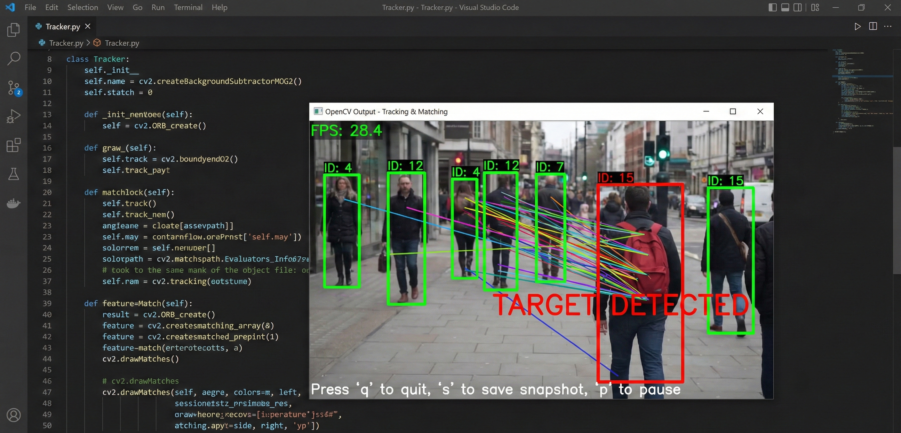

# 영상 속 움직이는 사람·물건을 따라가며 표시해주기

분야: AI/SW 심화  
구분: 컴퓨터 비전  
학습시간: 80시간  
필수/선택: 필수

## 문제기술

### 기술적 설명

### 1. 미션 소개

동영상은 시간 축을 가진 이미지의 연속입니다. 정지된 사진과 달리, 프레임 간의 변화를 분석하면 "무엇이 움직이는지", "어디로 이동하는지"를 파악할 수 있습니다. CCTV 보안 시스템, 자율주행 차량의 보행자 감지, 스포츠 경기 분석 등 실시간 영상 처리는 다양한 산업에서 핵심 기술로 활용됩니다. 특히 Mobility(보행자/차량 추적), Smart Factory(라인 모니터링), Robotics(작업자/부품 추적), Healthcare(재활 동작 모니터링), E-Commerce(매장 동선/물류 추적) 등 다양한 도메인에서 이 역량이 활용됩니다. 이 미션에서는 OpenCV를 활용해 영상 속 움직이는 객체를 감지하고, 고유 ID를 부여하여 추적하는 시스템을 직접 구현합니다. 배경 차분으로 움직임을 감지하고, 특징점 매칭으로 특정 물체를 재인식하는 과정을 경험합니다. 각 객체의 이동 경로를 시각화하고, 추적이 유지되거나 실패하는 순간을 직접 관찰합니다. 또한, 두 사람이 겨춰 지나갈 때 ID가 뒤바뀌는 현상, 조명이 변할 때 추적이 무너지는 현상을 정량적으로 분석합니다. 이를 통해 "위치 정보만으로는 객체를 구분할 수 없다"는 한계를 체감하고, 객체의 외형을 학습하는 딥러닝 기반 접근이 왜 필요한지 스스로 이해하게 됩니다.

### 2. 최종 결과물

다음 기능이 정상 동작하는 Python 비디오 분석 애플리케이션 1개와 한계 분석 보고서 1개를 완성한다. 최종 산출물은 GitHub 리포지토리로 제출한다.

1. 실시간 영상 분석 애플리케이션
   - 웹캠 스트림 또는 비디오 파일을 입력받아 프레임 단위로 분석한다.
   - 화면에 분석 결과(바운딩 박스, 궤적, ID)가 오버레이되어 출력된다.
   - FPS가 화면에 표시되고, 키보드로 제어(종료, 스냅샷, 일시정지)할 수 있다.

2. 모션 감지 및 객체 추적
   - 화면 내에서 움직이는 물체를 배경과 분리하여 감지한다.
   - 감지된 객체에 고유 ID를 부여하고, 물체가 이동해도 ID를 유지하며 추적한다.
   - 물체의 이동 경로를 선으로 시각화한다.

3. 특정 물체 재인식
   - 미리 등록된 이미지(특정 물체)가 영상에 등장하면 "Target Found"를 표시한다.
   - 특징점 매칭 기반으로 동작한다.

4. 분석 보고서
   - 추적 성능을 정량적으로 측정한 결과가 포함된다.
   - 알고리즘이 실패하는 조건(겹침, 가림, 조명 변화)을 분석한다.
   - "고전적 컴퓨터 비전의 한계"와 "딥러닝이 필요한 이유"에 대한 결론이 포함된다.
     - *보고서 요구 사항(확인 필요)*

       ### 분석 보고서 요구사항

       다음 내용이 포함된 분석 보고서를 작성한다.

       **1. 추적 성능 측정 결과**

       | 상황 | 테스트 횟수 | ID Switch | 추적 실패 | 비고 |
       | --- | --- | --- | --- | --- |
       | 단일 객체 이동 | 10 | ? | ? |  |
       | 두 객체 겹침 | 10 | ? | ? |  |
       | 객체 일시 정지 | 5 | ? | ? |  |
       | 조명 변화 | 5 | ? | ? |  |

       측정 기준 정의 **:**

       - ID Switch: 겨침 이후 5프레임 이상 다른 ID로 유지되는 경우
       - 추적 실패: 대상이 화면에 존재하나 10프레임 이상 미검출 또는 ID 미부여
       - 가림(occlusion) 구간: 50% 이상 가려진 경우 추적 실패에서 제외하고 비고란에 기록

       **2. 특징점 매칭 성능 측정**

       | 조건 | 추출된 특징점 수 | 매칭된 특징점 수 | 매칭률 |
       | --- | --- | --- | --- |
       | 정면 | ? | ? | ?% |
       | 30도 회전 | ? | ? | ?% |
       | 60도 회전 | ? | ? | ?% |
       | 30% 가림 | ? | ? | ?% |
       | 50% 가림 | ? | ? | ?% |

       **3. 배경 모델링의 한계**

       - 배경 학습률에 따른 동작 차이를 기술한다.
       - "느린 변화"와 "빠른 변화"에 대한 트레이드오프를 설명한다.
       - 조명 변화 시 발생하는 문제를 기록한다.

       **4. 거리 기반 추적의 본질적 한계**

       - 왜 겹침 상황에서 ID Switch가 발생하는지 설명한다.
       - 규칙을 추가해서 해결하려 했던 시도와 그 결과를 기록한다.
       - "위치만으로는 객체를 구분할 수 없다"는 결론을 도출한다.

       **5. Hand-crafted Feature의 한계**

       - ORB/SIFT가 왜 회전과 가림에 취약한지 설명한다.
       - "학습되지 않은 특징"이 왜 새로운 상황에 일반화되지 못하는지 분석한다.

       **6. 딥러닝이 필요한 이유**

       - 본인의 경험을 바탕으로, 다음 질문에 답한다:
         - "객체의 외형을 학습한다면 겹침 문제가 해결될까?"
         - "다양한 변형을 학습한다면 특징점 매칭이 개선될까?"
         - "환경 변화를 학습한다면 배경 모델링이 강건해질까?"

### 3. 과제 목표

이 과제를 마친 후, 학습자는 아래를 스스로 설명할 수 있어야 한다.

1. 동영상이 시간 축을 가진 이미지의 연속임을 이해하고, 프레임 간 차이를 이용해 움직임 정보를 추출하는 원리를 설명할 수 있다.
2. 정지된 배경과 움직이는 전경을 분리하는 수학적 원리와, 현실 세계의 노이즈(조명 변화, 그림자)가 왜 문제가 되는지 설명할 수 있다.
3. 거리 기반 매칭이 겹침 상황에서 왜 실패하는지, 그리고 이를 규칙으로 해결할 수 없는 이유를 설명할 수 있다.
4. SIFT/ORB 등 사람이 설계한 특징점이 회전, 가림, 조명 변화에 얼마나 취약한지 정량적 데이터로 설명하고, "왜 학습된 특징이 필요한가"를 자신의 경험으로 설명할 수 있다.

### 4. 기능 요구 사항

다음 요구사항을 모두 만족해야 한다.

1. 영상 입출력 및 제어
   - `cv2.VideoCapture`를 사용하여 웹캠 또는 비디오 파일을 읽는다.
   - 현재 FPS를 계산하여 화면에 표시한다.
   - 키보드 이벤트를 처리한다: `q` 종료, `s` 현재 프레임 저장, `p` 일시정지

2. 배경 차분 (Background Subtraction)
   - `createBackgroundSubtractorMOG2`를 사용하거나, `absdiff`로 직접 차영상을 구현한다.
   - 모폴로지 연산(열림, 닫힘)을 적용하여 노이즈를 제거하고 객체를 덩어리로 만든다.
   - 배경 모델의 학습률(learning rate)을 최소 3가지 값으로 조절하여 효과를 관찰한다.

3. 객체 감지
   - 움직임이 감지된 영역에서 윤곽선을 추출한다.
   - 면적 필터링을 통해 너무 작은 움직임은 무시한다.
   - 각 객체의 바운딩 박스와 중심점을 계산한다.

4. 객체 추적 (Tracker 클래스 구현)
   - `Tracker` 클래스를 별도 파일(tracker.py)로 구현하여 ID 관리 로직을 분리한다.
   - 이전 프레임의 객체들과 현재 프레임의 객체들 간 거리를 계산한다.
   - 가장 가까운 객체끼리 같은 ID로 매칭한다.
   - 일정 프레임 이상 등장하지 않는 객체는 ID를 삭제한다.
   - 새로 등장한 객체에는 새 ID를 부여한다.
   - 각 객체의 이동 경로를 저장하고 화면에 선으로 표시한다.

5. 특징점 매칭
   - 추적하고 싶은 물체의 이미지 1장을 미리 로드한다.
   - ORB 또는 SIFT를 사용하여 특징점을 추출한다.
   - 매 프레임에서 해당 물체의 특징점을 매칭한다.
   - 매칭 성공 시 화면에 "TARGET DETECTED" 메시지를 표시한다.

6. 정량적 성능 측정
   - 테스트 영상에서 다음을 수동으로 측정한다:
     - ID Switch 횟수: 객체의 ID가 잘못 바뀐 횟수
     - 추적 실패 횟수: 객체가 화면에 있는데 감지되지 않은 횟수
     - 조건별(겹침, 정지, 조명 변화) 실패율을 기록한다.

   - **측정 프로토콜:**
     - 각 조건별 20~30초 영상에서 표의 테스트 횟수만큼 이벤트를 관찰/기록한다.
     - 기록 템플릿: "영상명 - 조건 - 프레임 범위 - ID Switch 수 - 실패 수 - 관찰 메모" 컬럼으로 정리

### 5. 보너스 과제

1. **Hungarian Algorithm 구현**
   - 거리 행렬을 기반으로 최적 할당 문제를 푸는 Hungarian Algorithm을 직접 구현한다.
   - scipy 없이 Numpy만으로 구현한다.
   - Greedy 매칭 대비 성능 차이를 비교한다.

2. **침입 감지 구역 설정**
   - 화면 내 특정 영역(사각형)을 마우스로 지정한다.
   - 해당 영역에 객체의 중심점이 들어오면 경고 메시지를 출력하고 로그를 저장한다.

3. **IoU 기반 매칭**
   - 중심점 거리 대신 바운딩 박스의 IoU(Intersection over Union)로 매칭한다.
   - 두 방식의 성능 차이를 ID Switch 횟수와 추적 유지율로 비교한다.

4. **칼만 필터 기반 예측**
   - Tracker에서 cv2.KalmanFilter를 활용하여 객체의 다음 위치를 예측하고, 예측값을 매칭에 활용한다.
   - 칼만 필터 적용 전/후 ID Switch 비율을 비교한다.

### 개발환경

### 6. 개발 환경

- Python 3.8 이상
- 권장 환경: Python 3.10+, OpenCV 4.5+
- SIFT 사용 시 opencv-contrib-python 필요, ORB는 기본 opencv-python으로 가능

### 제약조건

### 7. 제약 사항

사용 금지

- YOLO, SSD, R-CNN 등 딥러닝 객체 탐지 모델 사용 금지
- OpenCV의 dnn 모듈 사용 금지
- MediaPipe 등 고수준 AI 라이브러리 사용 금지

구조 및 산출물

- Tracker 클래스는 별도 파일(tracker.py)로 분리하여 구현한다.
- 정량적 성능 측정 결과가 보고서에 포함되어야 한다.
- ID Switch 횟수와 조건별 실패율을 반드시 측정한다.

테스트 영상 가이드

- 평가용 표준 시나리오로 최소 1개 영상을 사용한다:
  - 필수: "두 객체 겨침" 시나리오 (20~30초)
  - 권장: "조명 급변", "정지/재등장" 시나리오 각 1개

- 웹캠 직접 촬영 또는 공개 데이터셋(PETS, MOT Challenge 등) 활용 가능하다. 보고서에 영상명/조건 라벨/측정 방법을 기입한다.

### Test Case

### 8. 결과 예시

아래는 정답이 아니라 참고 예시다. 실제 구현은 얼마든지 달라도 된다.

**실행 화면 예시**

- (참고) 실행 화면 예시 이미지

  

```css
┌──────────────────────────────────────────┐
│  FPS: 28.4                               │
│                                          │
│      ┌────┐                              │
│      │ID:1│ ←(초록색 박스)                │
│      └────┘                              │
│        ╲                                 │
│         ╲ ←(빨간색 궤적선)                │
│          ╲                               │
│           ●                              │
│                                          │
│              ┌────┐                      │
│              │ID:2│                      │
│              └────┘                      │
│                                          │
│  [TARGET DETECTED] ← 등록된 물체 발견 시   │
└──────────────────────────────────────────┘
Press 'q' to quit, 's' to save snapshot
```

**추적 성공 케이스**

```css
상황: 한 사람이 화면을 가로질러 이동
결과: ID:1이 시작부터 끝까지 유지됨, 궤적이 정확히 그려짐
```

**추적 실패 케이스**

```css
상황: 두 사람이 화면 중앙에서 겹쳐 지나감
결과: 겹치기 전 ID:1, ID:2 → 겹친 후 ID:1, ID:2가 서로 바뀜
원인: 위치 정보만으로는 두 사람을 구분할 수 없음
시도: 거리 임계값 조정 → 근본적 해결 불가
```
